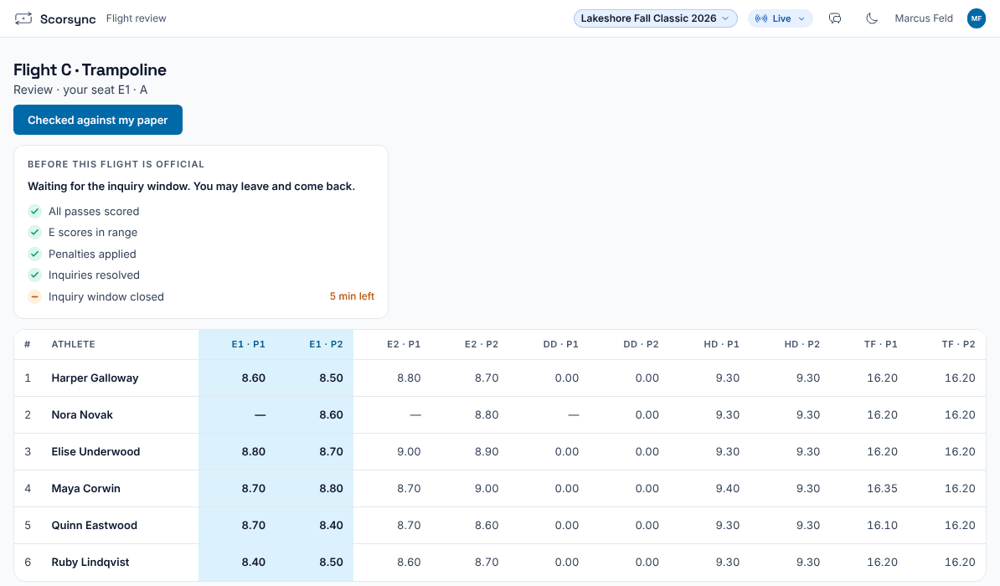
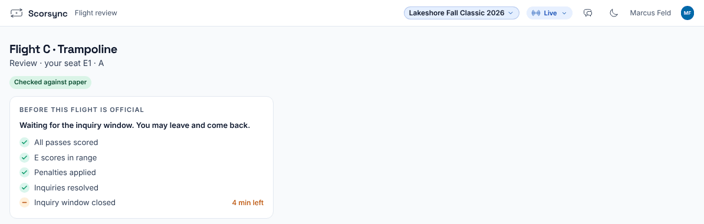

**Who it's for:** Judges · Scorsync Cloud and Scorsync Desktop

Use this at the end of each flight, when your tablet opens **Flight review** by itself.

## Before you start

- Have your paper for the flight next to the tablet.
- Stay on the scoring screen at the end of the flight. That's where your tablet reliably opens the review when the chair selects **Review and release**.

## Steps

<Steps>

1. Wait for the chair to release the panel. Your tablet opens **Flight review** for the flight: athletes in run order, with your own seat's columns first and shaded.

   

2. Go down your columns and compare each score with your paper. P1 and P2 are the first and second routine (or pass). A dash (—) means no mark was recorded for that seat.

3. If a score doesn't match your paper, tell the chair now, before the flight is confirmed official. Name the athlete, the routine and the right mark.

4. When every score matches, select **Checked against my paper**.

5. Check that the button is replaced by **Checked against paper**. The chair sees a tick next to your seat.

   

</Steps>

:::note
Checking is a confirmation for the chair. It doesn't make the flight official, and the chair can confirm the flight official without it. The box "Before this flight is official" is the chair's checklist: you don't need to do anything with it.
:::

## If something goes wrong

- **Your tablet didn't open Flight review.** There's no other way to it from a judge's tablet. Check your paper against the chair's review screen instead, and tell the chair you've checked.
- **A score is wrong or shows —.** Tell the chair. The chair corrects it with **Override**. See [Override a mark, Score 0 and penalties](/judges/chair/override-and-penalties/).
- **The flight is already official.** Tell the chair: the chair reopens it to fix a score. See [Reopen an official flight to fix a score](/judges/chair/reopen-official-flight/).

## Related

- [Confirm a flight official](/judges/chair/confirm-flight-official/)
- [Fix a score you submitted](/judges/fix-a-score/)
- [Getting started as a judge](/judges/)
