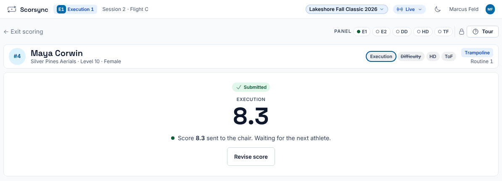
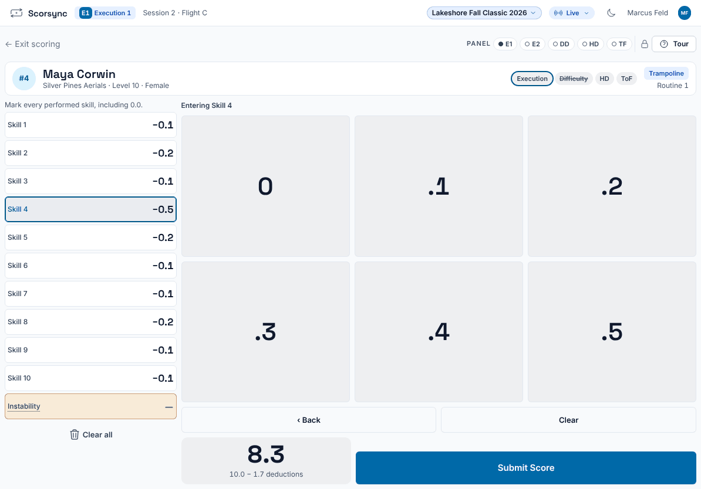
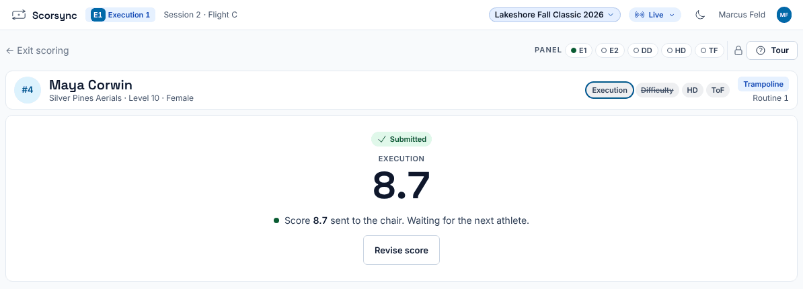

**Who it's for:** Judges · Scorsync Cloud and Scorsync Desktop

Use this when you've sent a score and spot a mistake, such as a mark on the wrong skill.

## Before you start

- The athlete is still on your screen. Once the chair moves to the next athlete, you can't reopen it: tell the chair instead (see [If something goes wrong](#if-something-goes-wrong)).

## Steps

<Steps>

1. On the screen that says "… sent to the chair", select **Revise score**.

   

2. Your marks come back. Tap the skill you want to change. It's highlighted, and the screen says "Entering Skill 4" (or the skill you chose).

   

3. Tap the right mark on the pad.

4. Check the score at the bottom left, then select **Submit Score**.

5. Check that your tablet says "… sent to the chair" with the new number. The chair now sees it.

   

</Steps>

:::tip
You can revise as many times as you need while the athlete is on your screen. The chair doesn't have to approve it.
:::

## If something goes wrong

- **There's no Revise score button, and the screen says "Chair changed your score".** The chair has overridden your score, so only the chair can change it now. Tell the chair the right mark.
- **The next athlete is already on your screen.** You can't go back. Show the chair your paper: the chair corrects it with **Override** on your card. See [Override a mark, apply penalties or score 0](/judges/chair/override-and-penalties/).
- **"Not saved — the chair has moved on".** The chair advanced while you were revising, and your tablet jumps to the next athlete. Tell the chair the right mark.
- **"Awaiting chair approval".** Your revision counts only once the chair approves it. Until then, "Counts now" shows the score that stands. If you then see "The chair rejected your revision", your first score stands: talk to the chair.
- **"The chair changed the number of skills — re-judge to update your score."** Select **Re-judge score**, enter your marks for the new skill count, and submit.
- **"Official · Results are official. Ask the meet host to correct a score."** The flight is official. Tell the chair: only the chair can reopen it. See [Reopen an official flight to fix a score](/judges/chair/reopen-official-flight/).

## Related

- [Check your paper after the flight](/judges/check-your-paper/)
- [Score when the Wi-Fi drops](/judges/score-when-wifi-drops/)
- [Getting started as a judge](/judges/)
