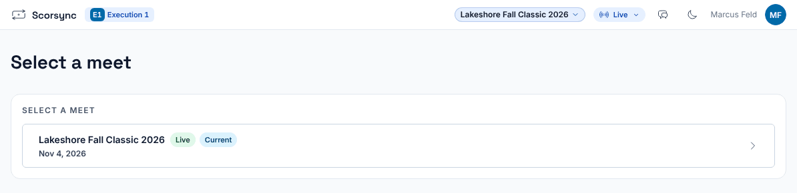
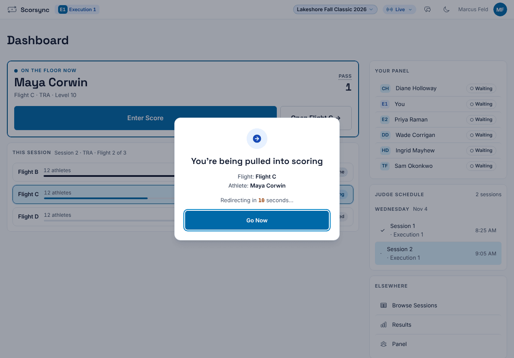
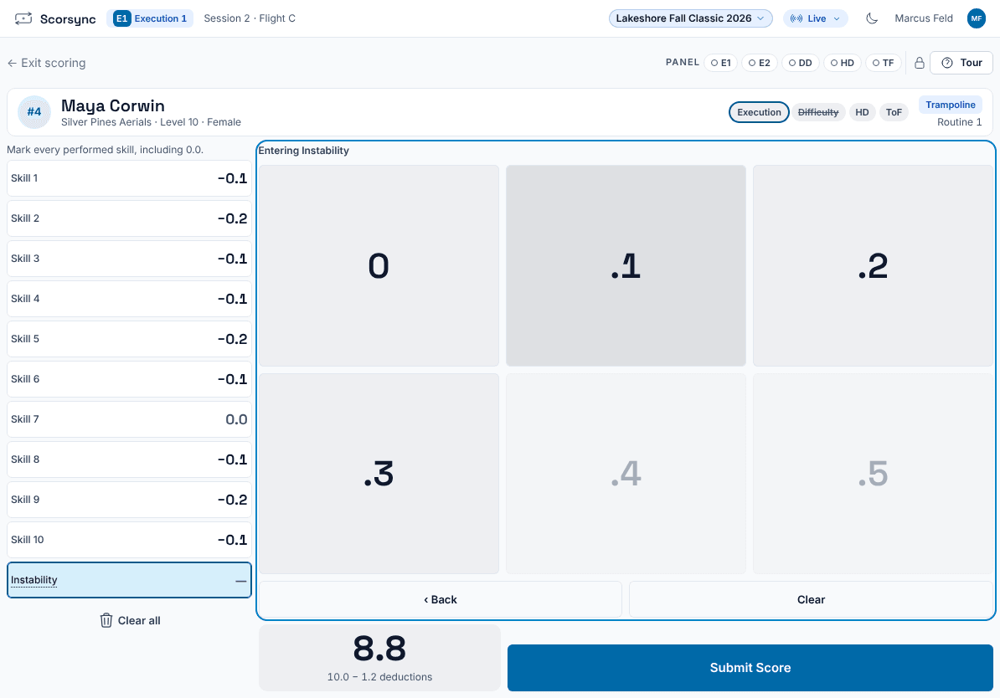
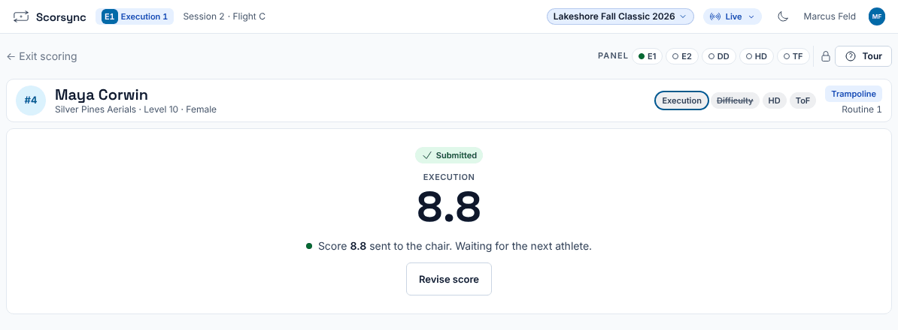

**Who it's for:** Judges · Scorsync Cloud and Scorsync Desktop

Start here if you're judging on a tablet for the first time. Chairs: read this, then [Getting started as the chair](/judges/chair/).

## Before you start

- You have your sign-in sheet (email and PIN), or the scoring table will give you a code.
- Your tablet is on the Wi-Fi the scoring table tells you to use, and you know the address to open.

## Steps

<Steps>

1. On your tablet, open the address the scoring table gave you in the browser.

2. Sign in the way the scoring table tells you: email and PIN, a code, or a QR code. See [Get judges signed in and scoring](/scoring-table/get-judges-signed-in/).

3. If your tablet lists meets under **Select a meet**, select yours. To change it later, select the meet name at the top.

   

4. Wait on your **Dashboard**. When the chair calls up an athlete, your tablet says "You're being pulled into scoring" and opens the scoring screen by itself. Select **Go Now** to skip the wait.

   

5. Enter your marks. Each seat has its own screen: the execution screen, for example, says "Mark every performed skill, including 0.0."

   

6. Select **Submit Score**.

7. Check that your tablet says "Score … sent to the chair. Waiting for the next athlete." It moves to the next athlete when the chair does.

   

</Steps>

## What's next

| I need to... | Go to |
| -- | -- |
| Change a score I've sent | [Fix a score you submitted](/judges/fix-a-score/) |
| My tablet shows a red **OFFLINE** banner | [Score when the Wi-Fi drops](/judges/score-when-wifi-drops/) |
| My tablet opened **Flight review** after the flight | [Check your paper after the flight](/judges/check-your-paper/) |

## If something goes wrong

- **"That email and password or PIN do not match."** Check your sign-in sheet and type them again. If it still fails, ask the scoring table for a code.
- **Your dashboard says "Waiting for CJP".** The chair hasn't called up an athlete on your panel yet. Wait, or ask the chair.
- **Your tablet doesn't move to the scoring screen.** Select **Enter Score** on your dashboard.

## Related

- [Fix a score you submitted](/judges/fix-a-score/)
- [Score when the Wi-Fi drops](/judges/score-when-wifi-drops/)
- [Getting started as the chair](/judges/chair/)
