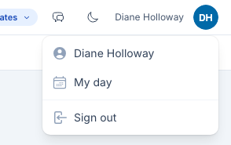
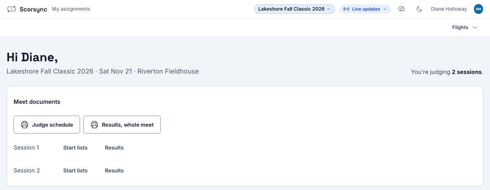
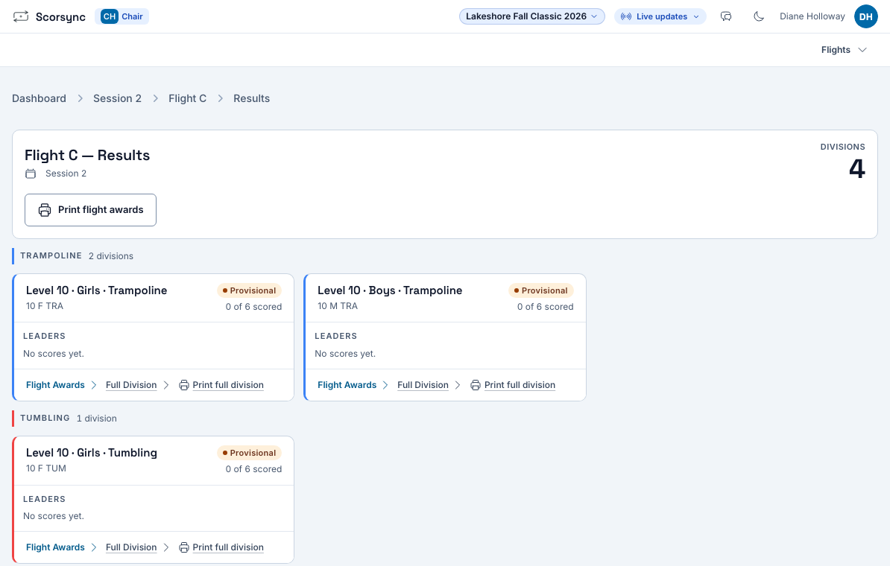

**Who it's for:** Judges, chairs and data-entry judges · Scorsync Cloud and Scorsync Desktop

Use this when you need a printout for the meet you're working, without asking the host.

## Before you start

- You're signed in, and you have a seat at this meet (or you're its meet referee or data-entry judge).
- Your device can print, or you can save the PDF and print it elsewhere.

## Start lists, judge schedule and results

<Steps>

1. Select your initials at the top right of the screen.

   

2. Select **My day**.

3. Select **Meet documents** to open the list.

   

4. Select what you need. Each one opens as a PDF in a new tab:

   | To print | Select |
   | -- | -- |
   | Who judges where, for the whole meet | **Judge schedule** |
   | Results for every session | **Results, whole meet** |
   | One session's start lists | **Start lists**, next to the session name |
   | One session's results | **Results**, next to the session name |

5. Print the PDF from your browser.

</Steps>

## Flight awards

<Steps>

1. Open your flight from the dashboard.

2. Select **Flight awards** at the top of the flight view.

   

3. Select **Print flight awards** for every division in the flight, ranked among this flight's athletes. To print one division's whole standings, select **Print full division** on its card.

</Steps>

## If something goes wrong

- **There's no Meet documents list on My day.** You don't have a seat at this meet, or no meet is chosen. Ask the scoring table to check your seat.
- **The tab says the page can't be found.** The link is for a meet you don't have a seat at. Go back to **My day** and open it again.

## Related

- [Getting started as a judge](/judges/)
- [Getting started as the chair](/judges/chair/)
