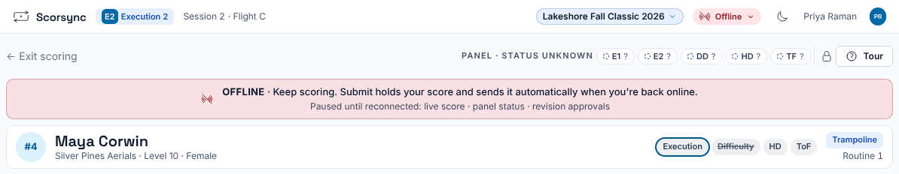
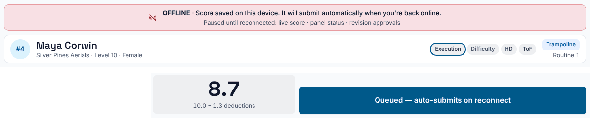
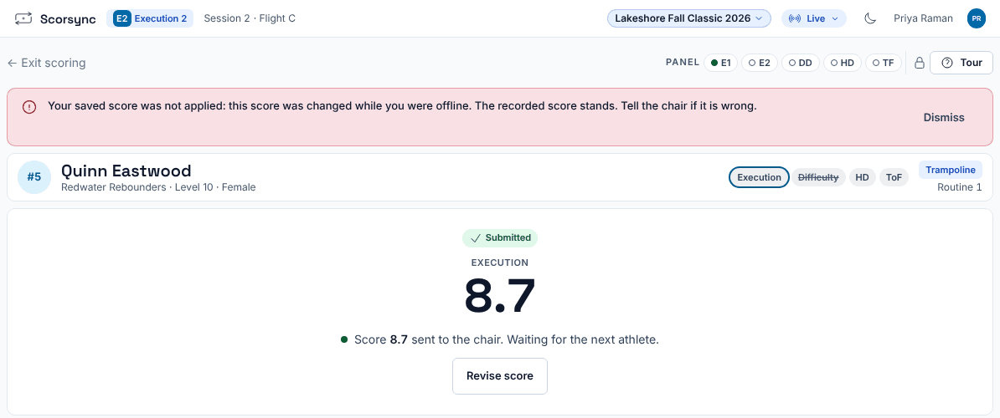

**Who it's for:** Judges · Scorsync Cloud and Scorsync Desktop

Use this when your tablet shows a red **OFFLINE** banner while you're scoring.

## Steps

<Steps>

1. Keep scoring. The banner says "Keep scoring. Submit holds your score and sends it automatically when you're back online."

   

2. Enter your marks as usual.

3. Select **Submit — held until online**.

4. Check that the banner now says "Score saved on this device. It will submit automatically when you're back online." The button reads **Queued — auto-submits on reconnect**.

   

5. Leave the tablet on this screen. Tell the chair your tablet is offline and you've submitted.

6. When the Wi-Fi comes back, wait. Your score sends by itself within a few seconds, and your screen says "… sent to the chair".

</Steps>

:::danger[Don't reload, sign out or close the page]
While your score is held, stay on the scoring screen. A reload with no connection can show the browser's own error page, and your score only sends once the scoring screen is open again.
:::

:::caution
The chair can't see a score that's held on your tablet: your card on their screen doesn't say Submitted. If the chair enters your mark or moves on before your score arrives, your held score may not be used. That's why step 5 matters.
:::

## For the chair and scoring table: check the score arrived

On the chair's screen, the judge's card changes from **Waiting** to **Submitted** with the mark once the score arrives. If it still says Waiting after the Wi-Fi is back, and the judge's tablet doesn't say "sent to the chair", the chair enters the mark from the judge's paper. See [Move on when a judge hasn't submitted](/judges/chair/move-on-missing-judge/).

## If something goes wrong

- **"Your saved score was not applied: this score was changed while you were offline. The recorded score stands. Tell the chair if it is wrong."** The chair moved on, or changed your score, before yours arrived. The number on your screen is the one the chair recorded, not the one you sent. Show the chair your paper.

  

- **"Unsent score" with a Send button.** Your tablet holds a score for an earlier athlete. It doesn't send by itself: select **Send**.
- **"This device can't store scores" or "Score held on this screen only".** This tablet can't save scores (often a private browsing tab). A held score is lost if the page closes or reloads, so don't touch it until the Wi-Fi is back. Use a normal tab next time.
- **The tablet came back on the dashboard, not the scoring screen.** Your held score sends once the scoring screen opens again. Wait for the tablet to move you there, or tell the chair.
- **The tablet stays Offline for more than a minute.** Check the tablet is on the scoring Wi-Fi. If every tablet dropped at once, tell the scoring table. See [Troubleshooting](/help/troubleshooting/).

## Related

- [Fix a score you submitted](/judges/fix-a-score/)
- [Move on when a judge hasn't submitted](/judges/chair/move-on-missing-judge/)
- [Meet-day runbook: Scorsync Desktop](/runbook/scorsync-desktop/)
