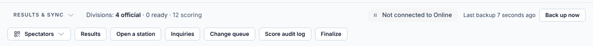
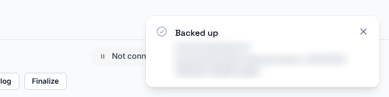
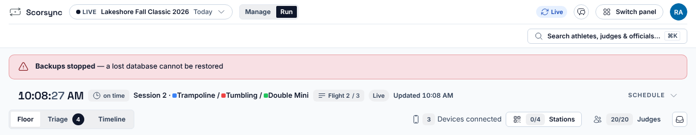

**Who it's for:** Offline host · Scorsync Desktop

The laptop holds the only copy of your meet: set up the USB copy before meet day, and keep the USB drive with you.

## Before you start

- Scorsync is open, and the tray menu says **● Running**.
- You're signed in to Meet Control as the host.
- You have a USB drive that stays plugged into the laptop all day.

## Back up now

Scorsync backs up by itself every 5 minutes, to the laptop's own disk. Back up by hand as well at the end of each session.

<Steps>

1. In Meet Control, open **Run**, and find **Last backup** at the bottom right, in the Results & Sync strip.

   

2. Select **Back up now**.

3. Check that a **Backed up** message appears, and that Last backup now says a few seconds ago.

   

</Steps>

You can also select **Back Up Now** in the tray menu. Scorsync then shows a "Backed up." box: select **OK** to close it.

## Copy every backup to a USB drive

Do this before the meet, not between athletes: the last step restarts Scorsync for a few seconds.

<Steps>

1. Plug the USB drive into the laptop.

2. In the tray menu, select **Second Backup Folder…**.

3. Choose a folder on the USB drive, then select **Open** (**Select Folder** on Windows).

4. Scorsync says "Each backup will also be copied to:" the folder, and "This starts with the next Restart Server." Select **OK**.

5. In the tray menu, select **Restart Server**. Wait until it says **● Running** again.

6. In Run, select **Back up now**.

7. Open the folder on the USB drive, and check that a file named `scorsync-` followed by the date is there.

</Steps>

:::caution
The USB copy starts only after **Restart Server**, and the tray menu never says it's on. Always do step 7.
:::

## Restore a backup

To restore a backup, contact Scorsync support (support@scorsync.com). Don't use **Restore from Backup…** on your own: everything scored after the backup is lost.

## If something goes wrong

- **"Backups stopped — a lost database cannot be restored"** across the top of Run. No backup has run for 15 minutes. Select **Back up now**. If the line comes back, contact Scorsync support.

  

- **"Disk almost full — backups and scores may stop saving"**. The laptop has less than 500 MB free, so backups can't run. Delete or move large files you don't need, such as videos, then select **Back up now**.
- **"Backed up", followed by "The backup could not be copied to the second disk".** The USB drive is unplugged or full. Plug it back in, or free some space on it, then select **Back up now**.
- **"The backup did not finish."** after **Back Up Now** in the tray. Try **Back up now** in Run. If that fails too, contact Scorsync support.
- **"Backup not started" or "Backup failed"** in Run. Read the message under it, for example "Not enough free disk space for a backup". If it isn't clear what to do, contact Scorsync support.

## Related

- [Keep the meet running](/offline-host/keep-the-meet-running/)
- [Use the Scorsync tray menu](/offline-host/tray-menu/)
- [Meet-day runbook: Scorsync Desktop](/runbook/scorsync-desktop/)
- [Print start lists and paper backup sheets](/host/before-meet-day/print-start-lists/)
