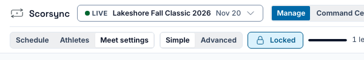
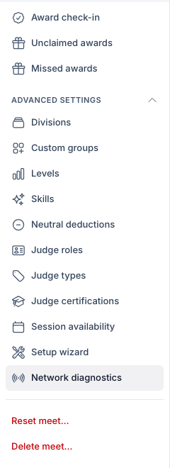
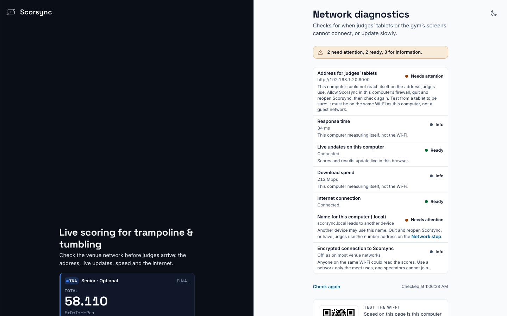

**Who it's for:** Offline host · Scorsync Desktop

Run this at home after setup, and again at the venue on the morning of the meet, once the router is on.

## Before you start

- Scorsync is open, and the menu says **● Running**.
- The laptop and one tablet are on the scoring Wi-Fi.
- You know your admin email and password.

## Check from the laptop

<Steps>

1. In the Scorsync window, select **Manage** at the top.

2. Select the **Meet settings** tab, next to **Schedule** and **Athletes**.

   

3. In the list on the left, select **Advanced settings** near the bottom to open it, then **Network diagnostics**.

   

4. Wait a few seconds while each row fills in. Each row ends in **Ready**, **Needs attention**, **Not ready** or **Info**.

   

5. Check the rows against the table below. On the laptop itself, **Info** next to "Response time", "Download speed" and "Encrypted connection to Scorsync" is normal: the laptop is measuring itself.

</Steps>

## Check from a tablet

The laptop can't measure the Wi-Fi. A tablet can.

<Steps>

1. On the laptop, keep **Network diagnostics** open, and find the **Test the Wi-Fi** card.

2. On the tablet, scan the card's QR code with the camera. Or type the address under it into the tablet's browser.

3. Sign in with your own admin email and password. The tablet opens Network diagnostics.

4. Check that "Response time", "Live updates on this tablet" and "Download speed" say **Ready**.

5. Before you hand the tablet to a judge, select **Sign out** on the page.

</Steps>

## What each row means

| Row | Needed for | If it isn't Ready |
| -- | -- | -- |
| Address for judges' tablets | Scoring | "Does not answer on this address": allow Scorsync in the laptop's firewall, then quit and reopen Scorsync. "Something else answers on this address": another program uses the address. Quit it, then quit and reopen Scorsync. |
| Response time | Scoring | On a tablet, "slow" means judges' screens may lag. Move the router closer to the judges, and keep spectators off the scoring Wi-Fi. |
| Live updates | Live updates on every screen | When no one is scoring, select **Restart Server** in the Scorsync menu. Ready on the laptop but not on the tablet: the Wi-Fi blocks it. Use your own travel router. If it still fails, contact support. |
| Download speed | Scoring | Same fix as Response time. A tablet needs 20 Mbps for **Ready**. |
| Internet connection | Publishing to scorsync.com only | "Something else answered" means a Wi-Fi sign-in page: open a browser on the laptop and sign in to the network. Scoring isn't affected. |
| Name for this computer (.local) | The `scorsync.local` address | When no one is scoring, select **Restart Server**. Until it's Ready, judges type the second address from the menu, the one after **Or**. |
| Encrypted connection to Scorsync | Nothing | Always **Info** on Scorsync Desktop ("Off, as on most venue networks"). Keep the scoring Wi-Fi for the laptop and judges only. |

Select **Check again** after each fix.

## If something goes wrong

- **The tablet can't open the Test the Wi-Fi address.** The tablet isn't on the scoring Wi-Fi. Join it, then scan the code again. If it still fails, open **If a tablet cannot open this page** on the laptop's Network diagnostics.
- **"scorsync.local is not answering".** Select **Restart Server** in the Scorsync menu when no one is scoring. Meanwhile, judges use the second address.
- **You can't find Meet settings.** It's a tab in **Manage**, not in **Command Center**. During first-run setup, the **System check** step also has a **Network diagnostics** link, under **If tablets cannot connect or update slowly**.

## Related

- [Connect the judges' tablets](/offline-host/connect-judges-tablets/)
- [Set up Scorsync Desktop and the venue network](/offline-host/set-up-the-venue-network/)
- [Use the Scorsync tray menu](/offline-host/tray-menu/)
- [Troubleshooting](/help/troubleshooting/)
