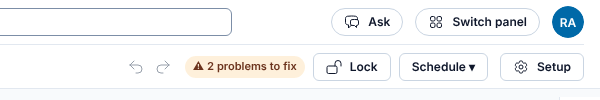
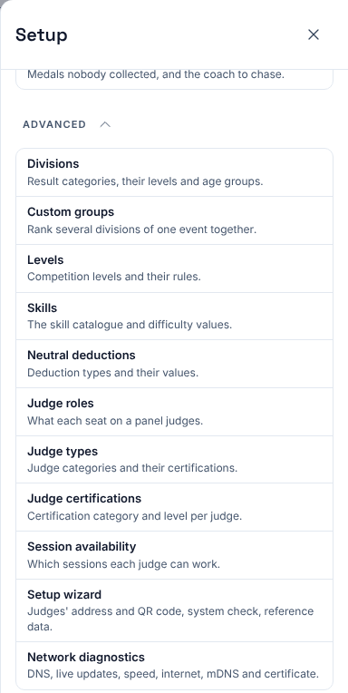
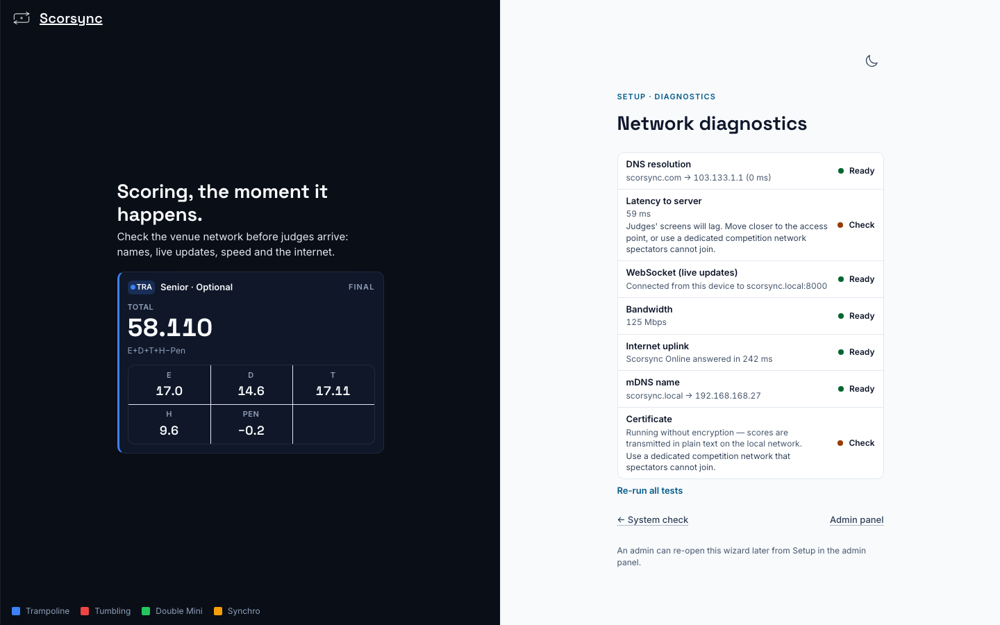
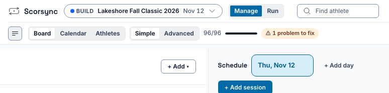

**Who it's for:** Offline host · Scorsync Desktop

Run this at home after setup, and again at the venue on the morning of the meet, once the router is on.

## Before you start

- Scorsync is open, and the menu says **● Running**.
- The laptop and one tablet are on the scoring Wi-Fi.
- You know your admin email and password.

## Check from the laptop

<Steps>

1. In the Scorsync window, select **Manage** at the top, then **Meet setup** (the gear, ⚙) at the top left.

   

2. In the list on the left, select **Advanced** near the bottom to open it, then **Network diagnostics**.

   

3. Wait a few seconds while each row fills in. Each row ends in **Ready**, **Check** or **Not ready**.

   

4. Check the rows against the table below. On the laptop itself, **Check** next to "Latency to server" and "Certificate" is normal: the laptop is measuring itself.

</Steps>

## Check from a tablet

The laptop can't measure the Wi-Fi. A tablet can.

<Steps>

1. On the tablet, open the judges' address from the Scorsync menu.

2. Sign in with your own admin email and password.

3. Select **Manage**, then **Meet setup**: on a tablet it's only the gear button (⚙), at the top left.

   

4. In the Meet setup list (on the left, or at the top on a narrow screen), select **Advanced** near the end to open it, then **Network diagnostics**.

5. Check that "Latency to server", "WebSocket (live updates)" and "Bandwidth" say **Ready**.

6. Before you hand the tablet to a judge, select your initials at the top of the screen, then **Sign out**.

</Steps>

## What each row means

| Row | Needed for | If it isn't Ready |
| -- | -- | -- |
| DNS resolution | Publishing only | Check the router's internet. Scoring isn't affected. |
| Latency to server | Scoring | "Judges' screens will lag." On a tablet: move the router closer to the judges, and keep spectators off the scoring Wi-Fi. |
| WebSocket (live updates) | Live updates on every screen | When no one is scoring, select **Restart Server** in the Scorsync menu. If it still fails, contact support. |
| Bandwidth | Scoring | Same fix as Latency. |
| Internet uplink | Publishing to scorsync.com only | "Something else answered" means a Wi-Fi sign-in page: open a browser on the laptop and sign in to the network. Scoring isn't affected. |
| mDNS name | The `scorsync.local` address | When no one is scoring, select **Restart Server**. Until it's Ready, judges type the second address from the menu, the one after **Or**. |
| Certificate | Nothing | Always **Check** on Scorsync Desktop ("Running without encryption"). Keep the scoring Wi-Fi for the laptop and judges only. |

Select **Re-run all tests** after each fix.

## If something goes wrong

- **"Could not reach this server from this device."** The tablet isn't on the scoring Wi-Fi. Join it, then select **Re-run all tests**.
- **"scorsync.local does not resolve."** Select **Restart Server** in the Scorsync menu when no one is scoring. Meanwhile, judges use the second address.
- **You can't find Meet setup.** It's only in **Manage**, not in **Run**. If the window is narrow, Meet setup shows as a gear icon (⚙) with no name. During first-run setup, the **System check** step also has a **Network diagnostics** link.

## Related

- [Connect the judges' tablets](/offline-host/connect-judges-tablets/)
- [Set up Scorsync Desktop and the venue network](/offline-host/set-up-the-venue-network/)
- [Use the Scorsync tray menu](/offline-host/tray-menu/)
- [Troubleshooting](/help/troubleshooting/)
