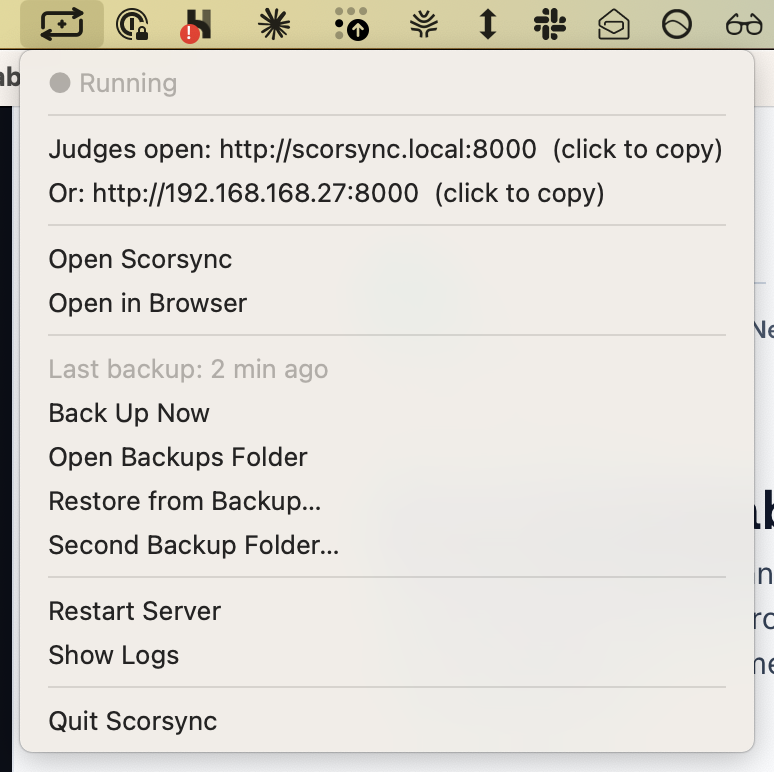
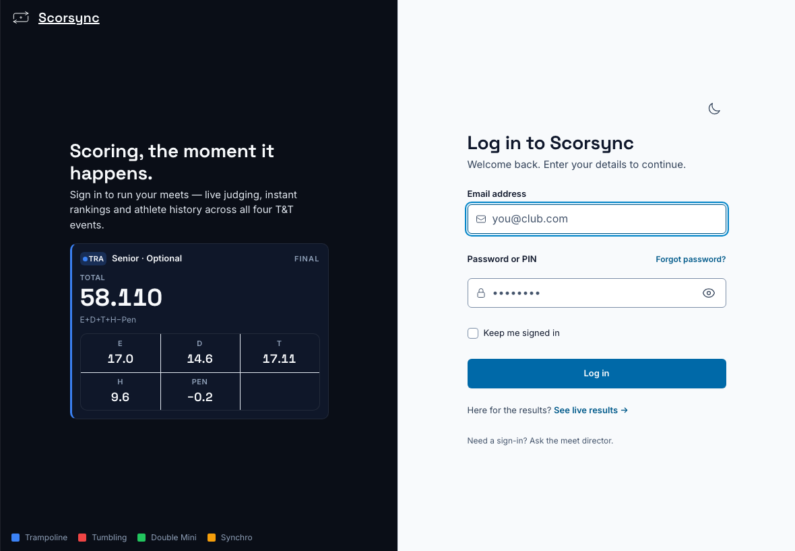
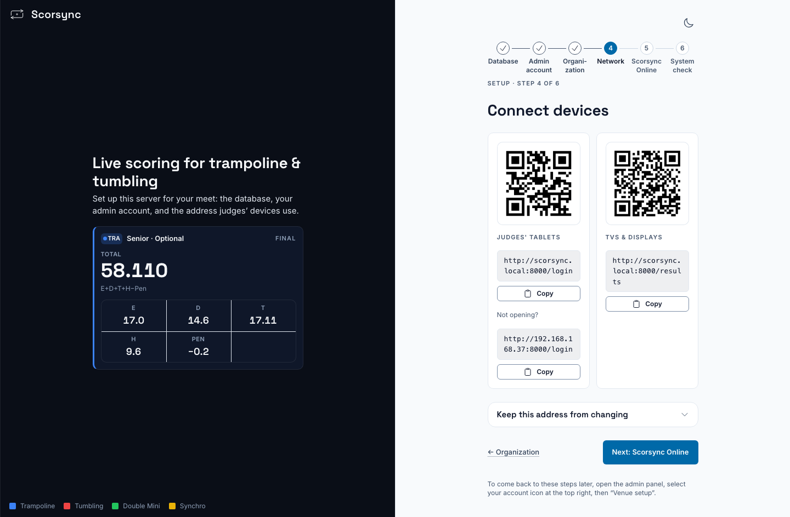
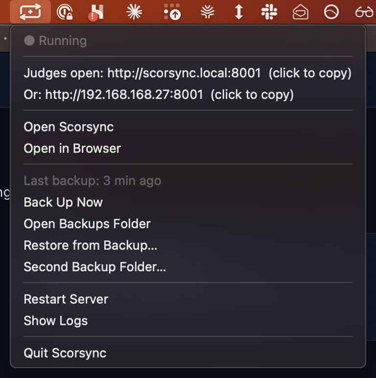

**Who it's for:** Offline host · Scorsync Desktop

Do this before judges sign in, at home with one tablet and again at the venue.

## Before you start

- Scorsync is open on the laptop.
- The laptop and the tablets are on the scoring Wi-Fi. See [Set up Scorsync Desktop and the venue network](/offline-host/set-up-the-venue-network/).

## Which address to give judges

| Address | Looks like | Use it for |
| -- | -- | -- |
| **Judges open** | `http://scorsync.local:8000` | Most tablets. Write this one on the judges' card. |
| **Or** | `http://192.168.1.20:8000` | Tablets that can't open the first one, such as some Android tablets and older iPads. |
| The QR code (Setup wizard) | A square code | Tablets with a camera that can open the first address. The QR code only holds the first address. |

Yours will differ. Some laptops show no `:8000`.

## Steps

<Steps>

1. On the laptop, click the Scorsync icon in the menu bar (on Windows, right-click it in the notification area).

2. Check that the menu says **● Running**. Write both addresses on a card: the one after **Judges open** and the one after **Or**. Click either line to copy it.

   

3. On a judge's tablet, open the web browser and type the **Judges open** address, including any `:8000` at the end.

4. Check that the tablet shows **Log in to Scorsync**. The tablet is connected. Now sign the judge in: see [Get judges signed in and scoring](/scoring-table/get-judges-signed-in/).

   

</Steps>

## Show the QR code instead

<Steps>

1. In the Scorsync window, select **Manage**, then **Setup** → **Advanced** → **Setup wizard**.

2. Select **Network** in the row of steps at the top.

3. Turn the screen to the judges. Each judge scans the code under **Judges open** with their tablet's camera.

   

</Steps>

:::tip
Test each tablet before meet day. A tablet that can't open `scorsync.local` at home won't open it at the venue either: give that judge the second address.
:::

## If something goes wrong

- **The tablet says it can't find the server, or the QR code opens nothing.** Type the second address, the one after **Or**. Check the tablet is on the scoring Wi-Fi, not the venue's.
- **After you reopen Scorsync, the address ends in a different number**, such as `:8001` instead of `:8000`. Give judges the new address from the menu. Scores a judge saved on their tablet meanwhile wait under the old address: see [Keep the meet running](/offline-host/keep-the-meet-running/).

  

- **The menu says "Network name is now scorsync-2.local — use Restart Server".** Another Scorsync laptop is on the same Wi-Fi. Close Scorsync on the other laptop, then select **Restart Server** when no one is scoring.
- **The second address changed.** The router gave the laptop a new address. Reserve one for it in the router. See [Set up Scorsync Desktop and the venue network](/offline-host/set-up-the-venue-network/).

## Related

- [Get judges signed in and scoring](/scoring-table/get-judges-signed-in/)
- [Check your network before the meet](/offline-host/check-your-network/)
- [The tray menu at a glance](/offline-host/tray-menu/)
- [Troubleshooting](/help/troubleshooting/)
