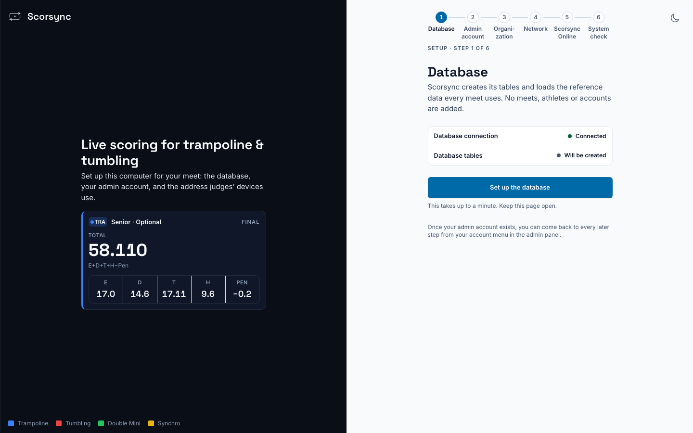
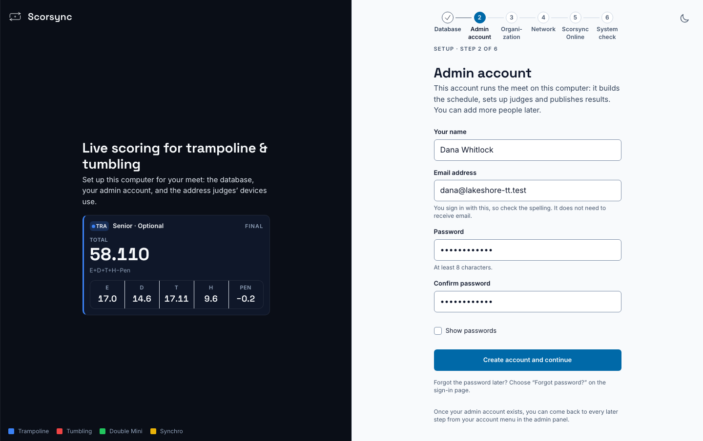
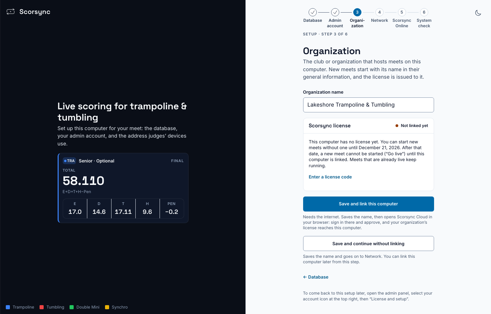
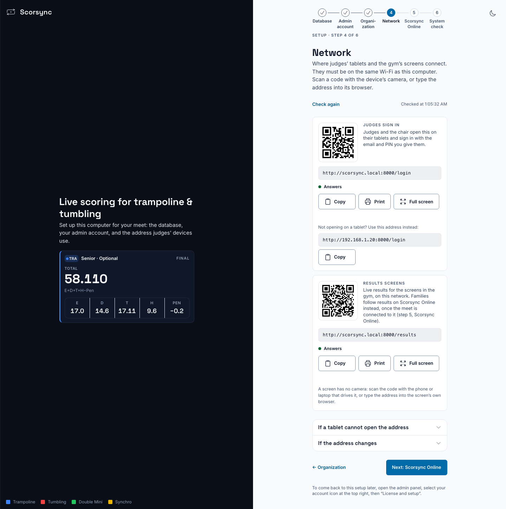
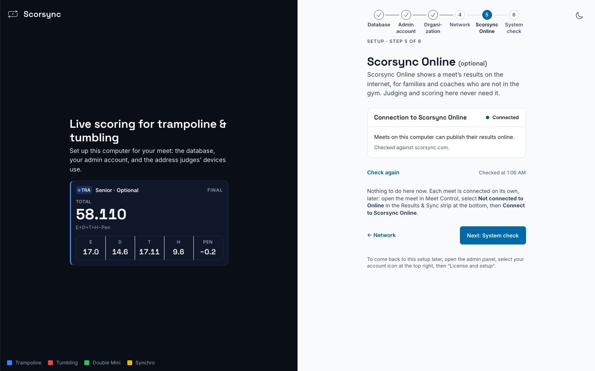
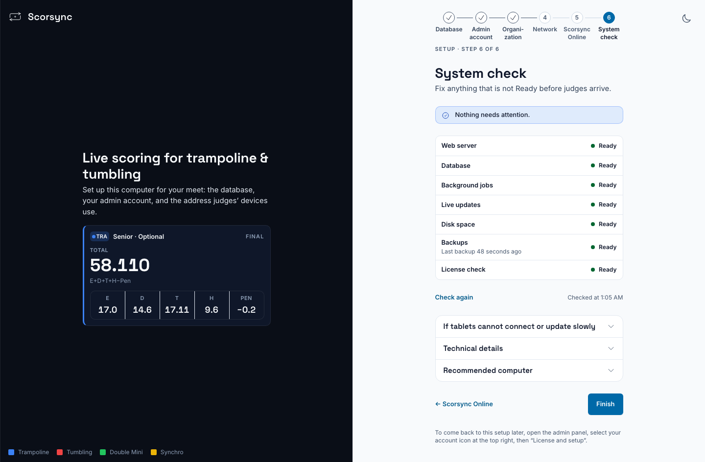

**Who it's for:** Offline host · Scorsync Desktop

The first time you open Scorsync Desktop, it shows six setup steps. You do them once per laptop.

## Before you start

- Scorsync Desktop is installed. See [Install on a Mac](/offline-host/install-on-mac/) or [Install on Windows](/offline-host/install-on-windows/).
- The laptop is on the scoring Wi-Fi from your travel router. The **Network** step shows the addresses for the network the laptop is on now. See [Set up Scorsync Desktop and the venue network](/offline-host/set-up-the-venue-network/).
- Internet, to link this computer to your Scorsync account in step 3.

## Steps

<Steps>

1. On **Database**, select **Set up the database**. It can take up to a minute. Keep the page open.

   

2. On **Admin account**, fill in **Your name**, **Email address**, **Password** and **Confirm password**, then select **Create account and continue**. The email doesn't need to receive mail: it's only what you sign in with. Write the password down somewhere safe.

   

3. On **Organization**, type your club's name under **Organization name**, as scorsync.com knows it.

4. Select **Save and link this computer**. Your browser opens app.scorsync.com: sign in with your Scorsync account, select **Allow** on "Link this computer?", then wait for "Computer linked". Back in the Scorsync window, the **Scorsync license** card says **Licensed**.

   Have a license code instead? Select **Enter a license code**, type it under **License code**, then select **Use license code**. An admin of your organization gets the code on app.scorsync.com, with **Get a license code** on the organization's page.

   Can't link right now? Select **Save and continue without linking**. You have 30 days from first run to link: the card says "You can start new meets without one until" a date.

   

5. If you linked or used a code, you're back on **Organization**: select **Save and continue**.

6. On **Network**, write down both addresses in the **Judges sign in** card: the one next to the QR code, and the one under "Not opening on a tablet? Use this address instead". **Copy** next to an address copies it, and **Print** prints the QR code and address as a sign. The **Results screens** card is for screens that show results: you don't need it now.

   

7. Select **Next: Scorsync Online**.

8. On **Scorsync Online (optional)**, select **Next: System check**. You don't connect anything here: you connect each meet to scorsync.com later, in Meet Control.

   

9. On **System check**, check that every row says **Ready**. A row that isn't Ready shows what to do under its name. **Technical details**, under the list, shows the detail of every check, for support.

   

10. Select **Finish**.

11. Check that Scorsync now says "Welcome" with your name and offers **New meet**. Setup is done. Next: [Build your meet in Meet Builder](/host/before-meet-day/build-your-meet/).

</Steps>

## About the license

- The pilot license covers your organization through March 2027.
- Linking needs internet once. You never need it on meet day.
- If 30 days pass without a link, only **Go live** for a new meet stops. Meets already live keep running.
- If linking fails, email support@scorsync.com.

## If something goes wrong

- **"This computer has no network address that other devices can reach."** The laptop isn't on any network. Join it to the scoring Wi-Fi (or plug it into the router), then reload the page with ⌘R (Ctrl+R on Windows).
- **"This computer does not answer on the addresses below."** on the Network step. Allow Scorsync in the laptop's firewall, then quit and reopen Scorsync. The page says where the firewall setting is on a Mac and on Windows. Then select **Check again**.
- **The "Go live works until…" date is before your meet.** Link this computer while you have internet: select your account icon at the top right of Scorsync, then **License and setup**. If linking fails, email support@scorsync.com.
- **The license card says your account "does not manage a club on Scorsync Cloud".** You linked with an account that doesn't host your club, so the computer gets no license. Select **Link again** and sign in with your club's host account, or use **Enter a license code**.
- **A System check row isn't Ready.** Follow the fix under its name, then select **Check again**. If it's still not Ready, contact support.
- **You need the judges' address or QR code again.** Select your account icon at the top right, then **License and setup**. In the setup steps at the top, select **Network**. See [Connect the judges' tablets](/offline-host/connect-judges-tablets/).
- **You forgot the admin password.** On the laptop's own Scorsync window you don't need it: the sign-in page offers **Continue as** with your name, with no password. A tablet or any other device still asks for the password, and Scorsync Desktop can't email you a reset link. Contact support (support@scorsync.com).

## Related

- [Check your network before the meet](/offline-host/check-your-network/)
- [Connect the judges' tablets](/offline-host/connect-judges-tablets/)
- [Set up Scorsync Desktop and the venue network](/offline-host/set-up-the-venue-network/)
- [Meet-day runbook: Scorsync Desktop](/runbook/scorsync-desktop/)
