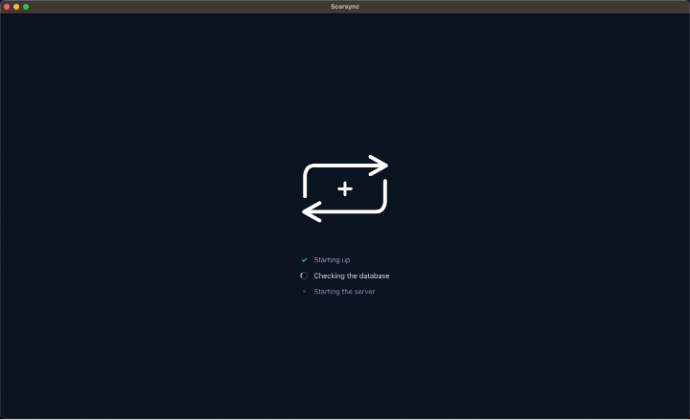
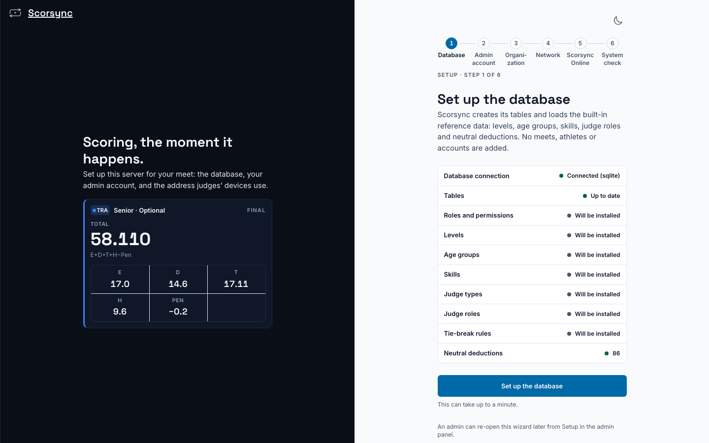

**Who it's for:** Offline host · Scorsync Desktop on a Mac

Do this once per laptop, at least a week before your meet, while you have internet. You link this computer to your Scorsync license in [first-run setup](/offline-host/first-run-setup/).

## Before you start

- A Mac with macOS 12 or later. To check the chip, open the Apple menu → **About This Mac**: "Apple M…" is Apple silicon, "Intel" is Intel.
- Internet, for the download.

## Steps

<Steps>

1. On the Mac, go to `app.scorsync.com/downloads`.

2. On the **Mac** card, choose **Apple silicon** or **Intel** to match your Mac, then select **Download for Mac** (or **Download for Intel Mac**). If there's no Intel choice and your Mac has an Intel chip, contact support.

3. Open your Downloads folder and double-click the Scorsync file that ends in `.dmg`.

4. In the window that opens, drag the Scorsync icon onto the **Applications** folder.

5. Open **Applications** in Finder and double-click **Scorsync**.

6. If macOS asks whether you're sure you want to open an app downloaded from the internet, select **Open**.

7. If macOS asks whether Scorsync can find devices on your local network, or accept incoming network connections, select **Allow**. Judges' tablets can't reach the laptop without it.

8. Wait while the window shows a short checklist that ends with "Starting the server". It takes a few seconds.

   

9. Check that the window shows **Set up the database**, and that the Scorsync icon is in the menu bar at the top of the screen. Scorsync is installed.

   

</Steps>

Next, work through the six setup steps. See [First-run setup](/offline-host/first-run-setup/).

:::review[Needs Austin's review: not checked on a Mac yet]
Pending a check on a real Mac: a fresh install from the downloads page (steps 1–7), and the macOS local-network and firewall prompts (steps 6–7 and the first two fixes below).
:::

## If something goes wrong

- **macOS won't open Scorsync, because it can't check or verify the app.** You have a preview build. Open System Settings → **Privacy & Security**, scroll down, and select **Open Anyway** next to Scorsync.
- **You selected Don't Allow by mistake.** Open System Settings → **Privacy & Security** → **Local Network**, and turn Scorsync on. Then select **Restart Server** in the Scorsync menu (the icon in the menu bar).
- **"Scorsync could not start" with "Ports 80 and 8000–8009 are all in use."** Another program on the Mac is acting as a web server. Quit it, then open Scorsync again. If you don't know which program it is, contact support.
- **"Scorsync processes from the last run are still running."** Restart the Mac, then open Scorsync again.
- **The window doesn't appear.** Click the Scorsync icon in the menu bar and select **Open Scorsync**.

## Related

- [First-run setup](/offline-host/first-run-setup/)
- [Set up Scorsync Desktop and the venue network](/offline-host/set-up-the-venue-network/)
- [Install a newer version](/offline-host/install-a-newer-version/)
- [Install Scorsync Desktop on Windows](/offline-host/install-on-windows/)
