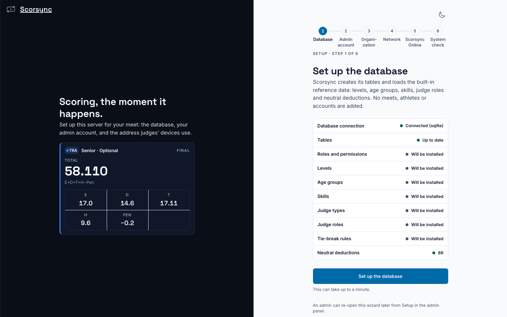

**Who it's for:** Offline host · Scorsync Desktop on Windows

Do this once per laptop, at least a week before the meet, while you have internet.

## Before you start

- A 64-bit laptop with Windows 10 or 11.
- An account that can install programs. If the laptop belongs to a school or club IT department, ask them first: Scorsync installs for every user, so Windows asks for an administrator.
- Internet, for the download.

## Steps

<Steps>

1. On the laptop, go to `scoring.scorsync.com/downloads` and select **Download for Windows**.

2. Open your Downloads folder and double-click **Scorsync-Setup**, the file that ends in `.exe`.

3. If Windows says it protected your PC, select **More info**, then **Run anyway**. Preview builds may not be signed yet.

4. When Windows asks whether to allow this app to make changes to your device, select **Yes**. The installer asks nothing else, and it opens the Windows firewall for judges' tablets by itself.

5. Wait for Scorsync to open. If it doesn't open by itself, open **Scorsync** from the Start menu.

6. Wait while the window shows a short checklist that ends with "Starting the server". The first start can take a few minutes, and the window says so. Leave it alone until it finishes.

7. Check that the window shows **Set up the database**. Scorsync is installed.

   

</Steps>

On Windows, the Scorsync icon sits in the notification area, at the bottom right of the taskbar. You may need to select **^** to see it. Left-click it to open the window; right-click it for the menu with the judges' address. See [Use the Scorsync tray menu](/offline-host/tray-menu/).

Next, work through the six setup steps. See [First-run setup](/offline-host/first-run-setup/).

:::review[Needs Austin's review: not checked on Windows yet]
Nobody has installed Scorsync Desktop on Windows for these docs yet. Every step here, including the prompts, the first-start time and the tray icon, comes from the code. Where pilot hosts download the build also isn't decided.
:::

## If something goes wrong

- **The downloads page says "Coming soon".** The app isn't published yet. Email support@scorsync.com, and we'll send it to you.
- **Windows asks for an administrator's password.** Ask whoever manages the laptop to type it. Without it, Scorsync can't install.
- **There's no Run anyway button.** The laptop's settings block programs from new publishers. Ask whoever manages the laptop, or contact support.
- **"Scorsync could not start" with "Ports 80 and 8000–8009 are all in use."** Another program on the laptop is acting as a web server. Close it, then open Scorsync again. If you don't know which program it is, contact support.
- **"Scorsync processes from the last run are still running."** Restart the laptop, then open Scorsync again.
- **The judges' address ends in `:8000`.** That's normal when another program uses the usual web port. Give judges the address exactly as Scorsync shows it.
- **Tablets can't open `scorsync.local`.** On Windows the name doesn't always work. Give judges the second address from the menu, the one after **Or:**. See [Connect the judges' tablets](/offline-host/connect-judges-tablets/).

## Related

- [First-run setup](/offline-host/first-run-setup/)
- [Set up Scorsync Desktop and the venue network](/offline-host/set-up-the-venue-network/)
- [Install the pilot build before meet day](/offline-host/install-the-pilot-build/)
- [Install Scorsync Desktop on a Mac](/offline-host/install-on-mac/)
