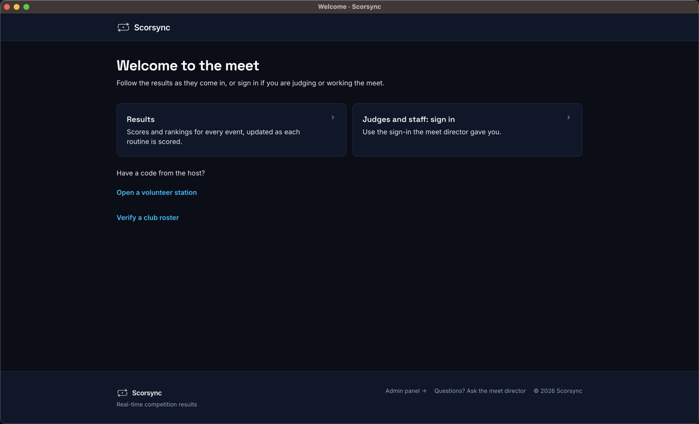
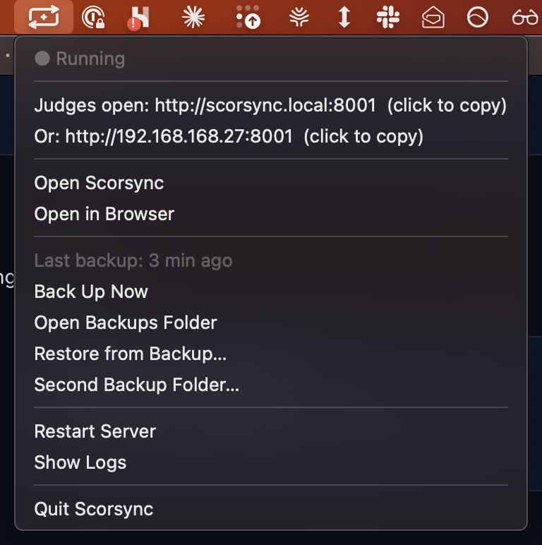

**Who it's for:** Offline host · Scorsync Desktop

Scorsync Desktop serves every judge from your laptop, so the meet runs only while Scorsync is open and the laptop is awake.

## Before the first session

<Steps>

1. Plug the laptop into mains power, through a UPS (a battery backup) if you have one.

2. In the laptop's power settings, turn off sleep while plugged in.

3. Keep the lid open all day. Closing it can put the laptop to sleep.

4. Quit other programs you don't need. Another program can take Scorsync's address.

5. Open Scorsync.

6. Open the tray menu (the Scorsync icon in the Mac menu bar, or right-click it in the Windows notification area). Check it says **● Running**.

7. Write the address after **Judges open** on a card for the judges' table.

</Steps>

## What stops the meet, and what doesn't

| You do this | Judges keep scoring? |
| -- | -- |
| Close or minimise the Scorsync window | Yes. The tray icon keeps Scorsync running. |
| Let the screen go dark or lock | Yes |
| Select **Restart Server** in the tray menu | Yes, after about 5 seconds |
| Let the laptop sleep, or close its lid | No |
| Run out of battery, or restart the laptop for an update | No |
| **Quit Scorsync** in the tray menu, ⌘Q, Dock → Quit, or File → Exit on Windows | No |

:::danger[Don't Quit Scorsync during the meet]
Quit stops scoring for every judge within a second, and nothing asks you to confirm. Close the window instead. To open it again, select **Open Scorsync** in the tray menu.
:::

:::review[Needs Austin's review: closing the window and the lid]
Closing the window: confirmed on Windows; pending a check on Mac. Closing the laptop lid: pending a check on real hardware.
:::

## Reopen Scorsync after a restart

Scorsync doesn't open by itself when the laptop starts. If every judge drops at once, the travel router lost power, or someone quit Scorsync, or the laptop slept or restarted.

<Steps>

1. Check the travel router has power and its Wi-Fi light is on. If it restarted, wait a minute for the tablets to rejoin the scoring Wi-Fi.

2. Open the tray menu. If it says **● Running**, Scorsync is fine: skip to step 5.

3. If there's no Scorsync icon, open Scorsync. Wait for "Starting the server…" to finish: about 10 seconds.

4. If the window shows **Welcome to the meet**, select **Admin panel** at the bottom, and sign in again.

   

5. Open the tray menu, and check that the address after **Judges open** matches your card.

6. Ask the chair to check that every judge shows on the panel again. Judges stay signed in, and scores saved on their tablets send by themselves.

</Steps>

## If something goes wrong

- **The address after Judges open has changed**, for example `:8001` instead of `:8000`. Another program took the old address.
  1. Each judge opens the new address on their tablet. They stay signed in.
  2. A score a judge saved on their tablet while Scorsync was closed doesn't send from the new address. The judge tells the chair the mark, and the chair enters it. See [Move on when a judge hasn't submitted](/judges/chair/move-on-missing-judge/).

  

- **"Scorsync could not start" with "Ports 80 and 8000–8009 are all in use."** Quit the other programs you don't need, then select **Restart Server** in the tray menu. Opening Scorsync again won't retry. If it still fails, restart the laptop and open only Scorsync.
- **"Scorsync processes from the last run are still running."** Restart the laptop, then open Scorsync again.
- **The Sync Rail chip in Run says "Sending stopped".** Keep scoring: judges' scores are safe on the laptop. Between athletes, select **Restart Server** in the tray menu, once. If it still says "Sending stopped", contact Scorsync support (support@scorsync.com). Don't Quit.
- **One judge drops, not all of them.** That's their tablet or the Wi-Fi, not the laptop. See [Score when the Wi-Fi drops](/judges/score-when-wifi-drops/).

## Related

- [Back up your meet](/offline-host/backups/)
- [Use the Scorsync tray menu](/offline-host/tray-menu/)
- [Set up Scorsync Desktop and the venue network](/offline-host/set-up-the-venue-network/)
- [Meet-day runbook: Scorsync Desktop](/runbook/scorsync-desktop/)
