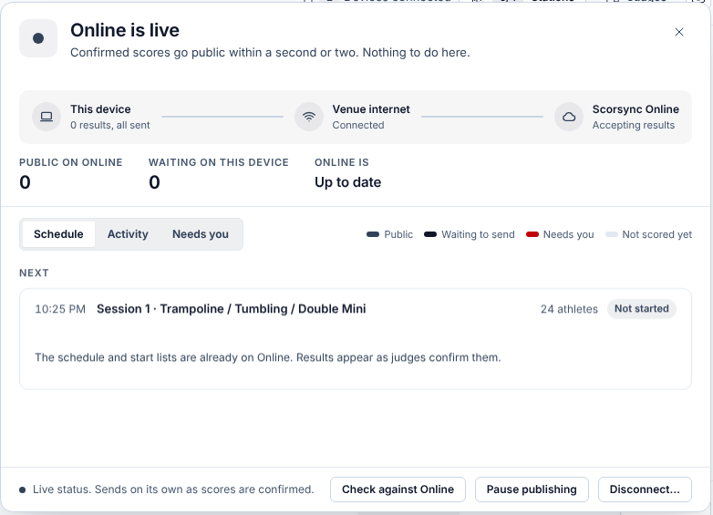

**Who it's for:** Offline host · Scorsync Desktop

Use this page when the venue internet drops, or if you have none at all: scoring carries on either way.

## What needs the internet

| Task | Needs the internet? |
| -- | -- |
| Judges scoring, the chair, Meet Control and backups | No. They only need the laptop and the scoring Wi-Fi. |
| Publishing results to scorsync.com | Yes. Results wait on the laptop until the internet is back. |
| Connecting the meet to scorsync.com | Yes. Do it the day before. See [Connect your meet to scorsync.com](/host/before-meet-day/connect-to-scorsync-com/). |

If your meet doesn't publish to scorsync.com, you never need the internet on meet day, and Run shows **Not connected to Online**. That's fine.

## Check that scorsync.com is catching up

You don't need to do anything when the internet drops or comes back: results go out by themselves, in order. To check on them:

<Steps>

1. In Meet Control, open **Run**, and find the Sync Rail chip at the bottom right, next to **Last backup**. While the internet is down, it says **Offline · holding** and how many results are waiting.

   

2. Select the chip.

3. Check **Waiting on this device** and **Online is**. Once the internet is back, the chip says **Catching up**, flashes **All caught up**, then goes back to **Online · live**. scorsync.com has everything when Waiting on this device is 0 and Online is says **Up to date**.

   

</Steps>

## What the chip says

| Chip | What to do |
| -- | -- |
| **Online · live** | Nothing. Results go to scorsync.com within a second or two. |
| **Offline · holding** | Keep scoring. Results go out by themselves when the internet is back. |
| **Online not answering** | Keep scoring. Your internet works, but scorsync.com didn't answer. Scorsync keeps trying. |
| **Catching up** | Nothing. It clears by itself. |
| **Reconnect needed** | scorsync.com signed the laptop out. While you have internet, select the chip, then **Reconnect**. See [Connect your meet to scorsync.com](/host/before-meet-day/connect-to-scorsync-com/). |
| **Sending stopped** | Results are safe, but none are going out. Between athletes, select **Restart Server** in the tray menu. If it comes back, contact Scorsync support. |
| **Online refused results** | Contact Scorsync support (support@scorsync.com). |
| **Online publishing off** | Nothing. Results stay on the laptop until you select the chip, then **Turn on Online publishing**. |

## If something goes wrong

- **The chip says "Online · live", but you know the internet is down.** The chip only notices once a result is waiting to send. It changes to **Offline · holding** after the next score.
- **The chip says "Offline · holding", and the sheet says "The venue internet is down", but the internet works.** scorsync.com may be the one not answering. Select **Try now** in the sheet. If it lasts more than a few minutes, contact Scorsync support.
- **The internet is back, but the chip still says Offline · holding.** Scorsync retries every minute or so. To send straight away, select the chip, then **Try now**.
- **Families say scores aren't on scorsync.com.** Check **Waiting on this device** first. For what families see and when, see [What families see on scorsync.com](/start-here/what-families-see/). For their own questions, send them to [help.scorsync.com](https://help.scorsync.com).

## Related

- [Watch publishing on the Sync Rail](/scoring-table/watch-publishing/)
- [Score when the Wi-Fi drops](/judges/score-when-wifi-drops/)
- [Keep the meet running](/offline-host/keep-the-meet-running/)
- [Set up Scorsync Desktop and the venue network](/offline-host/set-up-the-venue-network/)
