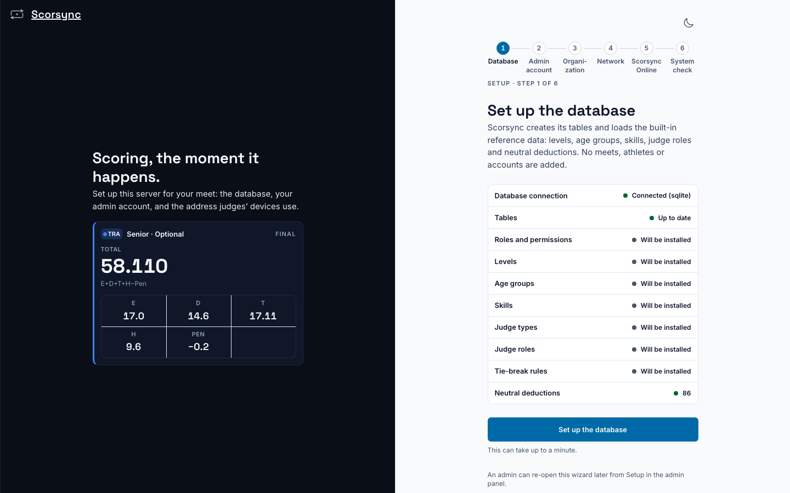
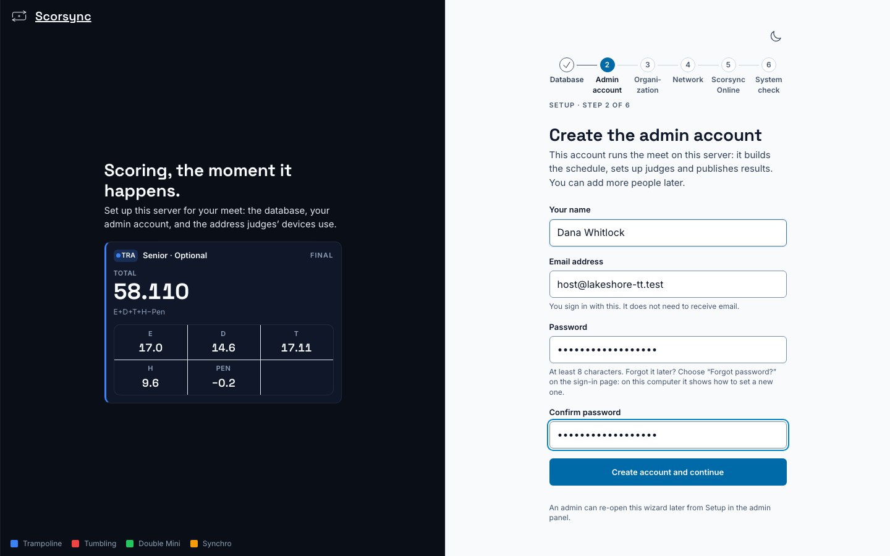
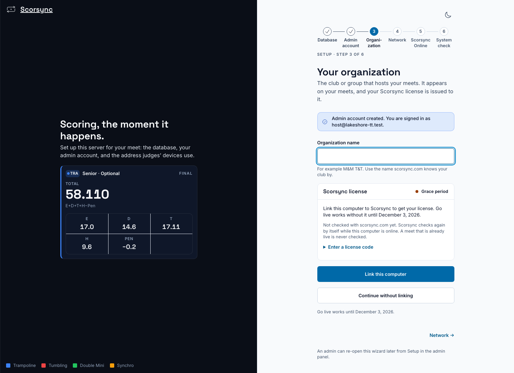
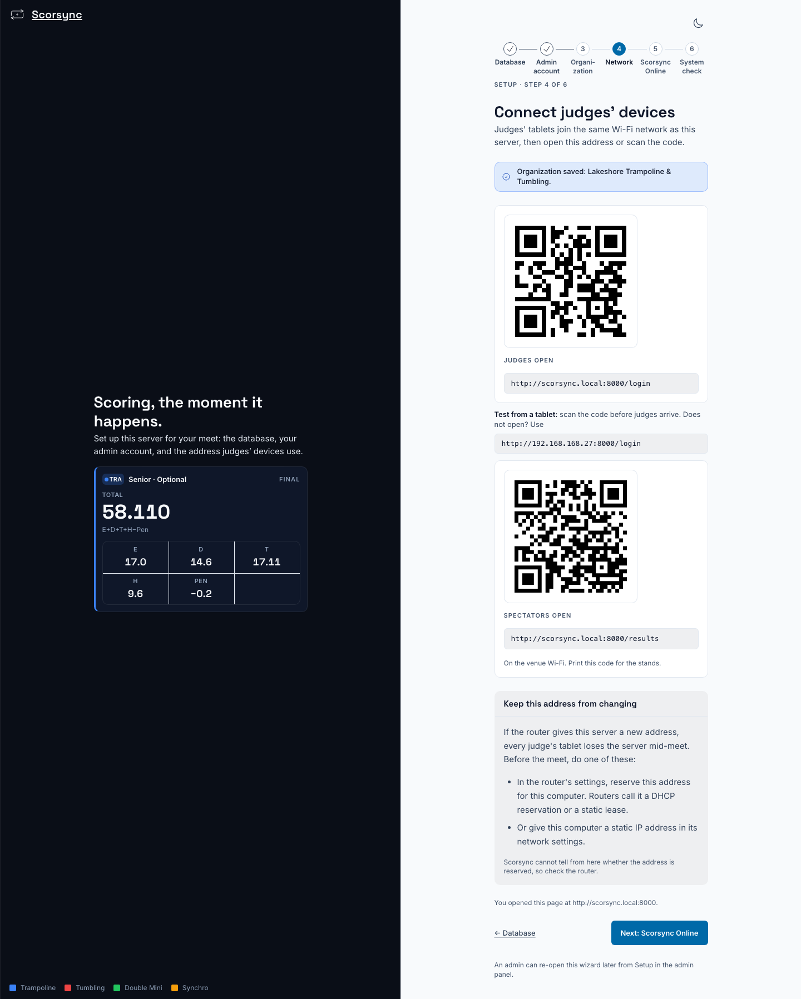
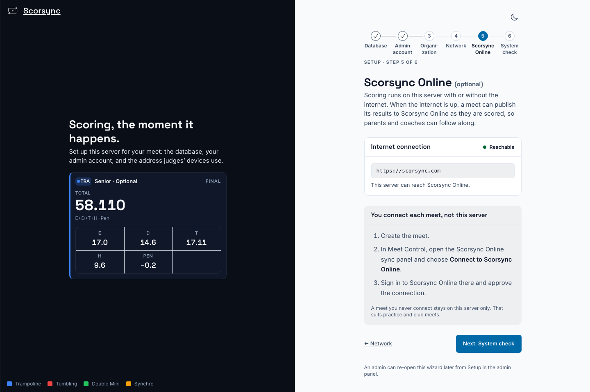
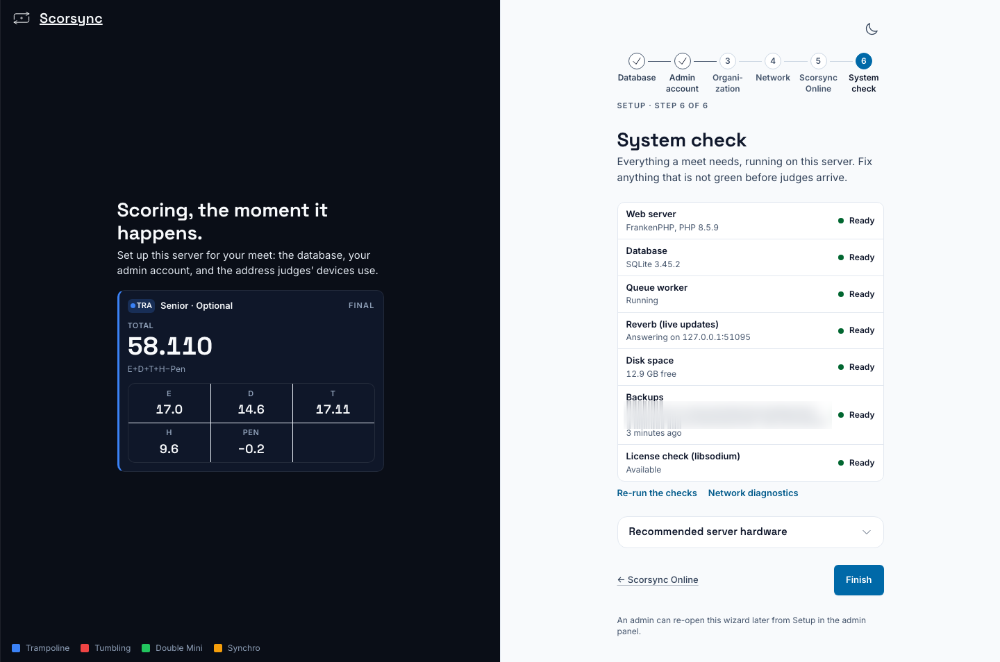
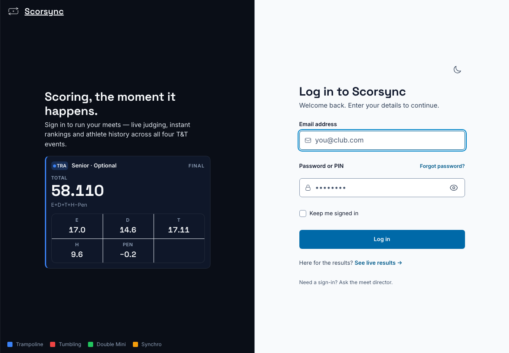
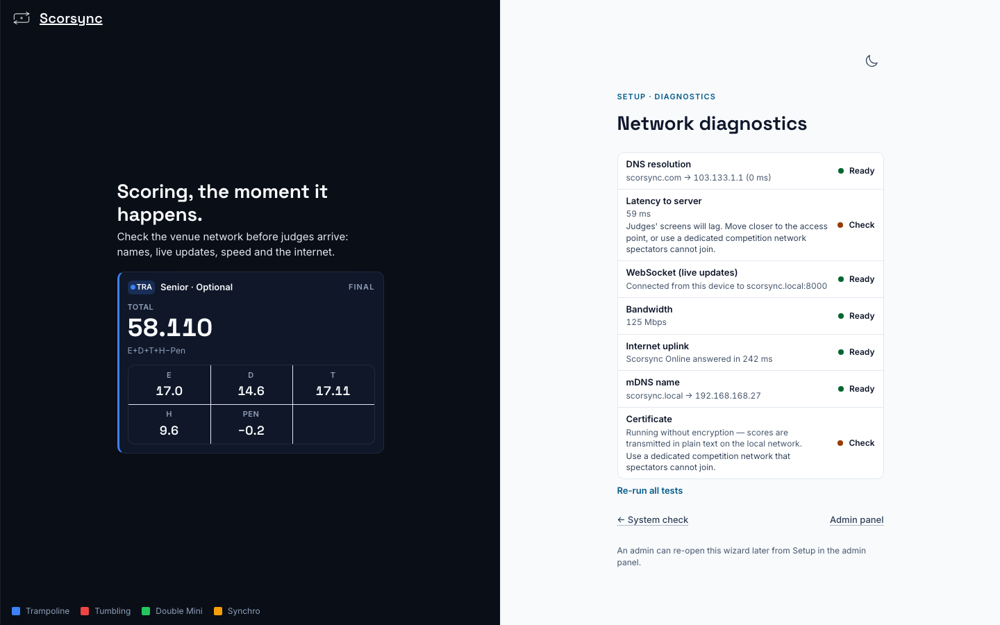
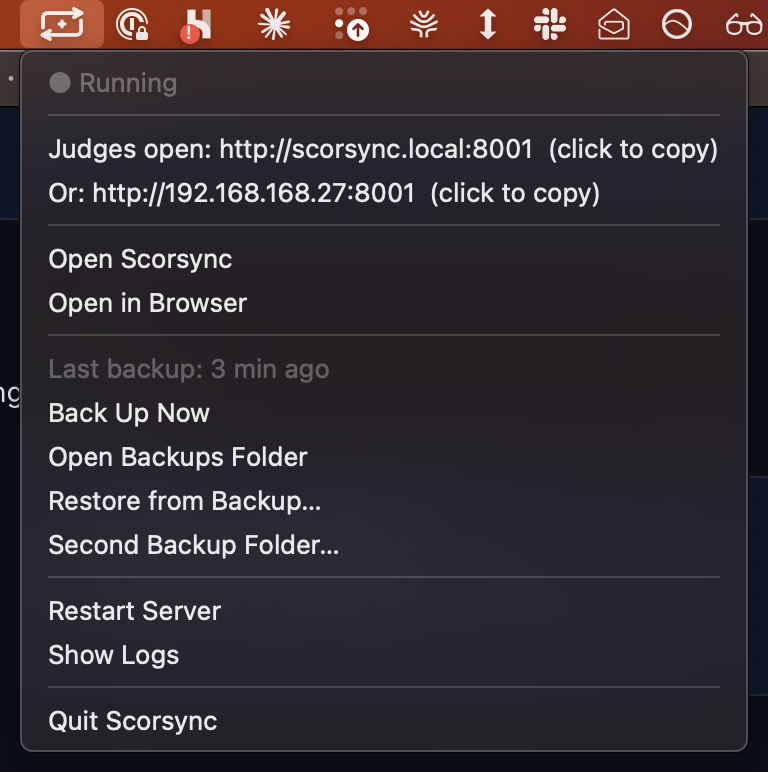

**Who it's for:** Offline host · Scorsync Desktop

Scorsync Desktop runs the whole meet on your laptop. Judges' tablets connect to the laptop over a Wi-Fi network that you bring: a small travel router. Nothing needs the internet while you score.

Do this at home a few days before the meet, then check it again at the venue on the morning of the meet.

## Before you start

- Scorsync Desktop is installed on the laptop. See [Install on a Mac](/offline-host/install-on-mac/) or [Install on Windows](/offline-host/install-on-windows/).
- You have your own travel router (see the checklist below). Scorsync doesn't lend routers.
- You have one tablet to test with.

## What to bring

Any travel router will do if it can do these three things:

- **Make its own Wi-Fi network.** This is the scoring Wi-Fi. Only the laptop and the judges' tablets join it.
- **Reserve a fixed address for one device.** Router settings call this a "DHCP reservation" or a "static lease".
- **Take its internet from somewhere else**, such as a phone hotspot or the venue's internet. You only need internet if you publish results to scorsync.com.

Also bring the laptop's power cable, a power strip, and a small UPS (a battery backup the laptop plugs into) if you can.

:::caution[A hotspot on its own isn't supported]
Don't run the scoring Wi-Fi from your phone or from the laptop's own hotspot: judges' tablets may not find Scorsync at all. If you can't get a travel router, contact support before the meet.
:::

:::review[Needs Austin's review: booking the setup check]
The decided venue setup (SCO-2058) offers hosts a pre-meet setup check with Scorsync support, and says the guide tells them how to book it. How they book it isn't decided. Draft wording: "Want us to check your setup? Contact support a week before your meet and we'll go through it with you."
:::

## Set up the router

Every router is different, so these steps have no screenshots. Use your router's own instructions for each one.

<Steps>

1. Plug the router into mains power, next to where the laptop will sit.

2. Give the scoring Wi-Fi a name and a password. Write both down for the judges.

3. Connect the laptop to the scoring Wi-Fi.

4. In the router's settings, reserve the laptop's address for the laptop. This keeps the judges' address from changing mid-meet.

5. If you'll publish to scorsync.com, give the router its internet: plug in the venue's cable, or join your phone's hotspot from the router. Never turn on a hotspot on the laptop.

</Steps>

## Run first-run setup

The first time you open Scorsync Desktop, it walks you through six steps. You do this once per laptop.

<Steps>

1. Open Scorsync, and on **Set up the database**, select **Set up the database**. It takes a few seconds.

   

2. Type your name, your email and a password, then select **Create account and continue**. The email doesn't need to receive mail: it's only what you sign in with.

   

3. Type your club's name under **Organization name**, then choose **Link this computer** or **Continue without linking**. Note the date under the buttons: "Go live works until…".

   

4. On **Connect judges' devices**, write down both addresses: the one under **Judges open**, and the one after "Does not open? Use". Then select **Next: Scorsync Online**.

   

5. Select **Next: System check**. You don't connect anything here: each meet is connected to scorsync.com on its own, later.

   

6. Check that every row on **System check** says **Ready**, then select **Finish**.

   

</Steps>

:::review[Needs Austin's review: the license]
On the test run the license card read "Go live works without it until December 3, 2026": 30 days after first run, and two days before the pilot. Linking needs the internet. What we tell hosts about license codes, linking and that date isn't settled, so this page only says to note the date. The draft fix under "If something goes wrong" needs your sign-off.
:::

## Check it from a tablet

<Steps>

1. On the laptop, click the Scorsync icon in the menu bar at the top of the screen. Check that the menu says **● Running** and shows the judges' address after **Judges open**.

   

2. Join the tablet to the scoring Wi-Fi.

3. On the tablet, type the address from **Judges open** into the browser, including any `:8000` at the end.

4. Check that the tablet shows **Log in to Scorsync**. If it does, judges can reach Scorsync.

   

</Steps>

:::tip
For a closer look at the network, open Scorsync on the laptop, select **Setup**, then **Advanced** → **Network diagnostics**. When you run it on the laptop itself, "Check" next to "Latency to server" and "Certificate" is normal.
:::

## Keep the laptop running

- **Keep it plugged in** all day, through the UPS if you have one.
- **Turn off sleep** in the laptop's power settings, including sleep when the lid closes. A dark or locked screen doesn't stop scoring; a sleeping laptop does.
- **Never use Quit.** Close the window instead. See [Keep the meet running](/offline-host/keep-the-meet-running/).

:::danger[Don't Quit Scorsync Desktop]
**Quit Scorsync** in the menu, and ⌘Q on a Mac, stop scoring for every judge within a second. Nothing asks you to confirm.
:::

## If something goes wrong

- **A tablet can't open the address.** Type the second address from the menu, the one after **Or:**. The QR codes only hold the first address, so on that tablet type the address instead of scanning.
- **After you reopen Scorsync, the address ends in a different number**, such as `:8001` instead of `:8000`. Something else on the laptop took the old one. Give judges the new address from the menu. On meet day, close other programs before you open Scorsync.

  

- **The "Go live works until…" date is before your meet.** Link the computer while you have internet, or contact support.
- **A System check row isn't Ready.** Select **Re-run the checks**. If it's still not Ready, contact support.

## Related

- [Meet-day runbook: Scorsync Desktop](/runbook/scorsync-desktop/)
- [Get judges signed in and scoring](/scoring-table/get-judges-signed-in/)
- [Keep the meet running](/offline-host/keep-the-meet-running/)
- [Troubleshooting](/help/troubleshooting/)
