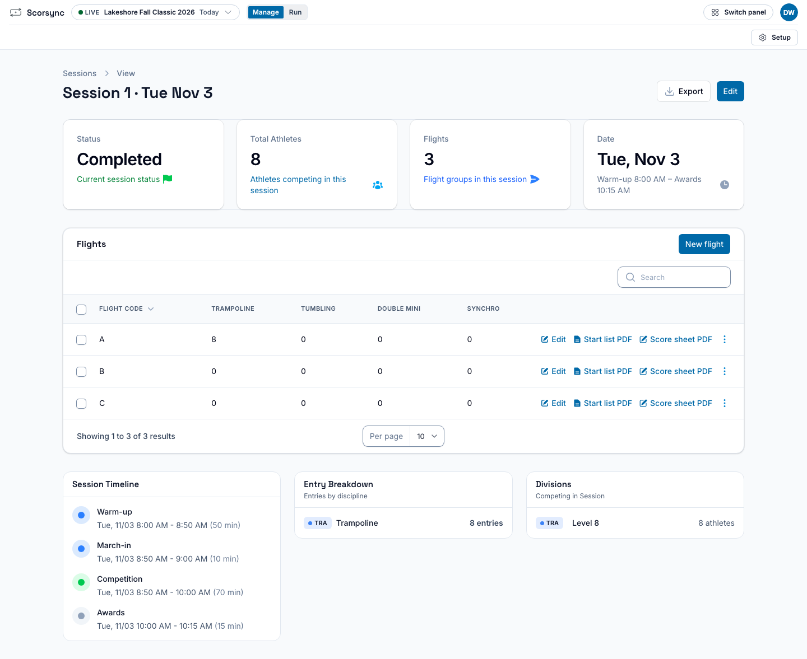
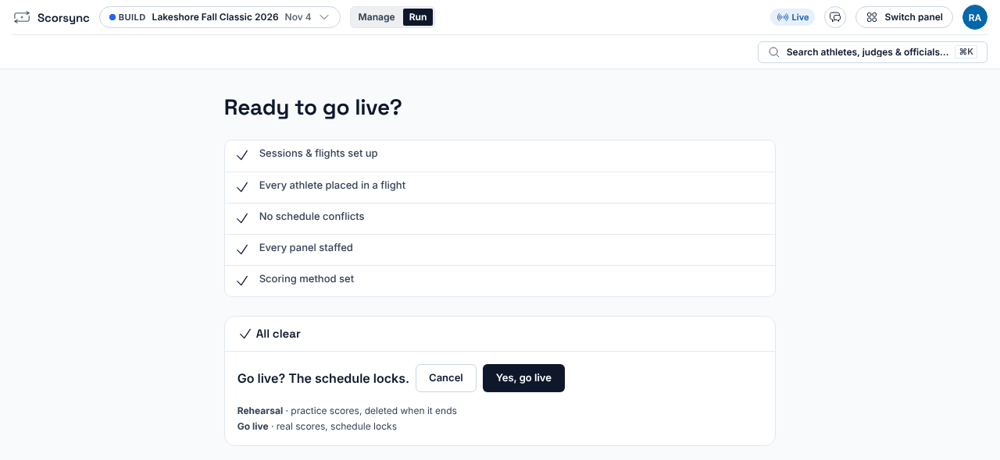
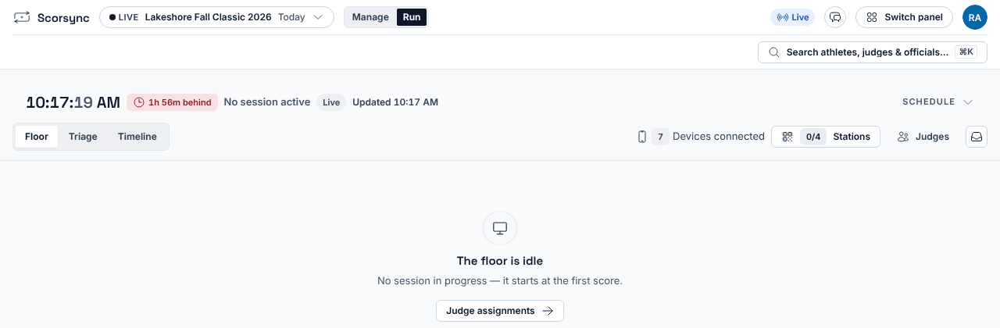
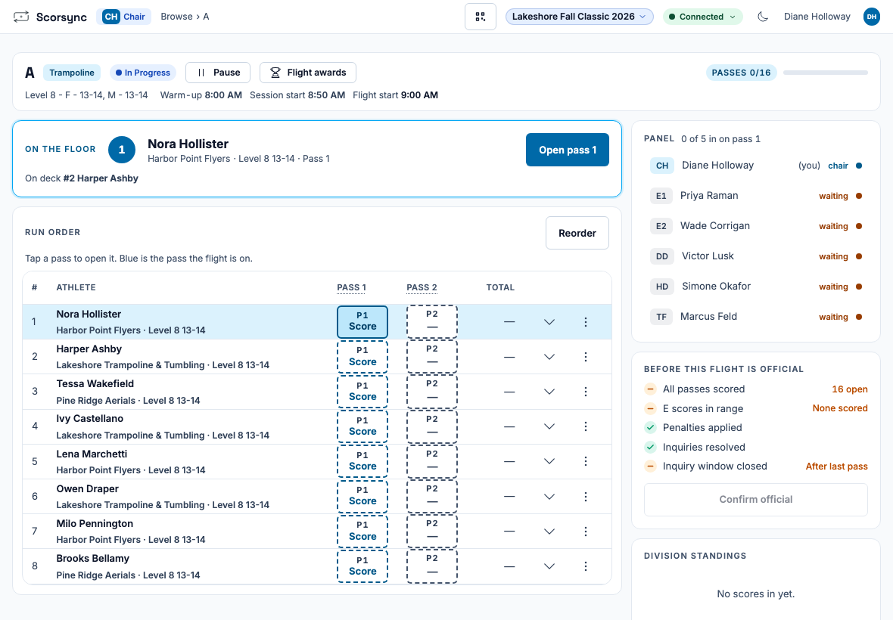
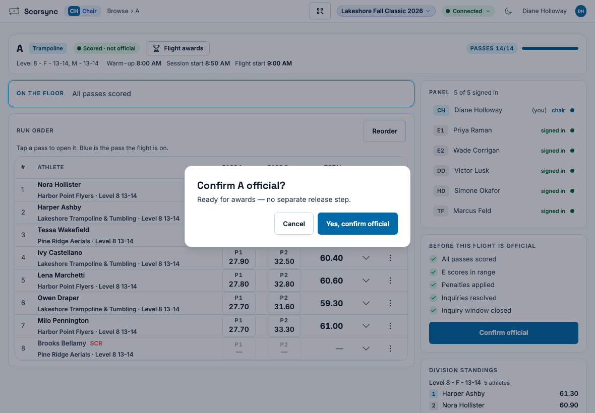
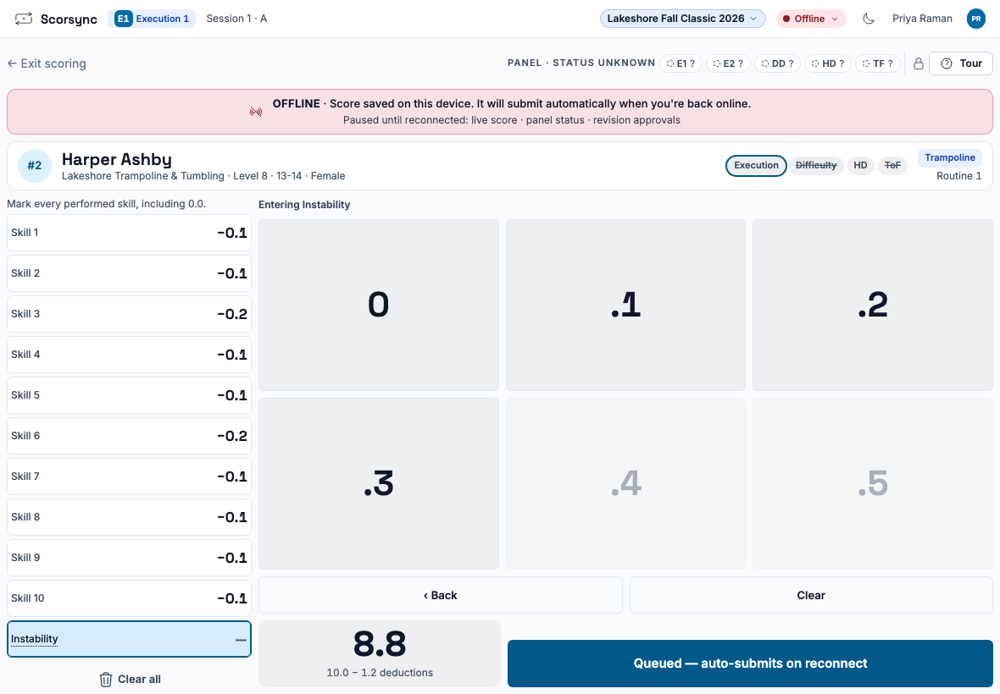

**Who it's for:** Host (meet director) and scoring table operator · Scorsync Cloud

Work down this page in order. Each step links to the full how-to. Print it and tick it off.

## Before you start

- Your meet is built in Meet Builder: sessions, flights, athletes and judges are in place.
- The venue has internet that every judge's tablet and the scoring table can use. On Scorsync Cloud, scoring runs over the internet at scoring.scorsync.com.

## A week before

<Steps>

1. Run a rehearsal with a couple of tablets, at the venue if you can. See [Rehearse your meet](/host/before-meet-day/rehearse/).

2. Print the judges' sign-in sheets, and the data-entry cards if a panel scores on paper. See [Print judge sign-in sheets and data-entry cards](/host/before-meet-day/print-judge-sign-in-sheets/).

</Steps>

## The day before

<Steps>

1. Lock the schedule. See [Lock the schedule](/host/before-meet-day/lock-the-schedule/).

2. Print a paper backup for each flight. Go to **Manage** → **Sessions**, open the session, and select **Start list PDF** and **Score sheet PDF** on each flight's row. See [Print start lists and paper backup score sheets](/host/before-meet-day/print-start-lists/).

   

3. If your meet will publish to scorsync.com, connect it and turn on publishing. See [Connect your meet to scorsync.com](/host/before-meet-day/connect-to-scorsync-com/).

</Steps>

## Morning of

<Steps>

1. Sign in at scoring.scorsync.com on the scoring-table laptop, and open Meet Control.

2. Sign each judge in. See [Get judges signed in and scoring](/scoring-table/get-judges-signed-in/).

3. In Meet Control, open **Build readiness** and select **Go live**. See [Go live](/host/before-meet-day/go-live/).

4. Select **Yes, go live**. The schedule locks.

   

5. Check that Run says "The floor is idle". That's expected: the session starts with the first score.

   

</Steps>

## Each session

<Steps>

1. The chair selects **Open Flight**, then **P1 Score** next to the first athlete. The judges' tablets follow by themselves. See [Start a session](/scoring-table/start-a-session/).

   

2. Watch the session from **Run**.

3. Scratch athletes and answer requests as they come. See [Scratch an athlete](/host/meet-day-changes/scratch-an-athlete/) and [Approve or reject requests](/host/meet-day-changes/approve-requests/).

4. If a panel scores on paper, its data-entry judge keys the sheets. See [Key scores as a data-entry judge](/scoring-table/key-scores/).

5. When the flight ends, the chair selects **Confirm official**, then **Yes, confirm official**. See [Confirm a flight official](/judges/chair/confirm-flight-official/).

   

6. For a division the chair didn't confirm, such as a paper panel's, use Finalize. See [Mark divisions official](/scoring-table/mark-divisions-official/).

</Steps>

At Level 8, the chair is asked to **Advance Anyway** for every athlete, because some judges have nothing to score. See [Get judges signed in and scoring](/scoring-table/get-judges-signed-in/#at-level-8).

## When something goes wrong

**A judge's tablet loses the Wi-Fi.** The judge keeps scoring. Their tablet says "Score saved on this device", and the score sends by itself when the Wi-Fi comes back. Meanwhile the chair sees that judge as "Waiting". See [Score when the Wi-Fi drops](/judges/score-when-wifi-drops/).

**The venue internet drops for everyone.** Judges' tablets hold their scores, but the chair, data entry and Meet Control can't send anything until it's back. If it lasts, switch to the paper score sheets, and contact Scorsync support (support@scorsync.com).

:::review[Needs Austin's review: a venue-wide outage on Scorsync Cloud]
What we tell Scorsync Cloud hosts to do when the venue internet goes down for everyone (how long to wait, when to switch to paper, and how paper scores get back in) isn't decided. This entry is a draft, and wasn't tested on the bench.
:::

**A panel is stuck, or a judge has to leave.** See [Free a stuck panel or nudge a station](/scoring-table/free-a-stuck-panel/) and [Replace a judge mid-meet](/scoring-table/replace-a-judge/).

**Scores aren't on scorsync.com.** See [Watch publishing on the Sync Rail](/scoring-table/watch-publishing/).

For anything else, see [Troubleshooting](/help/troubleshooting/), or contact support.

## End of day

<Steps>

1. In Finalize, check that every division is **Official**. See [Mark divisions official](/scoring-table/mark-divisions-official/).

2. If your meet publishes to scorsync.com, check that the Sync Rail chip says **Online · live** and nothing is waiting to send. See [Watch publishing on the Sync Rail](/scoring-table/watch-publishing/).

3. Sign out of Meet Control on the scoring-table laptop.

</Steps>

## Related

- [Get judges signed in and scoring](/scoring-table/get-judges-signed-in/)
- [Mark divisions official](/scoring-table/mark-divisions-official/)
- [Watch publishing on the Sync Rail](/scoring-table/watch-publishing/)
- [Meet-day runbook: Scorsync Desktop](/runbook/scorsync-desktop/)
