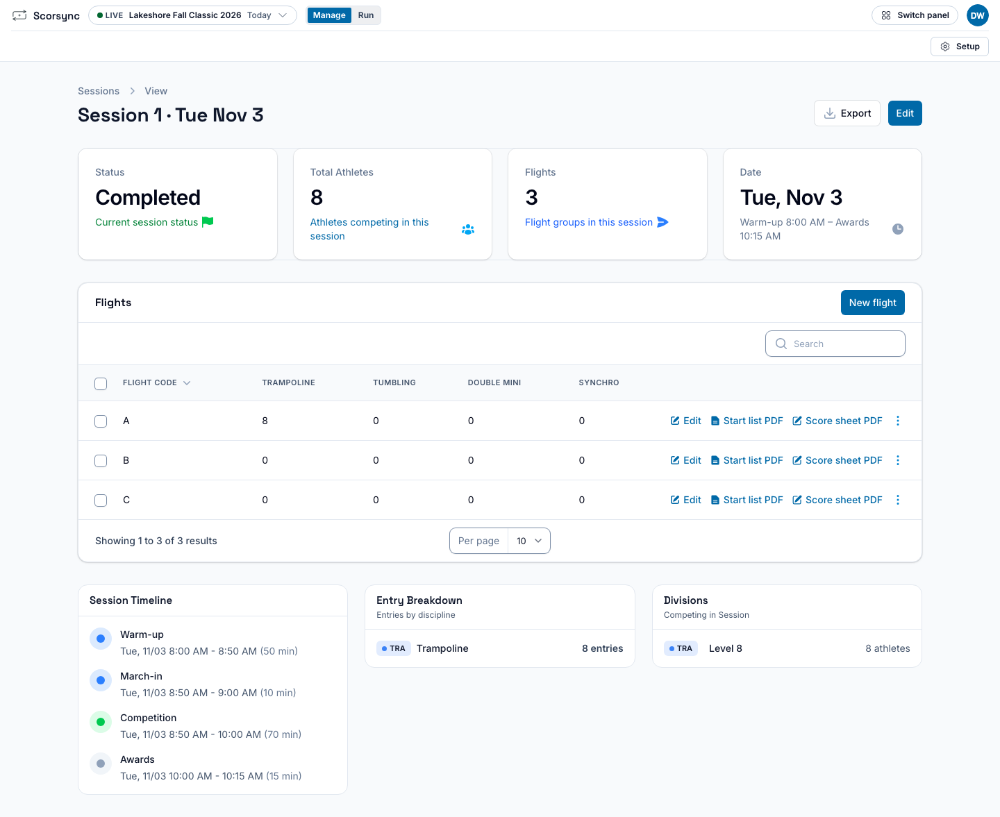
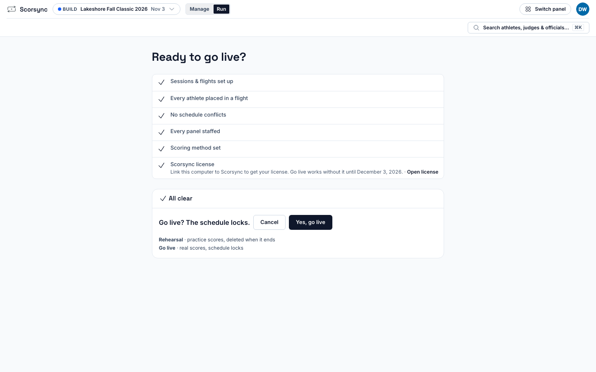
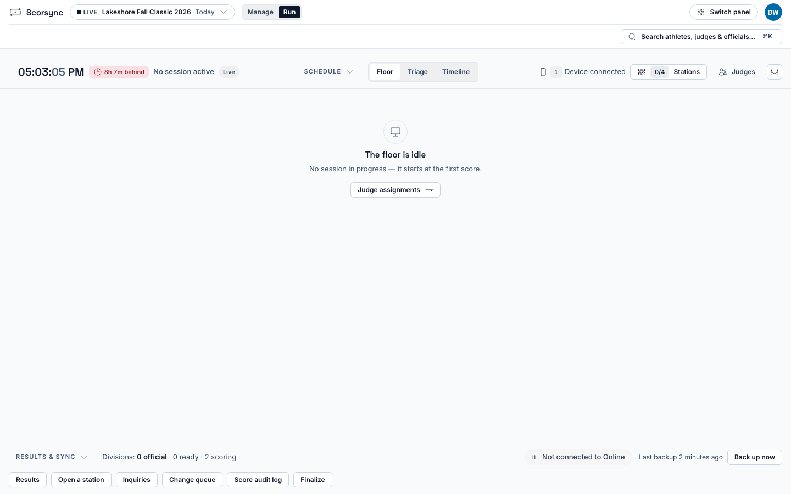
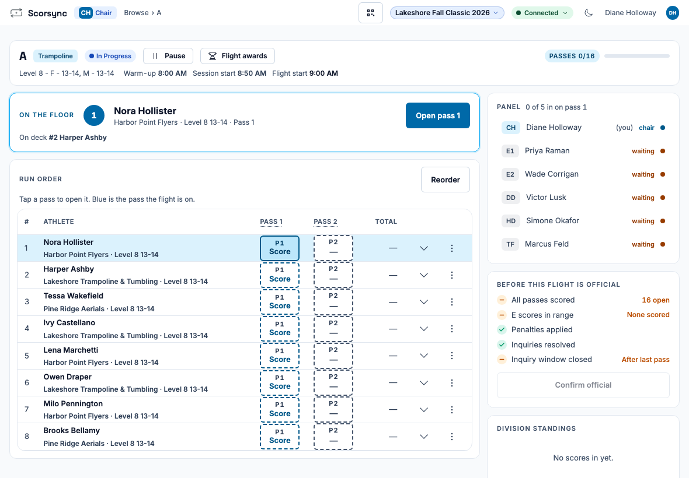
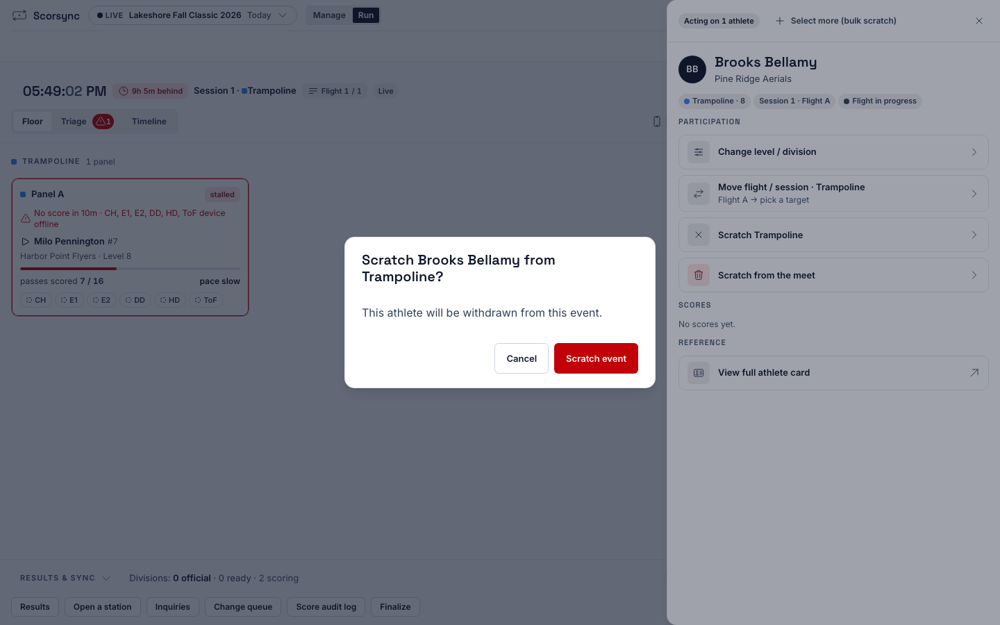
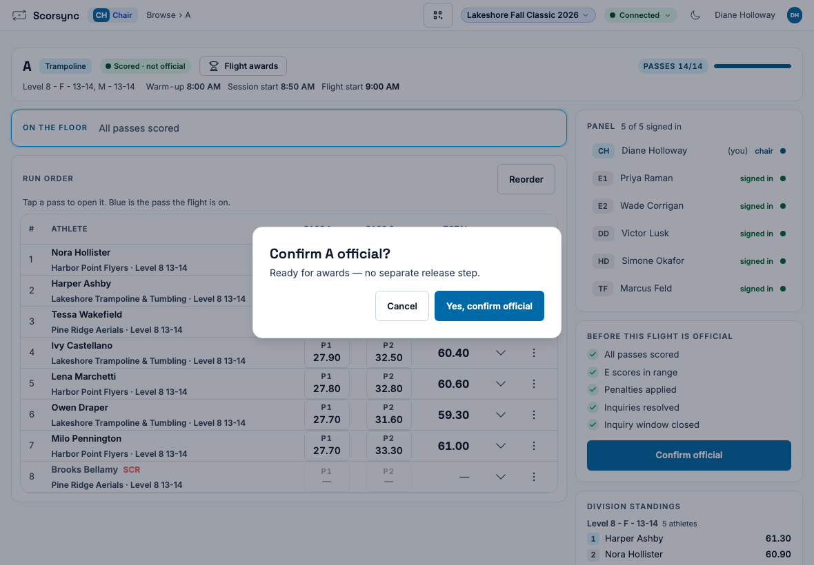
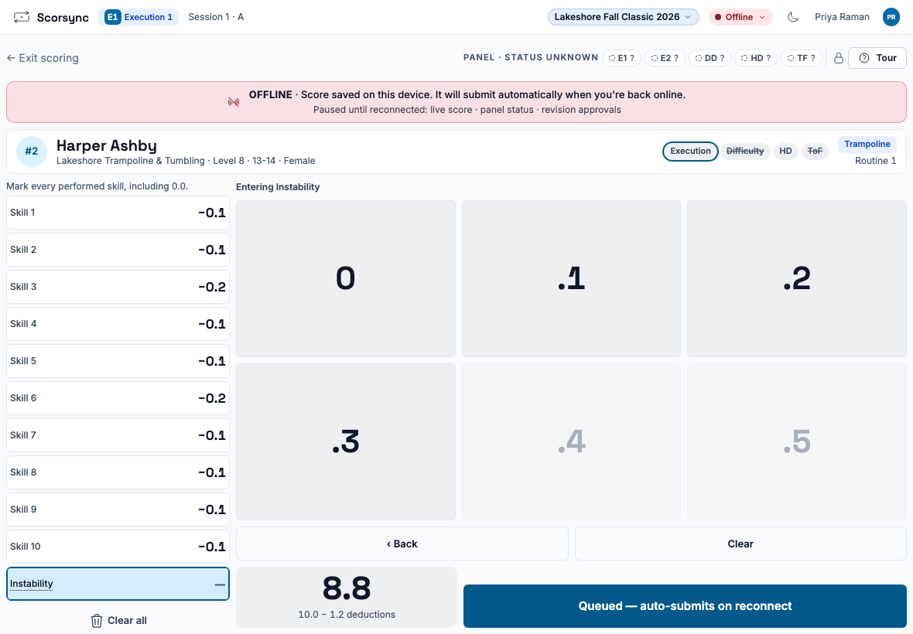
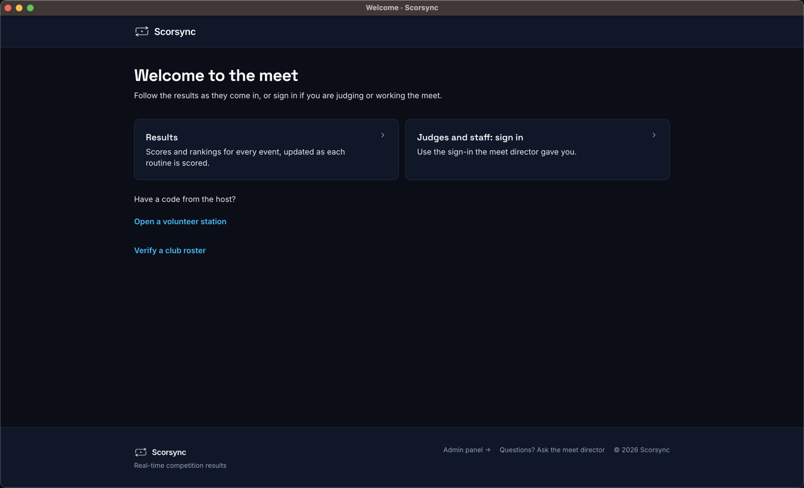
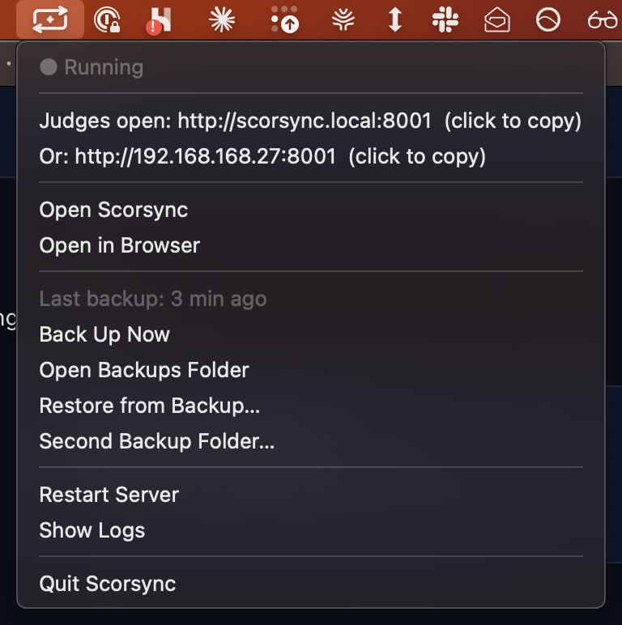
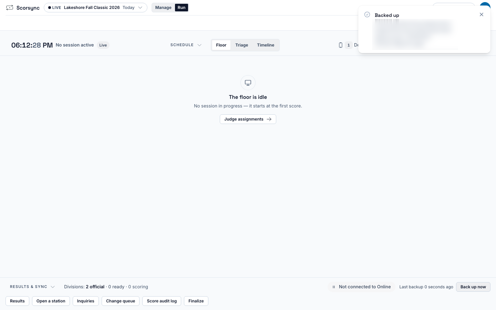

**Who it's for:** Offline host and scoring table operator · Scorsync Desktop

Work down this page in order. Each step links to the full how-to when there is one. Print it and tick it off.

## Before you start

- Your meet is built in Meet Builder. See [Build your meet in Meet Builder](/host/before-meet-day/build-your-meet/).
- You've set up the laptop and the travel router once already. See [Getting started with Scorsync Desktop](/offline-host/).

## A week before

<Steps>

1. If Scorsync told you a newer version is out, install it. See [Install a newer version](/offline-host/install-a-newer-version/).

2. In **Manage** → **Setup** → **License**, check the date after "Go live works without it until". If it's before your meet, link this computer while you have internet, or email support@scorsync.com with your meet date.

3. Set up the USB copy of every backup, and copy the key file. See [Back up your meet](/offline-host/backups/).

4. Run a rehearsal with a couple of tablets. See [Rehearse your meet](/host/before-meet-day/rehearse/).

5. Print the judges' sign-in sheets. See [Print judge sign-in sheets](/host/before-meet-day/print-judge-sign-in-sheets/).

</Steps>

:::review[Needs Austin's review: the license date]
On the test run, Go live worked without a license for 30 days from first run. What we tell hosts about license codes, linking and how early to install isn't settled; step 2's wording is a draft, and linking hasn't been tried end to end.
:::

## The day before

<Steps>

1. Lock the schedule. See [Lock the schedule](/host/before-meet-day/lock-the-schedule/).

2. Print a paper backup for each flight. Go to **Manage** → the gear (**Setup**) → **Structure** → **Sessions**, open the session, and select **Start list PDF** and **Score sheet PDF** on each flight's row.

   

3. If your meet will publish to scorsync.com, connect it now, while you have internet. See [Connect your meet to scorsync.com](/host/before-meet-day/connect-to-scorsync-com/).

4. Pack the laptop, its power cable, the travel router, a power strip and the UPS if you have one.

</Steps>

:::tip
The score sheet has one score line per athlete. For a two-routine flight, print two copies: one per routine.
:::

## Morning of

<Steps>

1. Plug the router and the laptop into mains power. Check that sleep is off.

2. Join the laptop to the scoring Wi-Fi, and plug in the USB drive for backups.

3. Open Scorsync. Wait a few seconds for "Starting the server" to finish.

4. Click the Scorsync icon in the menu bar (on Windows, right-click it near the clock). Check it says **● Running**. Write both addresses on a card for the judges' table: the one after **Judges open** and the one after **Or**.

   

5. Run Network diagnostics from one judge's tablet. See [Check your network before the meet](/offline-host/check-your-network/).

6. Sign each judge in. See [Get judges signed in and scoring](/scoring-table/get-judges-signed-in/).

7. Select **Run**, then **Ready to go live?** in the blue bar, then **Go live**.

8. Select **Yes, go live**.

   

9. Check that Run says "The floor is idle". That's expected: the session starts with the first score.

   

</Steps>

:::danger[Never Quit Scorsync during the meet]
**Quit Scorsync** in the menu, and ⌘Q on a Mac, stop scoring for every judge within a second. Nothing asks you to confirm. If you need the screen for something else, close or minimise the Scorsync window instead.
:::

:::review[Needs Austin's review: closing the window]
The decided venue setup says to close the window instead of quitting. The walkthrough confirmed that a dark or locked screen doesn't stop scoring, but didn't test closing the window.
:::

Test closing the window at your rehearsal: check that a judge can still submit a score.

## Each session

<Steps>

1. The chair selects **Open Flight**, then **P1 Score** next to the first athlete. The judges' tablets follow by themselves.

   

2. Watch the session from **Run** on the laptop.

3. To scratch an athlete, press ⌘K in Run, type their name, and choose them. Then select **Scratch Trampoline** (or the event) and **Scratch event**. **Undo** works for about 10 seconds. See [Scratch an athlete](/host/meet-day-changes/scratch-an-athlete/).

   

4. When the flight ends, the chair selects **Confirm official**, then **Yes, confirm official**.

   

</Steps>

At Level 8, the chair is asked to **Advance Anyway** for every athlete, because some judges have nothing to score. See [Get judges signed in and scoring](/scoring-table/get-judges-signed-in/#at-level-8).

Before confirming, the chair waits until "Inquiry window closed" is ticked under "Before this flight is official". The app only reminds: **Confirm official** works before then. See [Confirm a flight official](/judges/chair/confirm-flight-official/).

:::rule[What the rulebook says]
The meet referee must be told about a possible inquiry within 5 minutes after the flight ends (or before awards). The written inquiry is due within 10 minutes of that.

**Source:** USA Gymnastics, *Development Program Code of Points: Trampoline* (2025–2029), Section 4, Rule 13.4, page 29.
:::

:::review
Rules statement. Also: in the app, the 5-minute inquiry window starts again after any correction or ruling, so a reopened flight shows another 5 minutes. The app advises waiting but doesn't enforce it. Not yet signed off.
:::

## When something goes wrong

**A judge's tablet loses the Wi-Fi.** The judge keeps scoring. Their tablet says "Score saved on this device", and the score sends by itself when the Wi-Fi comes back. Meanwhile the chair sees that judge as "Waiting", like a slow judge. See [Score when the Wi-Fi drops](/judges/score-when-wifi-drops/).

**Every judge drops at once.** The travel router lost power, or someone quit Scorsync, or the laptop slept or restarted.

<Steps>

1. Check the travel router has power and its Wi-Fi light is on. If it restarted, wait a minute for the tablets to rejoin the scoring Wi-Fi.

2. Check the Scorsync icon says **● Running**. If there's no icon, open Scorsync again. It's ready in under 10 seconds. Judges stay signed in, and scores saved on their tablets send by themselves.

3. If the Scorsync window shows "Welcome to the meet", select **Admin panel** at the bottom, and sign in again.

   

4. Click the Scorsync icon, and check the address after **Judges open** is the same as on your card.

</Steps>

**The address changed after you reopened Scorsync**, for example `:8001` instead of `:8000`. Each judge opens the new address (they stay signed in). A score a judge saved on their tablet while Scorsync was closed doesn't send from the new address: the judge tells the chair the mark, and the chair enters it. See [Move on when a judge hasn't submitted](/judges/chair/move-on-missing-judge/).

**A tablet can't open the judges' address.** Type the second address from your card, the one after **Or** (all numbers). The QR codes only hold the first address.

**The tablets can't score for more than a few minutes.** Switch to the paper score sheets you printed the day before, and contact support.

For anything else, see [Troubleshooting](/help/troubleshooting/), or contact support.

## End of day

<Steps>

1. In **Finalize**, check that every division is **Official**. See [Mark divisions official](/scoring-table/mark-divisions-official/).

2. In Run, select **Back up now** (bottom right). Scorsync also backs up by itself every 5 minutes.

   

3. Open the USB drive and check that a file named `scorsync-` followed by today's date is there. Take the USB drive home separately from the laptop.

4. If your meet publishes to scorsync.com, select the Sync Rail chip, and leave Scorsync open until **Waiting on this device** is 0. No internet at the venue? At home, open Scorsync on your home Wi-Fi and leave it open until the chip says **Online · live** and **Waiting on this device** is 0. See [Score with no internet](/offline-host/score-without-internet/).

5. Close the Scorsync window. You don't need to Quit. If you want to, select **Quit Scorsync** only after Finalize shows every division Official and **Waiting on this device** is 0.

</Steps>

## Related

- [Getting started with Scorsync Desktop](/offline-host/)
- [Get judges signed in and scoring](/scoring-table/get-judges-signed-in/)
- [Backups](/offline-host/backups/)
- [Meet-day runbook: Scorsync Cloud](/runbook/scorsync-cloud/)
