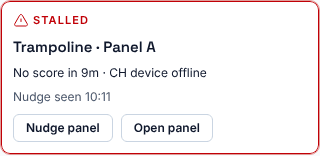
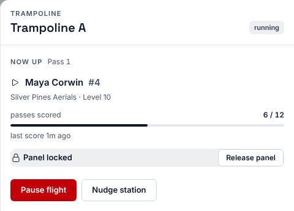
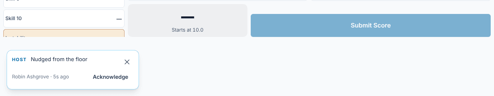
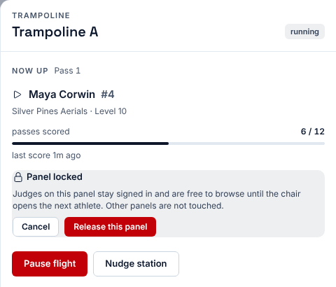
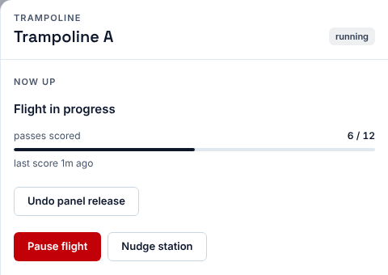

**Who it's for:** Scoring table operator and host · Scorsync Cloud and Scorsync Desktop

Use this when a panel has stopped scoring. Try a nudge first. Release the panel only when the chair can't move it on.

Panel waiting for one judge's score? See [Move on when a judge hasn't submitted](/judges/chair/move-on-missing-judge/) instead.

## Before you start

- You're signed in to Meet Control as the host or a scoring table operator.
- The meet is live, and the panel has an athlete on the floor.

## Spot a stuck panel

After 7 minutes with no score, the panel's card in Run turns red and says "stalled", with "No score in …". Triage lists it under **Needs you**, with the likely reason, such as "CH device offline".

Before you change anything, look at the panel. The athlete may still be warming up, or the chair may be dealing with an inquiry.

## Nudge the panel

A nudge puts a short message from you on every tablet of that panel. It changes nothing else.

<Steps>

1. In Run, select the panel's card. The panel drawer opens.

   

2. Select **Nudge station**. The drawer doesn't change: that's expected.

3. Check that the judges' tablets show a "Host" message: "Nudged from the floor", with **Acknowledge**.

   

4. In Triage, check the line under the panel: "Nudge sent", then "Nudge seen" when a tablet has shown it.

</Steps>

The message goes away when a judge selects **Acknowledge**, when the next score comes in, or after 10 minutes. You can also nudge from Triage with **Nudge panel**.

## Release a stuck panel

A panel stays on its athlete until the chair moves it on. If the chair's tablet died or the chair left, the panel is stuck. Releasing it frees the judges. It signs nobody out, and other panels aren't touched.

<Steps>

1. In Run, select the panel's card.

2. Next to **Panel locked**, select **Release panel**.

3. Read the message, then select **Release this panel**.

   

4. Check that the drawer says "Flight in progress" and shows **Undo panel release**. Judges stay where they are, but their tablets are no longer held on that athlete.

   

5. Get the chair signed in again on a working tablet. See [Get judges signed in and scoring](/scoring-table/get-judges-signed-in/). If the chair can't carry on, [replace the chair](/scoring-table/replace-a-judge/).

6. Ask the chair to select **Open Flight**. Their screen says "No athlete is up".

7. The chair selects the pass button (such as **P1 Score**) of the athlete who was up. Check that the drawer shows **Panel locked** and that athlete again.

</Steps>

:::tip
Released the wrong panel? Select **Undo panel release** straight away. It puts the panel back on the same athlete. It's there until the chair opens an athlete.
:::

## If something goes wrong

- **There's no Release panel button.** The panel isn't on an athlete, so there's nothing to release. Check the chair's tablet instead.
- **"This panel is not locked onto an athlete — there is nothing to release."** or **"The panel changed after the release. Nothing was restored."** The chair opened an athlete while you were looking. Close the drawer and open it again, then carry on from the chair's tablet.
- **Judges don't react to the nudge.** It only says "Nudged from the floor", not what you need. Walk over, or call the chair.
- **Every panel stalled at once.** It's probably the network or the laptop, not the panels. See [Troubleshooting](/help/troubleshooting/).

## Related

- [Replace a judge mid-meet](/scoring-table/replace-a-judge/)
- [Pause and resume a flight](/scoring-table/pause-and-resume/)
- [Move on when a judge hasn't submitted](/judges/chair/move-on-missing-judge/)
- [Score when the Wi-Fi drops](/judges/score-when-wifi-drops/)
