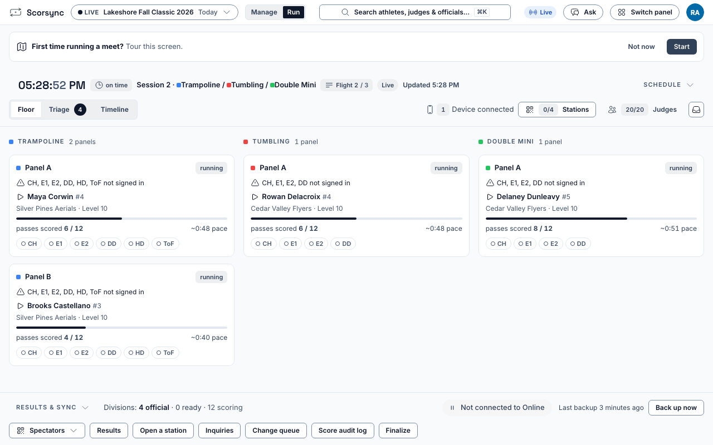
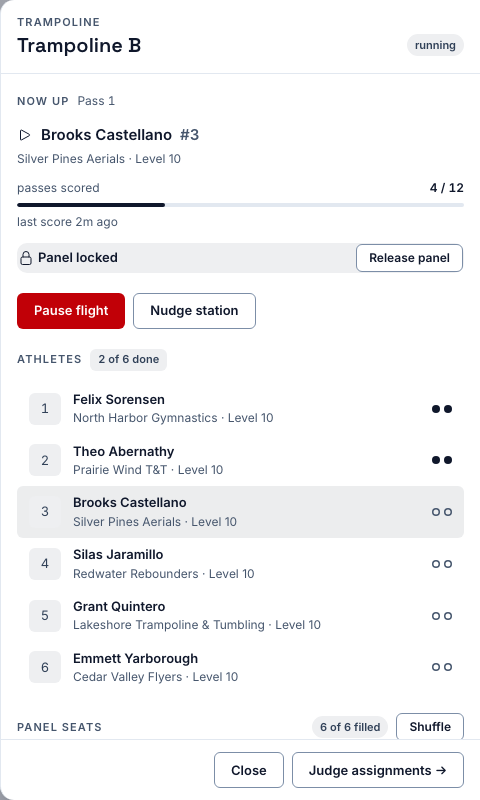
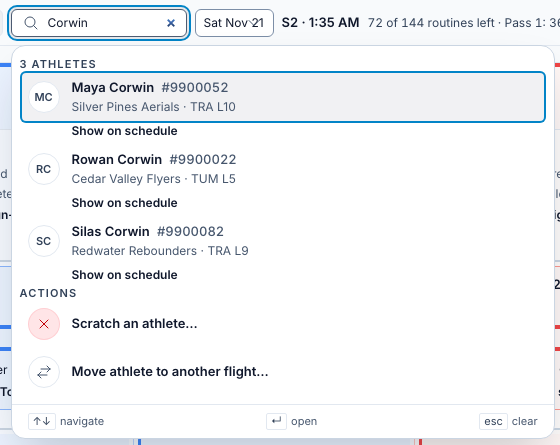

**Who it's for:** Scoring table operator and host · Scorsync Cloud and Scorsync Desktop

Start here if you'll watch the floor from Meet Control on meet day. Everything happens in the **Command Center** (it used to be called Run).

## The Command Center

| | What it is | Use it to |
| -- | -- | -- |
| 1 | The meet name | Check you're in the right meet, or switch meets. |
| 2 | **Manage** and **Command Center** | Stay on **Command Center** on meet day. **Manage** opens Meet Builder. |
| 3 | The middle of the top bar | See the meet clock, how far behind schedule you are, and the session and flight on the floor. |
| 4 | **Schedule**, **Triage**, **Timeline**, **Panels**, and the **Search athletes or gyms** box | Switch between the four views below, or find anyone. |
| 5 | A panel's name at the top of a Schedule column | Open the panel drawer. |
| 6 | The Results & Sync strip at the bottom | Open **Finalize**, **Print** or a station, and see whether scores are reaching scorsync.com. |

On the right of the top bar, **Go live** shows until the meet is live. After that, **To award** shows how many divisions are ready for awards.

## Take the tour

The first time a host opens the Command Center, a card says "First time running a meet? Tour this screen." Select **Start** for a short tour of the screen, or **Not now** to hide the card for good.

## The four views

| View | Shows | Use it when |
| -- | -- | -- |
| **Schedule** | The session as a table: a row for each flight, a column for each panel. Select a flight to see its athletes and marks. | You're watching the meet. It opens first. |
| **Triage** | Every panel in one table, and a **Needs you** list with **Nudge panel** and **Open panel** | The number next to Triage shows how many panels need you. |
| **Timeline** | Each panel's flights against the plan, with the projected finish | Someone asks if you're on time. |
| **Panels** | The whole day's judges, seat by seat, and **Station codes** | You seat a judge, or open a station tablet. The number shows empty seats. |

Each view has its own address, so you can bookmark the one you use most.

In **Schedule**, a problem shows on the panel's cell, such as "No score in 8m" or "Paused". If you're the host, select it to fix it there.

## The panel drawer

Once the session has started, select a panel's name at the top of its Schedule column to open its drawer. It shows who's up, the athletes in the flight and the panel's seats. **Pause flight**, **Nudge station** and **Release panel** are here too.

## Find anyone

Select **Search athletes or gyms** above the board (or press ⌘K on a Mac, Ctrl+K on Windows), and type a name. Select a result to open it. The same box offers actions such as **Scratch an athlete…**.

## What you'll do most

| I need to... | Go to |
| -- | -- |
| Sign the judges in | [Get judges signed in and scoring](/scoring-table/get-judges-signed-in/) |
| Know when the session starts | [Start a session](/scoring-table/start-a-session/) |
| Read a judge their PIN | [Show or reset a judge's PIN](/scoring-table/show-or-reset-a-pin/) |
| Stop the floor | [Pause and resume a flight](/scoring-table/pause-and-resume/) |
| A judge hasn't submitted and the chair can't move on | [Move on when a judge hasn't submitted](/judges/chair/move-on-missing-judge/) |
| Get a quiet or stuck panel moving | [Free a stuck panel or nudge a station](/scoring-table/free-a-stuck-panel/) |
| Put a different judge in a seat | [Replace a judge mid-meet](/scoring-table/replace-a-judge/) |
| Type in a panel's paper scores | [Key scores as a data-entry judge](/scoring-table/key-scores/) |
| Scratch, mark DNS, reorder or confirm official at the data-entry table | [Run the table as the data-entry judge](/scoring-table/run-the-table/) |
| Sign off divisions when the chair can't | [Mark divisions official](/scoring-table/mark-divisions-official/) |
| Check scores reach scorsync.com | [Check scores are reaching scorsync.com](/scoring-table/watch-publishing/) |
| Open a check-in, staging or awards desk tablet | [Open a station](/scoring-table/open-a-station/) |

## If something goes wrong

- **Schedule says "No session in progress — it starts at the first score."** That's normal until the first score of the session. See [Start a session](/scoring-table/start-a-session/).
- **Nothing happens when you select a panel's name.** The session hasn't started yet. The drawer opens after the first score.
- **There's no Finalize button.** Only the host and other admins of the organization see it. Ask the host.

## Related

- [Get judges signed in and scoring](/scoring-table/get-judges-signed-in/)
- [Meet-day changes](/host/meet-day-changes/)
- [Meet-day runbook: Scorsync Cloud](/runbook/scorsync-cloud/)
- [Meet-day runbook: Scorsync Desktop](/runbook/scorsync-desktop/)
