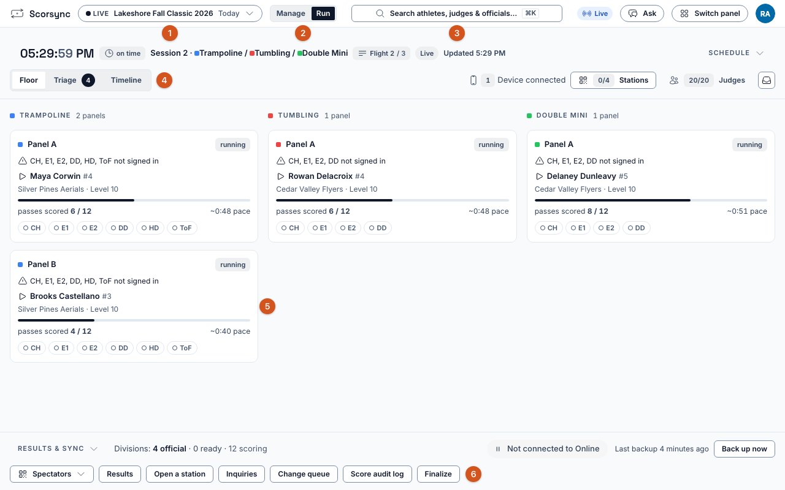
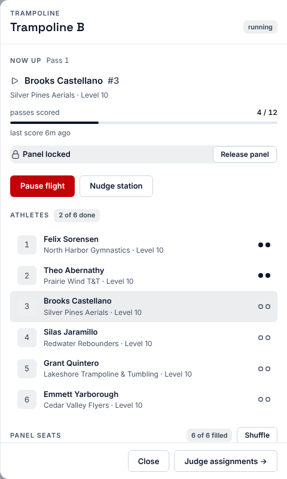
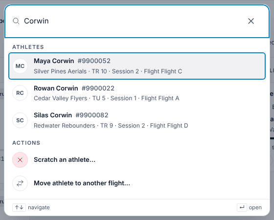

**Who it's for:** Scoring table operator and host · Scorsync Cloud and Scorsync Desktop

Start here if you'll watch the floor from Meet Control on meet day. Everything happens on the **Run** screen.

## The Run screen

| | What it is | Use it to |
| -- | -- | -- |
| 1 | The meet name | Check you're in the right meet, or switch meets. |
| 2 | **Manage** and **Run** | Stay on **Run** on meet day. **Manage** opens Meet Builder. |
| 3 | The search box, in the middle of the top bar | Find any athlete, judge or official. |
| 4 | **Floor**, **Triage**, **Timeline** | Switch between the three views below. |
| 5 | A panel card, one per panel | See who's up and how far the flight has got. Select it to open the panel drawer. |
| 6 | The Results & Sync strip | Open **Finalize**, and see whether scores are reaching scorsync.com. |

The top bar is one row. On a phone it takes two lines, and the search box shows as a magnifying-glass icon.

## Take the tour

The first time a host opens Run, a card above the floor says "First time running a meet? Tour this screen." Select **Start** for a short tour of the screen, or **Not now** to hide the card for good.

## The three views

| View | Shows | Use it when |
| -- | -- | -- |
| **Floor** | A card for each panel: the athlete up, passes scored, and each seat | You're watching the meet. |
| **Triage** | Every panel in one table, and a **Needs you** list with **Nudge panel** and **Open panel** | The number next to Triage shows how many panels need you. |
| **Timeline** | Each panel's flights against the plan, and the **Projected finish** | Someone asks if you're on time. |

Each view has its own address, so you can bookmark the one you use most.

## The panel drawer

Select a panel card to open its drawer. It shows who's up, the athletes in the flight and the panel's seats. **Pause flight**, **Nudge station** and **Release panel** are here too.

## Find anyone

Select the search box in the middle of the top bar (or press ⌘K on a Mac, Ctrl+K on Windows), and type a name. Select a result to open it. The same box offers actions such as **Scratch an athlete…**.

## What you'll do most

| I need to... | Go to |
| -- | -- |
| Sign the judges in | [Get judges signed in and scoring](/scoring-table/get-judges-signed-in/) |
| Know when the session starts | [Start a session](/scoring-table/start-a-session/) |
| Read a judge their PIN | [Show or reset a judge's PIN](/scoring-table/show-or-reset-a-pin/) |
| Stop the floor | [Pause and resume a flight](/scoring-table/pause-and-resume/) |
| A judge hasn't submitted and the chair can't move on | [Move on when a judge hasn't submitted](/judges/chair/move-on-missing-judge/) |
| Get a quiet or stuck panel moving | [Free a stuck panel or nudge a station](/scoring-table/free-a-stuck-panel/) |
| Put a different judge in a seat | [Replace a judge mid-meet](/scoring-table/replace-a-judge/) |
| Type in a panel's paper scores | [Key scores as a data-entry judge](/scoring-table/key-scores/) |
| Make divisions official | [Mark divisions official](/scoring-table/mark-divisions-official/) |
| Check scores reach scorsync.com | [Check scores are reaching scorsync.com](/scoring-table/watch-publishing/) |

## If something goes wrong

- **Run says "The floor is idle".** That's normal until the first score of the session. See [Start a session](/scoring-table/start-a-session/).
- **There's no Finalize button.** Only the host and other admins of the organization see it. Ask the host.

## Related

- [Get judges signed in and scoring](/scoring-table/get-judges-signed-in/)
- [Meet-day changes](/host/meet-day-changes/)
- [Meet-day runbook: Scorsync Cloud](/runbook/scorsync-cloud/)
- [Meet-day runbook: Scorsync Desktop](/runbook/scorsync-desktop/)
