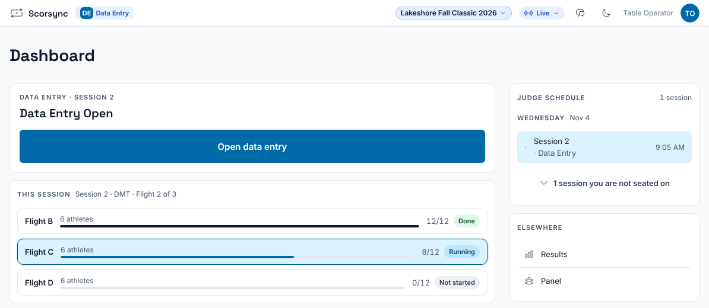
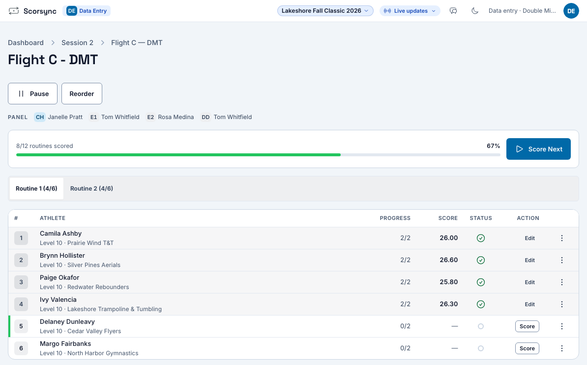
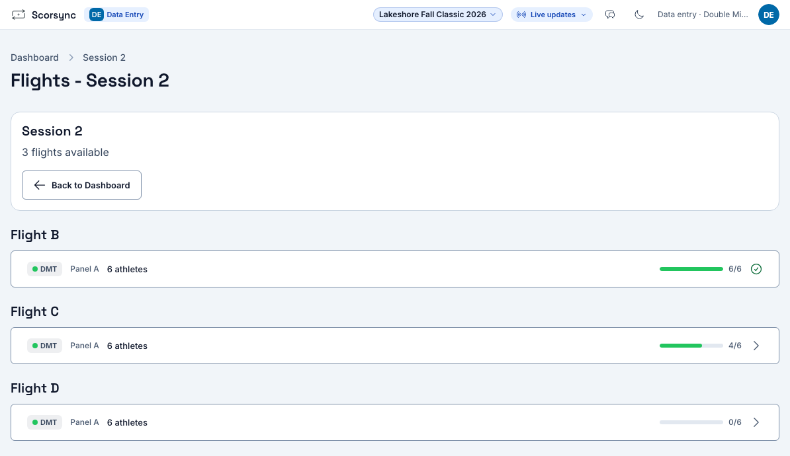
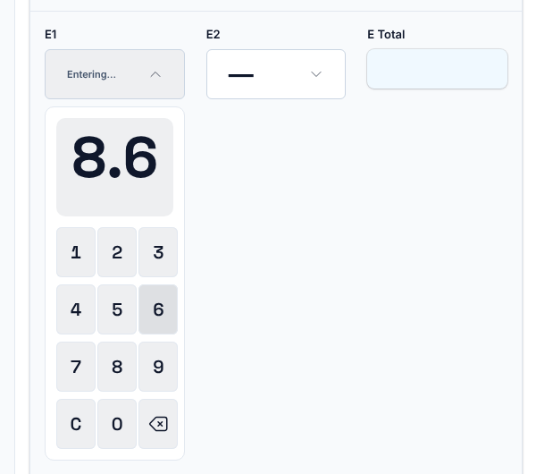
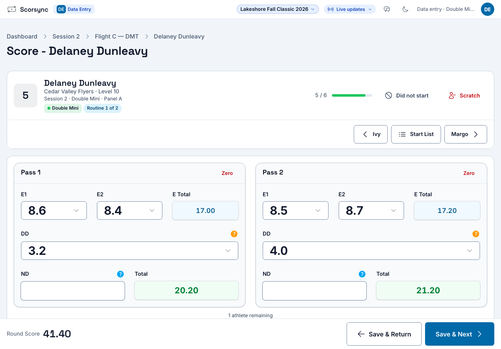
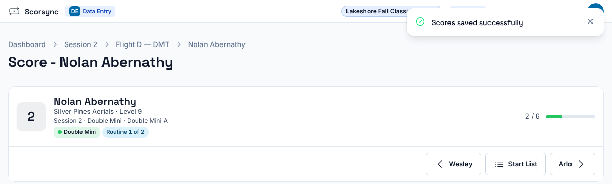

**Who it's for:** Data-entry judge at the scoring table · Scorsync Cloud and Scorsync Desktop

Use this page when a panel scores on paper and you type its marks into Scorsync. To scratch, mark DNS, change the order or confirm the flight official, see [Run the table as the data-entry judge](/scoring-table/run-the-table/).

## Before you start

- You have your data-entry card, with a **Username**, a **Password** and the **Sign in at** address. See [Print judge sign-in sheets and data-entry cards](/host/before-meet-day/print-judge-sign-in-sheets/).
- The host has set your panel to **Data entry**. Each panel has its own data-entry account, such as "Data entry · Trampoline A".
- You have the paper score sheets for the flight.

## Sign in and open your flight

<Steps>

1. On your tablet or laptop, open the address after **Sign in at** on your card.

2. Type the **Username** under **Email address** and the **Password** under **Password or PIN**, then select **Log in**.

3. On the **Dashboard**, under "Data Entry Open", select **Open data entry**. It opens the start list of your next flight that isn't finished.

   

4. Select **Score Next**. It opens the first athlete without a score.

   

</Steps>

To open another flight, select its row under **This session** on the Dashboard. When every flight is done, **Your flights** lists them all.

## Key an athlete's scores

<Steps>

1. Check the name and number at the top match the paper sheet.

2. Select the **E1** box and type the mark without the dot: the last digit is tenths, so `8` `6` is 8.6. A number pad opens next to the box.

   

3. Press **Enter** to move to the next box, and type the next mark. Fill in every box on the screen: **E1**, **E2**, **DD** and, if there is one, **ND**. The screen shows only the boxes that count at the athlete's level.

4. After the last box of Pass 1, press **Enter** again. It moves to Pass 2's **E1**. Key Pass 2 the same way.

5. Check **E Total** and **Total** against the paper. The **Round Score** shows at the bottom once every pass has marks.

   

6. Select **Save & Next**.

7. Check for "Scores saved successfully". The next athlete opens. If it says **Not saved — check the slip** instead, see [If something goes wrong](#if-something-goes-wrong).

   

</Steps>

The save button changes as you go:

| Button | When |
| -- | -- |
| **Save & Next** | You typed marks, and there's another athlete. |
| **Skip & Next** | Nothing is typed. Nothing is saved: Scorsync never saves a blank form. |
| **Save & Next:** with a name and **Pass 2** | The last athlete of Pass 1. It opens the first athlete again, on Pass 2. |
| **Save & Complete** | The last score of the flight. It opens the flight's **Review scores** list. |

If the paper gives a routine 0 (the athlete started and stopped), select **Zero** next to the pass name, confirm with **Zero Pass 1** (or the pass you're on), then save. Every mark becomes 0.

When the flight is done, check it against the paper and confirm it official. See [Run the table as the data-entry judge](/scoring-table/run-the-table/#check-the-flight-and-confirm-it-official).

## Fix a score you keyed

<Steps>

1. Select **Start List**, then **Edit** on the athlete's row. (On the **Review scores** list, select **Edit** on the row.)

2. Change the mark.

3. Select **Save & Return**. From the review list, the button reads **Save & Back to Review**.

4. Check the new **Score** in the list.

</Steps>

Once the flight is official, the athlete shows "Official · Results are official. Ask the meet host to correct a score." and you can't save. Reopen the flight first. See [Run the table as the data-entry judge](/scoring-table/run-the-table/#reopen-an-official-flight).

## If something goes wrong

- **"Not saved — check the slip".** Nothing was saved. The message names what to check, for example "Pass 2 is empty." or "Pass 1 has no E2.". Fix it against the paper, then save again. If the paper really is like that, select the same save button again: Scorsync stores the scores as entered and says "Scores saved as entered".
- **"Not saved — E scores out of range".** The E marks are further apart than the rules allow, for example "Pass 1: E scores span 1.2. The limit is 1.0.". Check the marks against the paper and fix any typing mistake. If the paper really says that, type why under **Reason to save anyway**, then save again.
- **"This athlete is marked DNS. Clear DNS to enter scores."** The athlete was marked Did not start. If they did compete, select **Clear DNS** in the "DNS: did not start" bar, then key the scores.
- **"QR code expired or invalid"** or **"QR code already used".** The QR code on a card works once, until the date printed under it. Sign in with the username and password instead.
- **"This QR code was replaced when the PIN was reset."** Someone gave the account a new password, so the old card stopped working. Use the new card, or ask the host to print one.
- **The Dashboard says "Waiting for Panel Activation", with no Open data entry button.** Your panel isn't set to Data entry yet. Ask the host.
- **"Offline" with "Nothing you change is sent until the connection is back."** Nothing was saved, but your marks stay on the screen. When the connection is back, select **Save & Next** again.
- **"The E2 field must not be greater than 10."** A mark was mistyped, often a stray tap on the open number pad. Select the box, select **C**, and type it again.
- **"Not saved — this athlete was changed on another screen".** Someone else saved this athlete. Check the scores now shown, then type your change again.
- **"Level 9 maximum DD is 3.7. Save again to store 3.7."** under the DD box (or another level and number). The DD you typed is above the level's maximum. Check it against the paper. If it's right, save. Scorsync stops once with **Not saved — check the slip**: save again to store the maximum.

:::rule[What the rulebook says]
In Double Mini, if a routine's difficulty is above the level's maximum (3.7 at Level 9), the maximum is the difficulty that counts.

**Source:** USA Gymnastics, *Development Program Code of Points: Double Mini* (2025–2029), Section 3, Rule 5.12.1, page 19; Rules 7.1.3 and 7.2.3, page 20.
:::

:::review
The E-range check now stops the save (scorsync PR 2653), and the data-entry account can save anyway with a reason (PR 2704). The limit comes from the app's execution-range rule, which this page doesn't cite. Confirm before this page ships.
:::

## Related

- [Run the table as the data-entry judge](/scoring-table/run-the-table/)
- [Mark divisions official](/scoring-table/mark-divisions-official/)
- [Print judge sign-in sheets and data-entry cards](/host/before-meet-day/print-judge-sign-in-sheets/)
- [Troubleshooting](/help/troubleshooting/)
