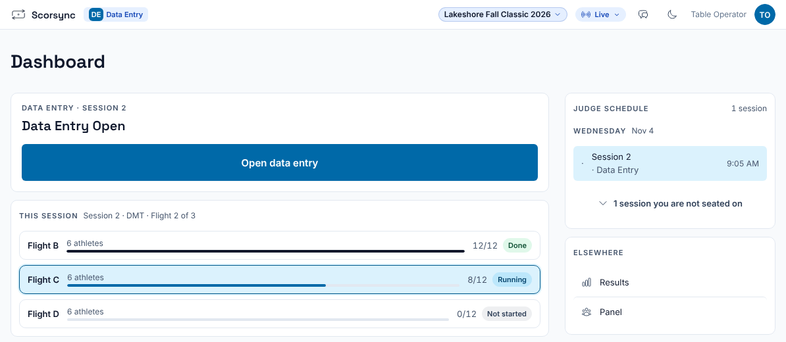
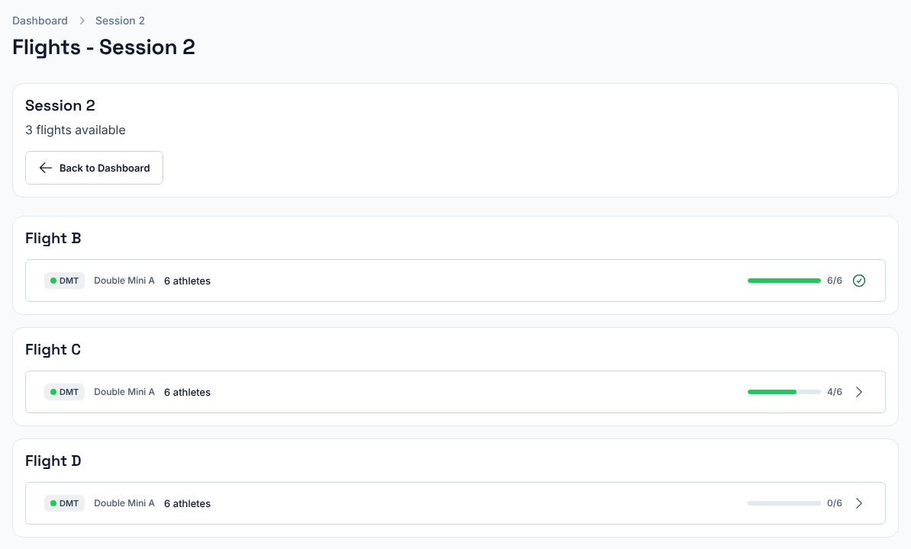
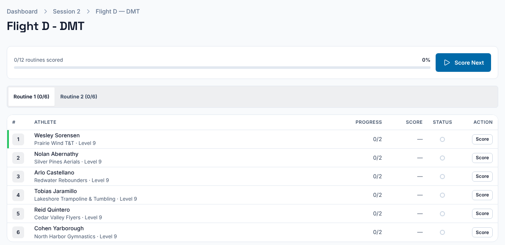
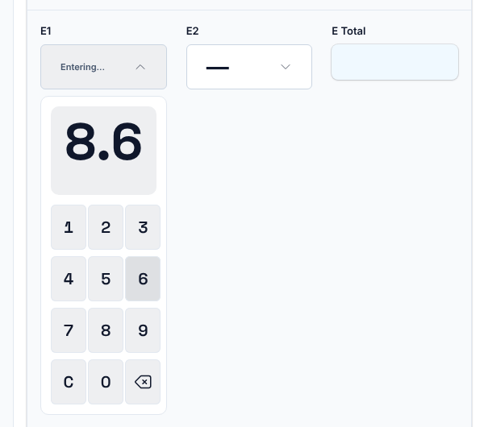
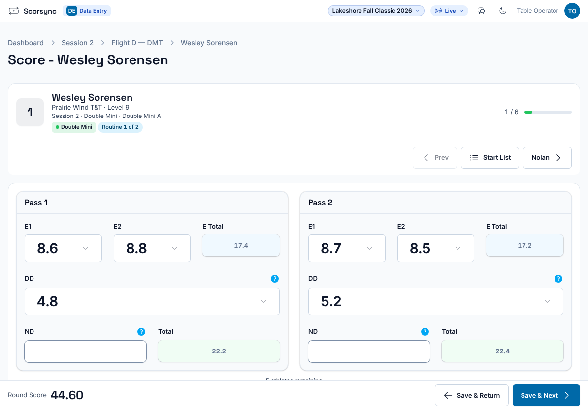
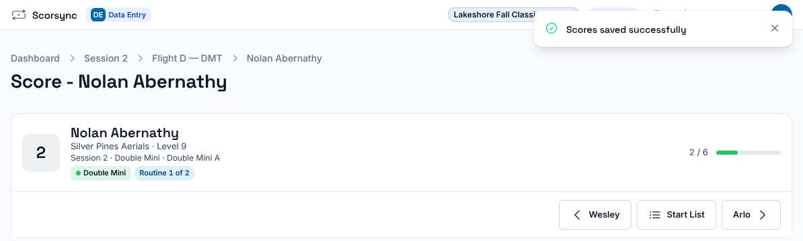
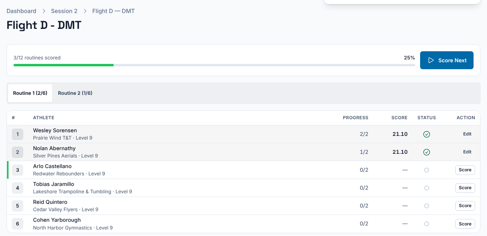

**Who it's for:** Data-entry judge at the scoring table · Scorsync Cloud and Scorsync Desktop

Use this page when a panel scores on paper and you type its marks into Scorsync.

## Before you start

- You have your data-entry card, with a **Username**, a **Password** and the **Sign in at** address. See [Print judge sign-in sheets and data-entry cards](/host/before-meet-day/print-judge-sign-in-sheets/).
- The host has set your panel to **Data Entry** and assigned it to you.
- You have the paper score sheets for the flight.

## Sign in and open your station

<Steps>

1. On your tablet or laptop, open the address after **Sign in at** on your card.

2. Type the **Username** under **Email address** and the **Password** under **Password or PIN**, then select **Log in**.

3. On the **Dashboard**, select **Open data entry**.

   

4. Select the row for the flight you're keying, for example Flight D, **DMT**, **Double Mini A**.

   

5. Select **Score Next**. It opens the first athlete without a score.

   

</Steps>

## Key an athlete's scores

<Steps>

1. Check the name and number at the top match the paper sheet.

2. Select the **E1** box and type the mark without the dot: the last digit is tenths, so `8` `6` is 8.6.

   

3. Press **Enter** to move to the next box, and type the next mark. Fill in every box the paper has a number for: **E1**, **E2**, **DD** and, if there is one, **ND**.

4. For the second pass or routine, select its **E1** box yourself. Enter doesn't jump there from the first **DD**.

5. Check **E Total** and **Total** against the paper.

   

6. Select **Save & Next**.

7. Check for "Scores saved successfully". The next athlete opens.

   

</Steps>

On the last athlete, the button reads **Save & Start Routine 2**, which takes you back to the first athlete. If you've keyed both passes for everyone, select **Save & Return** instead. When the whole flight is done, the button reads **Save & Complete**.

:::caution[Check every athlete has both passes]
If you press Enter after the first **DD** and keep typing, the digits go into that DD box, the second pass stays empty, and Scorsync still says "Scores saved successfully". After each save, check the start list: **Progress** should read 2/2, and the **Score** should match the paper. If not, select **Edit** on that athlete and fix it.

:::

## Fix a score you keyed

<Steps>

1. Select **Start List**, then **Edit** on the athlete's row.

2. Change the mark.

3. Select **Save & Return** (on the last athlete, it may read **Save & Complete**).

4. Check the new **Score** in the start list.

</Steps>

Once results are official, you can't change them: the athlete shows "Official · Results are official. Ask the meet host to correct a score." Tell the chair, who can reopen the flight. See [Reopen an official flight to fix a score](/judges/chair/reopen-official-flight/).

## If something goes wrong

- **"QR code expired or invalid."** The QR code on a card works only once, and only for 5 minutes after the card was made. Sign in with the username and password instead.
- **There's no Open data entry button.** Your panel isn't set to Data Entry yet, or isn't assigned to you. Ask the host.
- **"Offline. Nothing you tap is sent until the connection is back."** Nothing was saved, but your marks stay on the screen. When the connection is back, select **Save & Next** again.
- **"The E2 field must not be greater than 10."** A mark was mistyped, often a stray tap on the open number pad. Select the box, select **C**, and type it again.
- **"E scores span …, over the … tolerance."** Check the marks against the paper. It's a warning only: Scorsync saves what you typed.
- **"Not saved — this athlete was changed on another screen".** Someone else saved this athlete. Check the scores now shown, then type your change again.
- **After saving, the Score is lower than the Total you saw.** The DD you typed is above the level's maximum, and Scorsync saved the maximum, with no warning. Check the DD with the chair.

:::rule[What the rulebook says]
In Double Mini, if a routine's difficulty is above the level's maximum (3.7 at Level 9), the maximum is the difficulty that counts.

**Source:** USA Gymnastics, *Development Program Code of Points: Double Mini* (2025–2029), Section 3, Rule 5.12.1, page 19; Rules 7.1.3 and 7.2.3, page 20.
:::

## Related

- [Mark divisions official](/scoring-table/mark-divisions-official/)
- [Reopen an official flight to fix a score](/judges/chair/reopen-official-flight/)
- [Print judge sign-in sheets and data-entry cards](/host/before-meet-day/print-judge-sign-in-sheets/)
- [Troubleshooting](/help/troubleshooting/)
