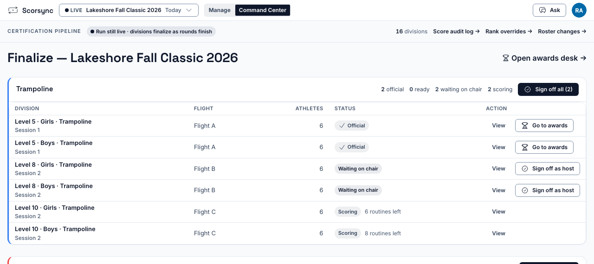
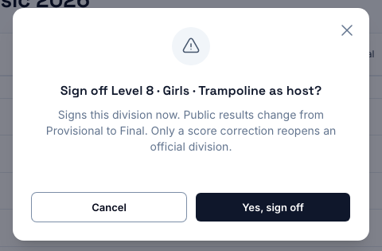
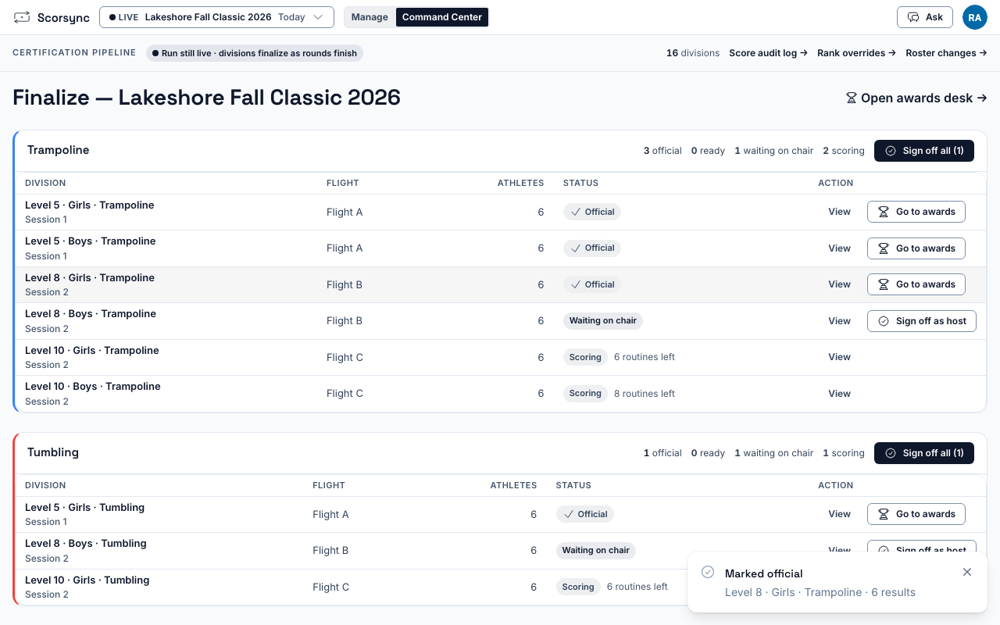

**Who it's for:** Host · Scorsync Cloud and Scorsync Desktop

Use this page when a division's scores are all in, but the chair hasn't signed it off, for example when the chair has left.

## Before you start

- You're a host of this meet, signed in with your own password. Only a host sees **Finalize**, and a PIN sign-in can't sign off.
- Every score in the division is in, and no inquiry is open.
- The inquiry time for the flight has passed (see the rule below).

## Sign off one division

<Steps>

1. In the **Command Center**, select **Finalize** in the Results & Sync strip at the bottom.

2. Find the division in its event's table. Its **Status** says **Waiting on chair**.

   

3. Select **View** to check the standings.

4. Select **Sign off as host** on the division's row.

5. Select **Yes, sign off**.

   

6. Check for "Marked official" and the division's name. Its status changes to **Official**, and the row shows **Go to awards**.

   

</Steps>

To sign off every waiting division of an event at once, select **Sign off all (N)** at the top of the event's table, then **Yes, sign off all**. Check for "Signed off", with how many were marked and skipped.

:::caution[Check the inquiry time first]
Finalize doesn't wait for the inquiry time. Only an open inquiry stops it. Sign off a division only once nobody can still ask for an inquiry on it.
:::

:::rule[What the rulebook says]
The meet referee must be told about a possible inquiry within 5 minutes after the flight ends (or before awards). The written inquiry is due within 10 minutes of that.

**Source:** USA Gymnastics, *Development Program Code of Points: Trampoline* (2025–2029), Section 4, Rule 13.4, page 29. The same in *Development Program Code of Points: Tumbling*, Section 4, Rule 6.4, page 27, and *Development Program Code of Points: Double Mini*, Section 4, Rule 10.4, page 26.
:::

## What each status means

| Status | What to do |
| -- | -- |
| **Not started** | Nothing yet. |
| **Scoring**, with "N routines left" | Wait for the last scores, or [key them](/scoring-table/key-scores/). |
| **Waiting on chair** | The chair signs it off. If they can't, select **Sign off as host**. |
| **Inquiry open** | Select **Go to inquiry**. The meet referee rules on it first. |
| **Ready to confirm** | Rare: every routine is signed, but the division isn't on the awards desk. Select **Confirm official**, type a **Reason**, then select **Yes, confirm official**. |
| **Official** | Nothing. Select **Go to awards** to present it. |

Awards don't wait for Official: the awards desk follows the divisions whose scores are all in. If the meet publishes, scorsync.com shows an official division's results as final. See [What families see on scorsync.com](/start-here/what-families-see/).

:::review
Awards start from scored divisions, not official ones (SCO-2547). Sign-off by the host is for when the chair can't. Check both are pilot policy.
:::

## If something goes wrong

- **There's no Finalize button.** Only a host of the organization sees it. Ask the host.
- **"Only a host of this meet, signed in with their own password, can confirm results official."** You signed in with a PIN or a code. Sign out, then sign in with your email and password.
- **"Scores changed since your confirm".** A score changed after you selected it. Check the division, then sign it off again.
- **A score is wrong after the division is official.** There's no button to undo official. The chair reopens the flight and fixes it. See [Reopen an official flight to fix a score](/judges/chair/reopen-official-flight/).

## Related

- [Confirm a flight official](/judges/chair/confirm-flight-official/)
- [Run the table as the data-entry judge](/scoring-table/run-the-table/)
- [Check scores are reaching scorsync.com](/scoring-table/watch-publishing/)
- [Meet-day runbook: Scorsync Cloud](/runbook/scorsync-cloud/)
