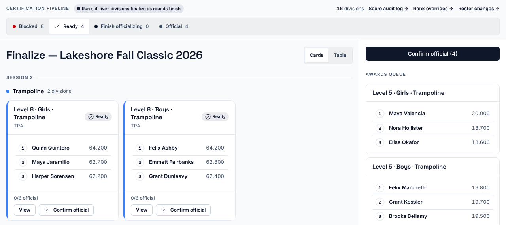
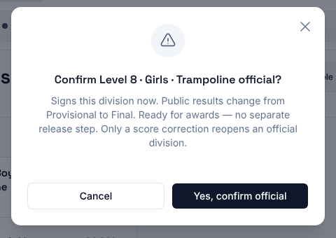
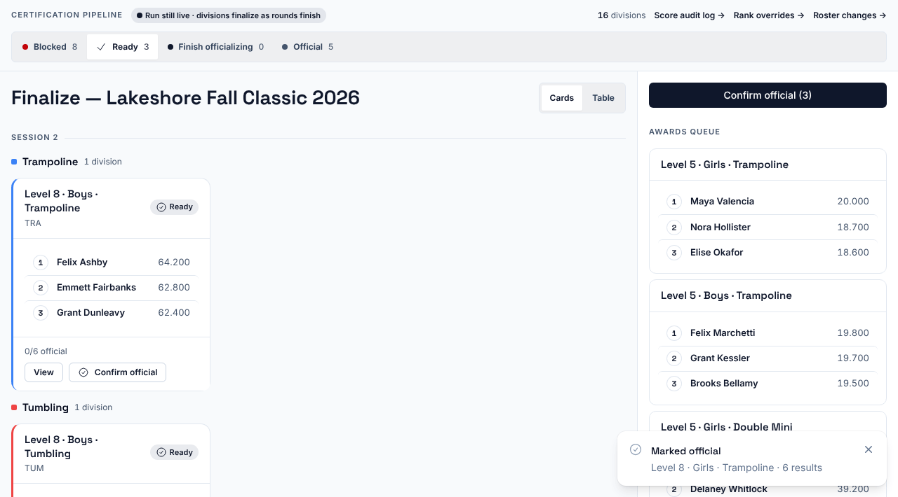

**Who it's for:** Host and scoring table operator · Scorsync Cloud and Scorsync Desktop

Use this page when a division's scores are all in and the chair hasn't confirmed it official, for example a panel that scored on paper.

## Before you start

- You're signed in to Meet Control as the host or another admin of your organization. Only they see **Finalize**.
- Every score in the division is in, and no inquiry is open.
- The inquiry time for the flight has passed (see the rule below).

## Confirm one division

<Steps>

1. In **Run**, select **Finalize** in the Results & Sync strip at the bottom.

2. At the top, select **Ready**. Only divisions you can confirm now are shown.

   

3. Check the top three on the division's card. Select **View** to see every athlete.

4. Select **Confirm official** on the card.

5. Select **Yes, confirm official**.

   

6. Check for "Marked official" and the division's name. It moves to **Official** and joins the **Awards queue** on the right.

   

</Steps>

To confirm every ready division at once, select **Confirm official (N)** at the top right, then **Yes, confirm all**. Blocked divisions are skipped. Check for "Officialization complete", with how many were marked and skipped.

:::caution[Check the inquiry time first]
Finalize doesn't wait for the inquiry time. Only an open inquiry stops it. Confirm a division only once nobody can still ask for an inquiry on it.
:::

:::rule[What the rulebook says]
The meet referee must be told about a possible inquiry within 5 minutes after the flight ends (or before awards). The written inquiry is due within 10 minutes of that.

**Source:** USA Gymnastics, *Development Program Code of Points: Trampoline* (2025–2029), Section 4, Rule 13.4, page 29. The same in *Development Program Code of Points: Tumbling*, Section 4, Rule 6.4, page 27, and *Development Program Code of Points: Double Mini*, Section 4, Rule 10.4, page 26.
:::

## What each status means

| Status | What to do |
| -- | -- |
| **Blocked**, "Waiting on scores" | Wait for the last scores, or [key them](/scoring-table/key-scores/). |
| **Blocked**, "Can't officialize — open inquiry with the referee" | The meet referee rules on the inquiry first. |
| **Ready** | Confirm it official. |
| **Finish officializing** | Part of the division is official already, for example one flight. Confirm the rest. |
| **Official** | Nothing. It's on its way to awards. |

If the meet publishes, scorsync.com shows the division's results as final. See [What families see on scorsync.com](/start-here/what-families-see/).

## If something goes wrong

- **There's no Finalize button.** Only the host and other admins of the organization see it. Ask the host.
- **"Scores changed since your confirm".** A score changed after you confirmed. Check the division, then select **Confirm official** again.
- **A score is wrong after the division is official.** There's no button to undo official. The chair reopens the flight and fixes it. See [Reopen an official flight to fix a score](/judges/chair/reopen-official-flight/).

## Related

- [Check scores are reaching scorsync.com](/scoring-table/watch-publishing/)
- [Confirm a flight official](/judges/chair/confirm-flight-official/)
- [Key scores as a data-entry judge](/scoring-table/key-scores/)
- [Meet-day runbook: Scorsync Cloud](/runbook/scorsync-cloud/)
