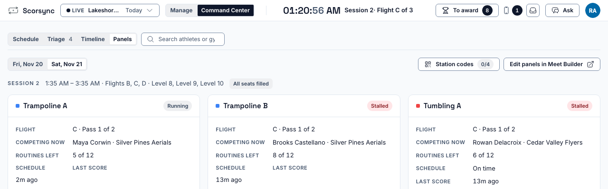
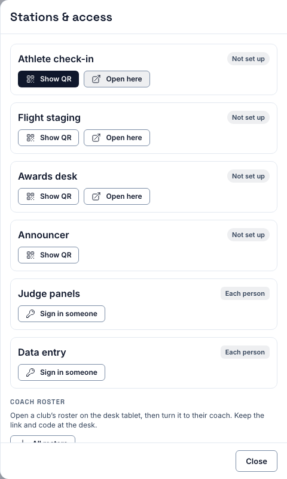
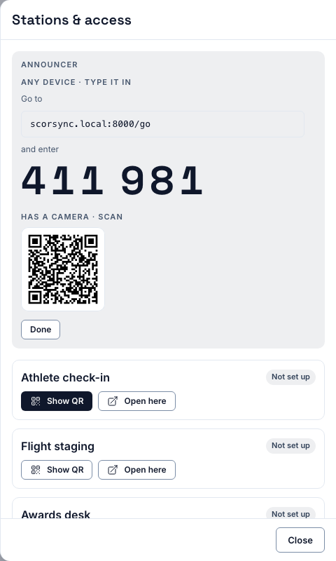
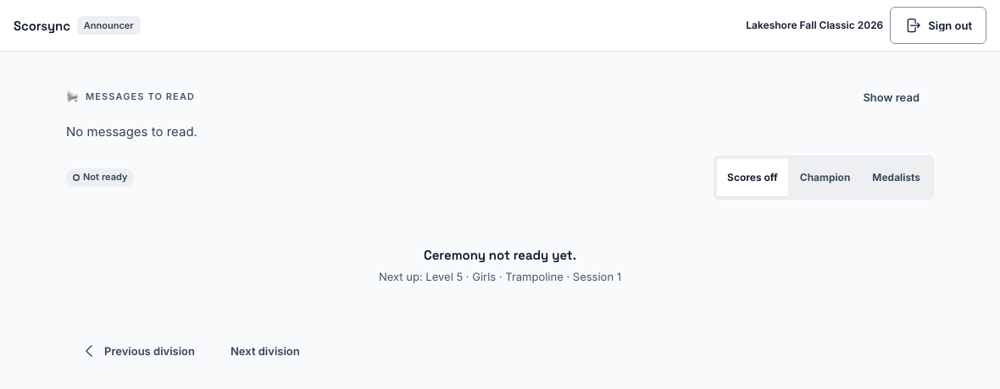
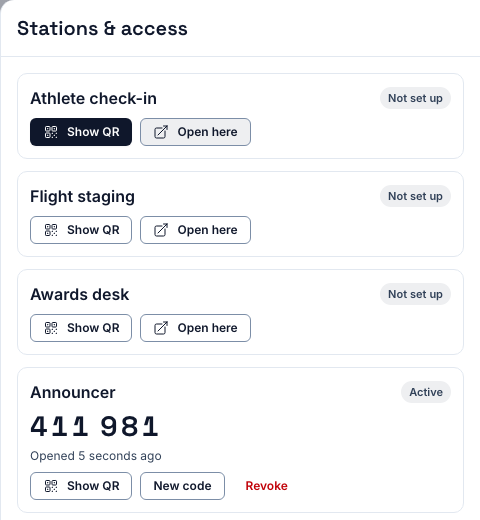

**Who it's for:** Host and scoring table operator · Scorsync Cloud and Scorsync Desktop

A station is a tablet for one meet-day job: **Athlete check-in**, **Flight staging**, **Awards desk** or **Announcer**. The volunteer on it doesn't need an account. They type the station's code once.

## Before you start

- You're signed in to Meet Control as the host.
- The station tablet is on the scoring Wi-Fi (Scorsync Desktop) or has internet (Scorsync Cloud).

## Steps

<Steps>

1. In the Command Center, select **Panels**.

   

2. Select **Station codes**. **Stations & access** opens, with a card for each station.

   

3. On the station's card, select **Show QR**. The window shows the station's 6-digit code, the address to type and a QR code.

   

4. On the station tablet, scan the QR code with the camera, or open the address and type the code under **Sign-in code**. Then select **Sign in**.

   

5. Check that the tablet shows the station's screen, and that its card in **Stations & access** says **Active**. Select **Done**.

   

</Steps>

On the laptop you're using, **Open here** opens the station's screen straight away.

:::caution
The code stays the same all meet. Keep it at the table. If it may have been seen by someone else, select **New code**: open tablets drop out, and the old code, link and QR stop working.
:::

## If something goes wrong

- **"This station was signed out. Type its code to open it again."** Select **Type the code**, and type the station's code.
- **"That code didn't work. Check the digits, or ask the meet host for a new one."** Check the code on the station's card.
- **The card says "Old code hidden · New code".** The station was set up before 6-digit codes. Its old link still works. For a code, select **New code**, then **New code** again to confirm.
- **A station must stop working.** Select **Revoke** on its card, then **Revoke station access**. The code, link and QR stop working and can't be restored.

## Related

- [Getting started at the scoring table](/scoring-table/)
- [Get judges signed in and scoring](/scoring-table/get-judges-signed-in/)
- [Meet-day runbook: Scorsync Cloud](/runbook/scorsync-cloud/)
