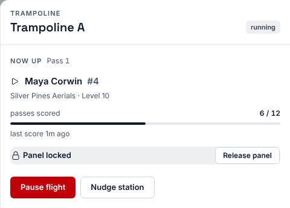
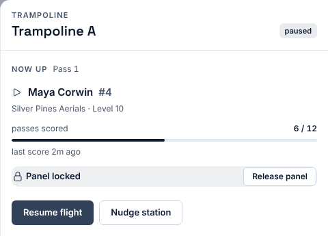
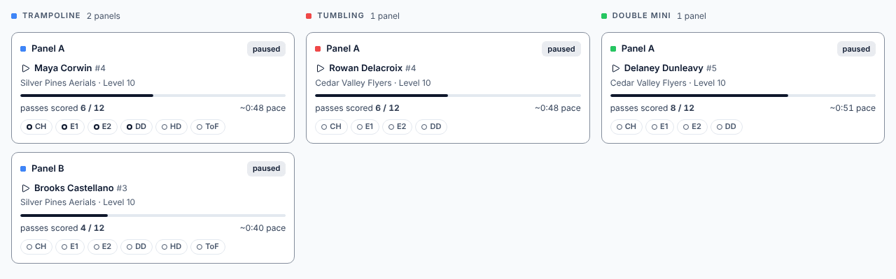
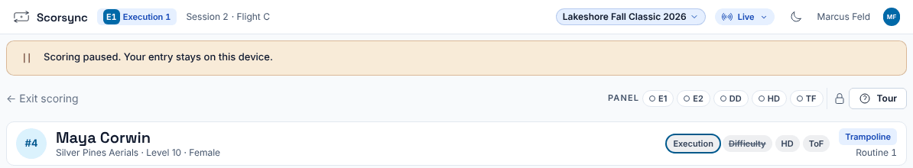
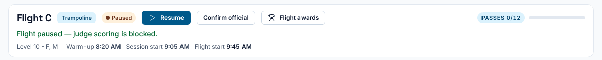

**Who it's for:** Scoring table operator, host and chair · Scorsync Cloud and Scorsync Desktop

Pause a flight when the floor has to stop, for example for an injury or a broken trampoline.

## Before you start

- The meet is live, or you're rehearsing. Pause doesn't work before that.
- You're signed in to Meet Control as the host or a scoring table operator. Or you're the chair, on your own tablet.

:::caution[Pause stops the whole flight]
A flight can run on several panels at once, such as Trampoline A, Trampoline B, Tumbling and Double Mini. Pausing it from one panel pauses every panel in that flight.
:::

## Pause from Run

<Steps>

1. In Run, select the panel's card. The panel drawer opens on the right.

   

2. Select **Pause flight**. Nothing asks you to confirm.

3. Check that the drawer now says "paused" at the top, and the button reads **Resume flight**.

   

4. Check the floor. Every card in that flight says "paused".

   

</Steps>

Judges' tablets show "Scoring paused. Your entry stays on this device." Judges can still enter marks, but **Submit Score** is refused until you resume. Nothing they typed is lost.

## Resume from Run

<Steps>

1. In Run, select one of the paused cards.

2. Select **Resume flight**.

3. Check that the cards say "running" again. Judges can submit straight away.

</Steps>

## Pause or resume from the chair's tablet

<Steps>

1. On the chair's tablet, select **Open Flight**.

2. Select **Pause** at the top, next to the flight's name.

3. Check that the screen says "Flight paused — judge scoring is blocked." and the button now reads **Resume**.

   

4. To carry on, select **Resume**. The screen says "Flight resumed — scoring is open."

</Steps>

## If something goes wrong

- **"Flight controls are only available while the meet is running or rehearsing."** The meet isn't live yet. See [Go live](/host/before-meet-day/go-live/).
- **"Flight could not be paused (already paused or completed)."** Someone else already paused it, or every athlete in the flight has been scored. Close the drawer and open it again to see the current state.
- **There's no Pause flight button in the drawer.** No flight is running on that panel, or your account can't control flights. A meet referee can't pause. Ask the host.
- **The chair has no Pause button.** The flight is finished or official.
- **A judge says "Scoring is paused" after you resumed.** Ask them to select **Submit Score** again. Their marks are still on the tablet.

## Related

- [Free a stuck panel or nudge a station](/scoring-table/free-a-stuck-panel/)
- [Replace a judge mid-meet](/scoring-table/replace-a-judge/)
- [Start a session](/scoring-table/start-a-session/)
- [Getting started at the scoring table](/scoring-table/)
