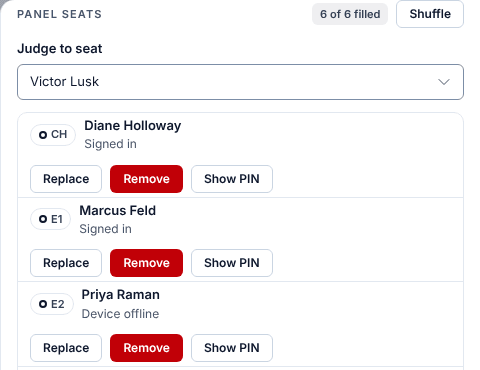
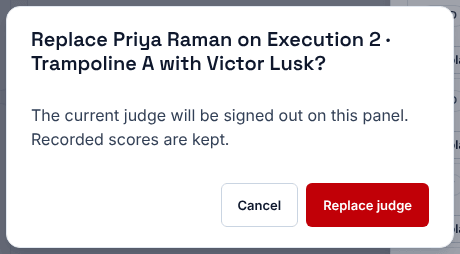
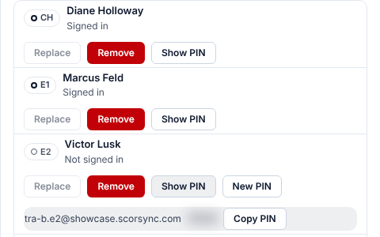
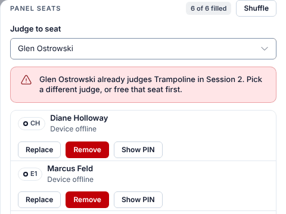

**Who it's for:** Scoring table operator, host and meet referee · Scorsync Cloud and Scorsync Desktop

Use this when a judge has to leave a panel during a session, or a seat has no judge.

## Before you start

- The decision to replace a judge has been made by the right people (see the rule below).
- The session has started: Run shows the panel's card. Before the first score, change seats in Judge Assignments.
- The new judge isn't on another panel in this session.

:::rule[What the rulebook says]
A judge who doesn't carry out their duties satisfactorily may be replaced. The Meet Referee decides, on the recommendation of the Chair of the Judges Panel, in consultation with the Meet Director, and the decision is documented with the T&T Technical Committee. The Meet Referee may also decide that the replaced judge's previous marks are replaced.

**Source:** USA Gymnastics, *Development Program Code of Points: Trampoline* (2025–2029), Section 2, Rule 1.3, page 7. Tumbling and Double Mini have their own version in Section 2 of their codes.
:::

:::review
Rules statement. Also: the app always keeps the replaced judge's recorded scores ("Recorded scores are kept"), while the rule allows their previous marks to be replaced. Not yet signed off.
:::

## Replace a judge

<Steps>

1. In Run, select the panel's card. The panel drawer opens.

2. Scroll down to **Panel seats**. Under **Judge to seat**, choose the new judge.

   

3. On the seat you're changing, select **Replace**.

4. Check the names in the question, then select **Replace judge**.

   

5. Check that the seat shows the new judge's name. The old judge's tablet stops scoring for this panel.

6. If the new judge needs to sign in, select **Show PIN** on their row and read them the email and PIN. See [Show or reset a judge's PIN](/scoring-table/show-or-reset-a-pin/).

   

7. Ask the chair to check that the new judge shows in the **Panel** list on their tablet.

</Steps>

## Other seat changes

| To | Do this |
| -- | -- |
| Empty a seat | Select **Remove** on the seat, then **Remove judge**. The seat shows "Seat empty". |
| Fill an empty seat | Choose the judge under **Judge to seat**, then select **+ Fill seat** on the empty seat. |
| Swap judges between seats on this panel | Select **Shuffle**, choose a judge for each seat, then select **Apply shuffle**. |
| Move a judge from another panel | First **Remove** them on their current panel, then fill or replace here. |

Removing, replacing or moving a judge signs them out of that seat. Scores they already gave are kept.

## If something goes wrong

- **"… already judges Trampoline in Session 2. Pick a different judge, or free that seat first."** A judge can sit on only one panel per session. Pick someone else, or remove them from the other panel first. The list under **Judge to seat** includes judges who are seated elsewhere.

  

- **"Choose a judge from the pool to fill the seat."** You selected **+ Fill seat** before choosing a judge. Choose one under **Judge to seat** first.
- **Replace is greyed out.** Choose a judge under **Judge to seat** first.
- **Two judges in the list have the same name.** Nothing on screen tells them apart. Check the email with **Show PIN** after you seat them, and use **Replace** again if it's the wrong person.
- **"A shuffle must keep at least one judge seated. Use Remove to clear a seat."** Leave at least one seat filled, or use **Remove**.
- **"Only an administrator or the meet referee can change panel seats."** Ask the host to make the change.

## Related

- [Show or reset a judge's PIN](/scoring-table/show-or-reset-a-pin/)
- [Free a stuck panel or nudge a station](/scoring-table/free-a-stuck-panel/)
- [Get judges signed in and scoring](/scoring-table/get-judges-signed-in/)
- [Move on when a judge hasn't submitted](/judges/chair/move-on-missing-judge/)
