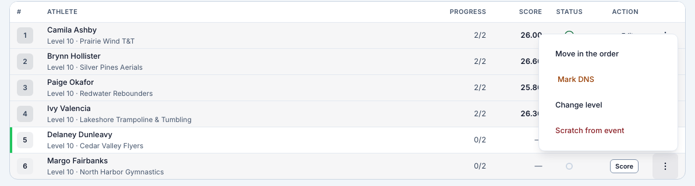
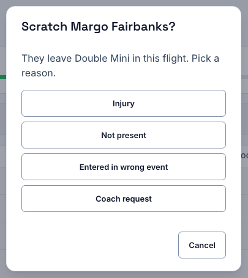
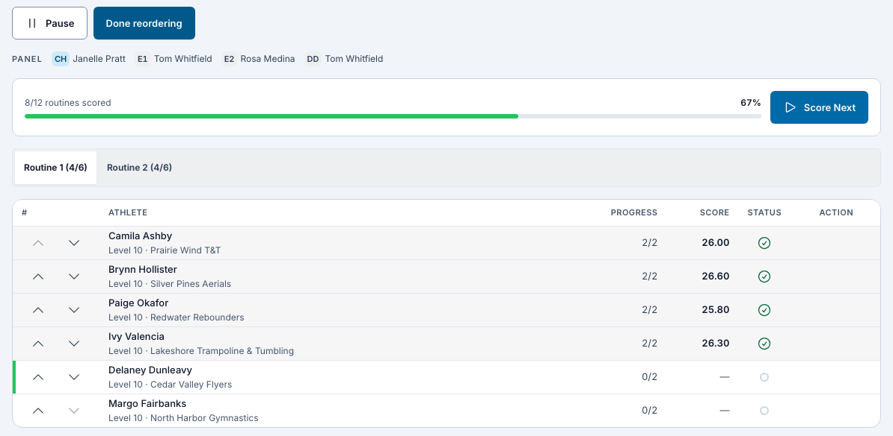

**Who it's for:** Data-entry judge at the scoring table · Scorsync Cloud and Scorsync Desktop

A data-entry panel has no chair on a tablet, so the data-entry account does the chair's jobs at the table. Everything here happens on the flight's start list or the athlete's scoring screen.

## Before you start

- You're signed in with your panel's data-entry account, and the flight's start list is open. See [Key scores as a data-entry judge](/scoring-table/key-scores/).
- The chair or the meet referee has told you what to change. You record their decision.

## Mark an athlete DNS

<Steps>

1. On the start list, select **⋮** on the athlete's row.

2. Select **Mark DNS**.

   

3. Select **Mark athlete DNS**.

4. Check the row now says "DNS".

</Steps>

On the athlete's scoring screen, **Did not start** does the same. Once a pass is saved, the athlete started, so **Mark DNS** is greyed out: fix the score instead.

To undo it, select **⋮** → **Clear DNS**, then **Clear athlete DNS**. On the scoring screen, select **Clear DNS** in the "DNS: did not start" bar.

:::rule[What the rulebook says]
Athletes must be ready at the time and in the order of the start list. For an extenuating circumstance, the chair (with the meet referee if needed) may let an athlete compete out of order; otherwise the athlete gets Did Not Start.

**Source:** USA Gymnastics, 2026–27 rule update (2026–27 Coaches T210, slide 6). The FIG rule it follows: *FIG Code of Points: Trampoline Gymnastics* (2025–2028), Part I, Rule 12.5, page 13.
:::

## Scratch or reinstate an athlete

<Steps>

1. On the start list, select **⋮** on the athlete's row, then **Scratch from event**. (On the scoring screen, select **Scratch**.)

2. Pick a reason: **Injury**, **Not present**, **Entered in wrong event** or **Coach request**.

   

3. Check for "… scratched (…)". The athlete moves to the end of the list with "Scratched" and the reason.

</Steps>

To put them back, select **⋮** on the scratched row, then **Reinstate athlete**. If the row says **Scratched from the meet**, only the host can put them back. See [Scratch an athlete](/host/meet-day-changes/scratch-an-athlete/).

## Change the run order

<Steps>

1. On the start list, select **Reorder** at the top.

2. Use the up and down arrows on the athlete's row.

   

3. Check for "Moved … in the order." Select **Undo** if it was the wrong athlete.

4. Select **Done reordering**.

</Steps>

## Change an athlete's level

<Steps>

1. On the start list, select **⋮** on the athlete's row, then **Change level**.

2. Under **Level**, choose the new level.

3. Select **Save level**.

4. Check for "… moved to … for this event."

</Steps>

## Check the flight and confirm it official

When the last score is saved, the start list shows "… complete" and opens **Review scores**: every routine in run order, laid out like the paper sheet.

<Steps>

1. Go down the list with the paper sheets. A row with a missing mark is flagged, such as "Missing E".

2. To fix a row, select **Edit**, change the mark, then select **Save & Back to Review**.

3. When every row matches the paper, select **Mark flight checked**. The flight shows **Checked**.

4. At the bottom, check the list "Before this flight is official". **All passes scored** and **Inquiries resolved** must be ticked.

5. Select **Confirm official**.

6. Select **Yes, confirm official**.

7. Check for "Flight confirmed official." and "Flight is official".

8. Select **Next flight: …**. After the last one, the screen says "All your flights are done".

</Steps>

**Flight results** shows the flight's standings. If you change a score after **Mark flight checked**, the flight needs checking again.

:::caution[Check the inquiry time first]
**Inquiry window closed** doesn't stop Confirm official. Confirm the flight only once nobody can still ask for an inquiry on it.
:::

:::rule[What the rulebook says]
The meet referee must be told about a possible inquiry within 5 minutes after the flight ends (or before awards). The written inquiry is due within 10 minutes of that.

**Source:** USA Gymnastics, *Development Program Code of Points: Trampoline* (2025–2029), Section 4, Rule 13.4, page 29.
:::

:::review
The data-entry account confirms and reopens flights at the table (scorsync PRs 2700 and 2704). Confirm this is the pilot policy before this page ships.
:::

## Reopen an official flight

<Steps>

1. Open the flight's start list. At the bottom, it says "Flight is official".

2. Select **Reopen results**.

3. Type a **Reason** if you have one, then select **Yes, reopen**. Results go back to Provisional, and the reopen shows on the public results.

4. Fix the score. See [Fix a score you keyed](/scoring-table/key-scores/#fix-a-score-you-keyed).

5. Confirm the flight official again.

</Steps>

## Pause the flight

Select **Pause** at the top of the start list. The flight shows **Paused**, and **Resume** opens it again. Pausing doesn't stop you keying scores. It stops judges on the flight's other panels, so use it only when the floor stops. See [Pause and resume a flight](/scoring-table/pause-and-resume/).

## If something goes wrong

- **There's no ⋮ on the rows, or no Reorder button.** You're not signed in with this panel's data-entry account. Sign in with the card for this panel.
- **Confirm official is greyed out.** **All passes scored** or **Inquiries resolved** isn't ticked. Key or mark DNS the missing passes, or wait for the meet referee's ruling.
- **"Meet is archived — results are frozen."** The meet is over and locked. Ask the host.

## Related

- [Key scores as a data-entry judge](/scoring-table/key-scores/)
- [Reorder, mark DNS or reinstate an athlete](/judges/chair/reorder-dns-reinstate/)
- [Confirm a flight official](/judges/chair/confirm-flight-official/)
- [Mark divisions official](/scoring-table/mark-divisions-official/)
