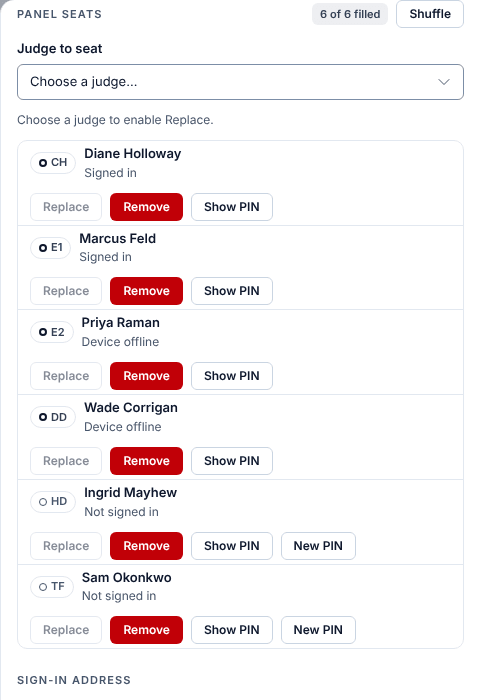
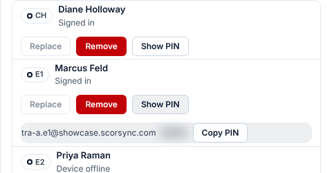
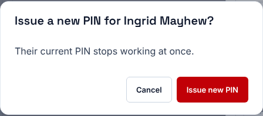

**Who it's for:** Scoring table operator and host · Scorsync Cloud and Scorsync Desktop

Use this when a judge forgot or lost their PIN or sign-in sheet, or their PIN may have been seen by someone else. Quickest fix for a judge at the desk: give them [a desk code](/scoring-table/get-judges-signed-in/#a-desk-code). Use this page if they need the PIN itself.

## Before you start

- You're signed in to Meet Control as the host or a scoring table operator. A meet referee can't see PINs.
- The judge's session has started. Before the first score, use Judge Assignments → **All credentials** instead (see below).

## Show a PIN

<Steps>

1. In Run, select the card of the judge's panel. The panel drawer opens.

2. Scroll down to **Panel seats**.

   

3. On the judge's row, select **Show PIN**.

4. Read the judge the email and the PIN under their row. They disappear after 60 seconds.

   

5. The judge signs in with that email and PIN. Check that their tablet shows their **Dashboard**.

</Steps>

## Give a judge a new PIN

A new PIN stops the old one working straight away. You can only do it while the judge is signed out, so the **New PIN** button shows only on rows that say "Not signed in".

<Steps>

1. In the panel drawer under **Panel seats** (or **All credentials** before the first score), on the judge's row, select **New PIN**. Don't select the red **Remove** button: it takes the judge off the seat.

2. Select **Issue new PIN**.

   

3. Read the judge the new PIN under their row. It also disappears after 60 seconds.

</Steps>

:::caution
Show PIN puts the PIN on your screen. Keep the screen turned away from the room, and select **Show PIN** only with the judge in front of you.
:::

## Before the session starts

Run has no panel cards until the first score. Until then, go to Judge Assignments → **All credentials**: it lists every judge's email and PIN, with **New PIN** and **Sign-in QR** on each row. You can also use a desk code. See [Get judges signed in and scoring](/scoring-table/get-judges-signed-in/).

## If something goes wrong

- **"A new PIN can only be issued for a judge who is not signed in."** The judge is still signed in on another seat at this meet. Use **Show PIN** instead.
- **"An admin signs in with their own password, so no PIN is issued for them."** That seat holds a host's account. They sign in with their own password.
- **Show PIN says "No PIN issued".** Select **New PIN** to give the judge one.
- **All credentials says "Expired: issue a New PIN or show a Sign-in QR".** Do one of those. This happens on Scorsync Cloud only.
- **All credentials says "Locked out of sign-in … after too many wrong PINs".** Check it's really the judge, then select **Unlock** on their row. This happens on Scorsync Cloud only.

## Related

- [Get judges signed in and scoring](/scoring-table/get-judges-signed-in/)
- [Replace a judge mid-meet](/scoring-table/replace-a-judge/)
- [Print judge sign-in sheets](/host/before-meet-day/print-judge-sign-in-sheets/)
