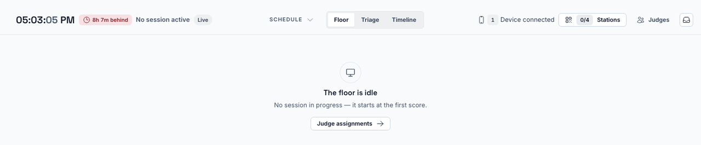
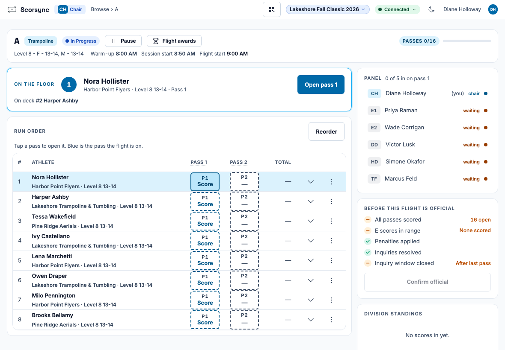
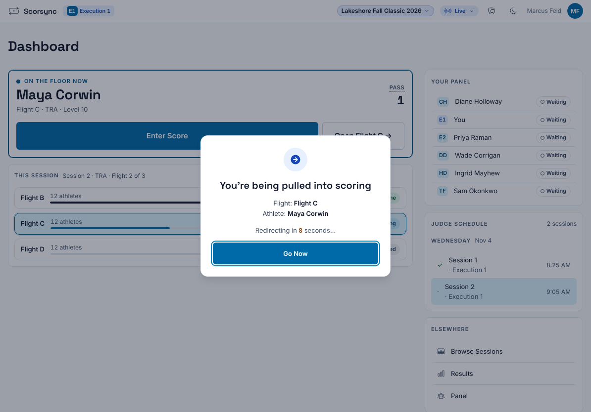
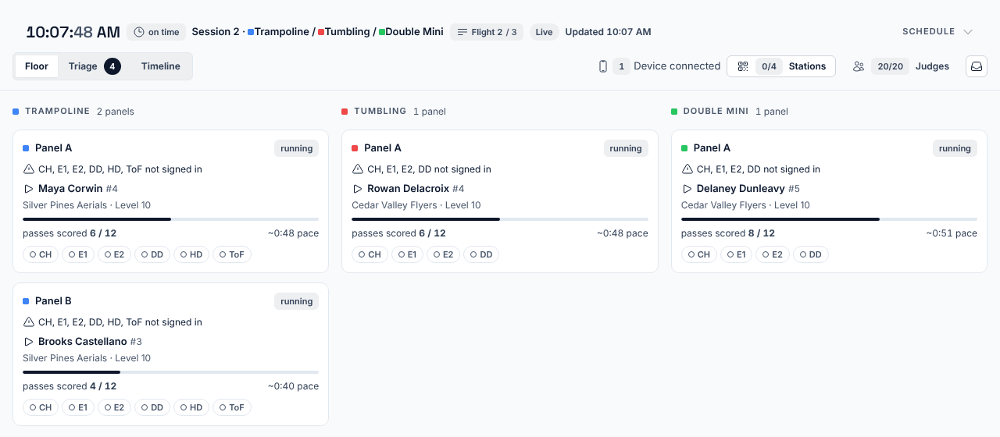

**Who it's for:** Scoring table operator and chair · Scorsync Cloud and Scorsync Desktop

There's no **Start session** button anywhere. A session starts when the chair opens the first athlete, and Run shows it once the first score is in.

## Before you start

- The meet is live. See [Go live](/host/before-meet-day/go-live/).
- The chair and the judges are signed in. See [Get judges signed in and scoring](/scoring-table/get-judges-signed-in/).

## Steps

<Steps>

1. In Run, check that the floor says "The floor is idle". That's normal before the first score.

   

2. Ask the chair to select **Open Flight** on their tablet, then **P1 Score** next to the first athlete.

   

3. Check that the judges' tablets move to the scoring screen. Each one shows "You're being pulled into scoring" and moves by itself. A judge can select **Go Now** to skip the wait.

   

4. Each judge enters their marks and selects **Submit Score**.

5. The chair selects **Confirm & next athlete**.

6. Check Run. Once the first score is in, the top bar shows the session and the flight, and the floor shows one card per panel.

   

</Steps>

Every later session starts the same way. Run moves to it once the session before it is finished and its first score is in.

## If something goes wrong

- **Run still says "The floor is idle" after the chair opened the athlete.** That's expected until the first athlete's score is in. Watch the chair's tablet instead.
- **A judge's tablet doesn't move to the scoring screen.** Ask the judge to select **Go Now**, or **Enter Score** on their dashboard. If their tablet says "Waiting for CJP", the chair hasn't opened an athlete on that panel yet.
- **The chair has no Open Flight button.** The chair isn't signed in, or isn't seated on this panel. Check their seat in Run → **Judge assignments**.

## Related

- [Pause and resume a flight](/scoring-table/pause-and-resume/)
- [Free a stuck panel or nudge a station](/scoring-table/free-a-stuck-panel/)
- [Getting started as the chair](/judges/chair/)
- [Get judges signed in and scoring](/scoring-table/get-judges-signed-in/)
