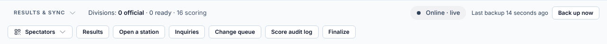
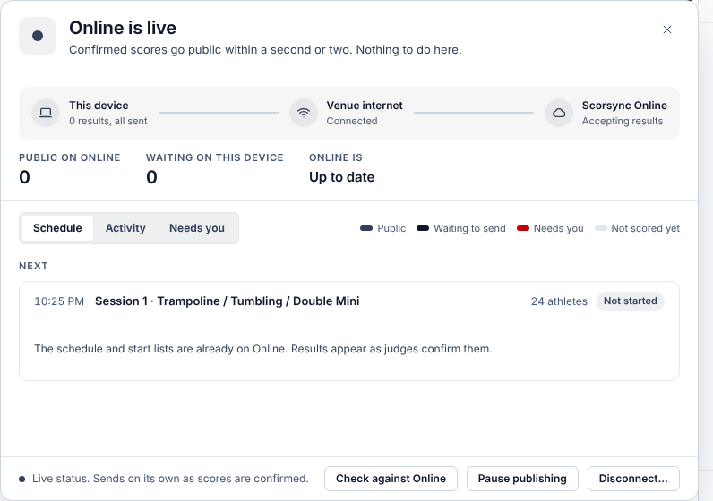
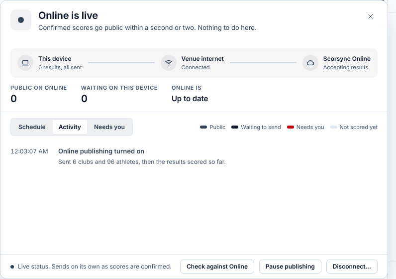

**Who it's for:** Host and scoring table operator · Scorsync Cloud and Scorsync Desktop

Use this page during the meet, or when families say scores aren't on scorsync.com.

## Before you start

- You're signed in to Meet Control as the host or another admin of your organization.
- The meet is connected to scorsync.com and publishing is on. See [Connect your meet to scorsync.com](/host/before-meet-day/connect-to-scorsync-com/).

## Check publishing

<Steps>

1. Open **Run**. Find the Sync Rail chip at the bottom right, in the **Results & Sync** strip.

   

2. If it says **Online · live**, there's nothing to do. Scores go to scorsync.com within a second or two of the chair moving on.

3. To see more, select the chip.

4. Check **Waiting on this device** (**Waiting to send** on Scorsync Cloud) and **Online is**. scorsync.com has everything when the waiting number is 0 and **Online is** says **Up to date**.

   

5. Select **Activity** to see what was sent recently, or **Needs you** for anything to sort out.

   

</Steps>

On Scorsync Cloud, the sheet has no **Venue internet** step.

## What the chip says

| Chip | What to do |
| -- | -- |
| **Online · live** | Nothing. |
| **Catching up**, then **All caught up** | Nothing. It clears by itself. |
| **Offline · holding** (Scorsync Desktop) | Keep scoring. Results go out by themselves when the internet is back. To try straight away, select the chip, then **Try now**. |
| **Online not answering** | Keep scoring. scorsync.com didn't answer, and Scorsync keeps trying. Select **Try now** if it lasts. |
| **Online publishing off** | Select the chip, then **Turn on Online publishing**. |
| **Not connected to Online** | The meet isn't connected yet. See [Connect your meet to scorsync.com](/host/before-meet-day/connect-to-scorsync-com/). |
| **Reconnect needed** | Select the chip, then **Reconnect**, and sign in to scorsync.com again. |
| **Sending stopped** | Scores are kept. On Scorsync Desktop, the sheet asks you to restart Scorsync: wait until between flights, because judges drop while it restarts. On Scorsync Cloud, contact Scorsync support (support@scorsync.com) if it lasts. |
| **Online refused results** | Contact Scorsync support (support@scorsync.com). |

Scorsync keeps every score either way: the chip is only about scorsync.com.

:::review[Needs Austin's review: Sending stopped]
The app's "Sending stopped" state and its advice to restart Scorsync are marked provisional in the code. What we tell a Desktop host to do mid-meet isn't decided.
:::

## The buttons at the bottom of the sheet

| Button | What it does |
| -- | -- |
| **Check against Online** | Compares scorsync.com with your meet and sends anything missing. |
| **Pause publishing** | Stops sending. Scores are kept, and **Turn on Online publishing** sends what was missed. |
| **Disconnect…** | Cuts the link to scorsync.com. You'd have to connect again to publish. Don't use it during the meet. |

## If something goes wrong

- **A score is on the floor, but not on scorsync.com.** A score goes out only once every judge has submitted, or the chair moves on. Check the chair isn't waiting for a judge. See [Move on when a judge hasn't submitted](/judges/chair/move-on-missing-judge/).
- **The chip says "Online · live", but you know the internet is down.** The chip only notices once a score is waiting. It changes after the next score.
- **"The venue internet is down", but the internet works.** scorsync.com may be the one not answering. Select **Try now**. If it lasts more than a few minutes, contact Scorsync support.
- **Families ask about their own account or subscription.** Send them to [help.scorsync.com](https://help.scorsync.com).

## Related

- [Mark divisions official](/scoring-table/mark-divisions-official/)
- [What families see on scorsync.com](/start-here/what-families-see/)
- [Score with no internet](/offline-host/score-without-internet/)
- [Connect your meet to scorsync.com](/host/before-meet-day/connect-to-scorsync-com/)
