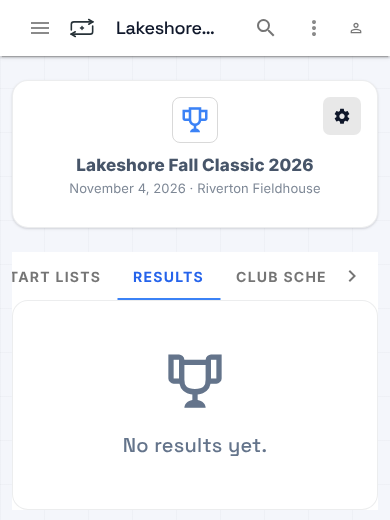
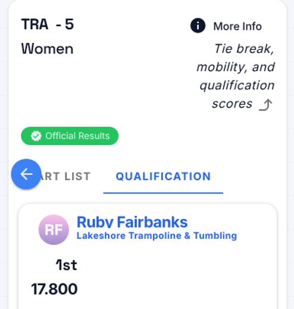
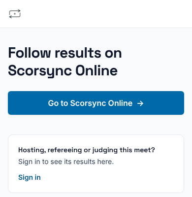

**Who it's for:** Host (meet director) and scoring table operator · Scorsync Cloud and Scorsync Desktop

Use this page to answer families who ask when something will show on scorsync.com.

## Before you start

- Your meet is connected to scorsync.com, and publishing is on. See [Connect your meet to scorsync.com](/host/before-meet-day/connect-to-scorsync-com/).

## What shows, and when

| When this happens | Families see on scorsync.com |
| -- | -- |
| You turn on publishing | Your meet, with "No results yet." |
| You [lock the schedule](/host/before-meet-day/lock-the-schedule/) or [go live](/host/before-meet-day/go-live/) | Sessions, flights and start lists |
| An athlete's score is in: every judge has submitted, or the chair [moved on without a judge](/judges/chair/move-on-missing-judge/) | The score and the places, marked **Unofficial Results** |
| The chair [confirms the flight official](/judges/chair/confirm-flight-official/), or you [mark the division official](/scoring-table/mark-divisions-official/) | **Official Results**, once every scored athlete in the division is official |
| The chair [reopens the flight](/judges/chair/reopen-official-flight/) | **Unofficial Results** again, with no note about the reopen. When it's confirmed official again, the corrected score and new places show. |
| You [rehearse](/host/before-meet-day/rehearse/) | Nothing. Rehearsal scores never appear. |

While you have internet, each score is sent as soon as it's in. Judge assignments and inquiries never go to scorsync.com.

:::review
What families can see without paying, and what we tell hosts about athletes' names and scores going public, aren't signed off.
:::

## If something goes wrong

- **Families can't find your meet on scorsync.com.** The meet isn't connected, or publishing is off. See [Connect your meet to scorsync.com](/host/before-meet-day/connect-to-scorsync-com/).
- **A score shows at the venue, but not on scorsync.com.** A score goes out only once every judge has submitted, or the chair moves on. See [Move on when a judge hasn't submitted](/judges/chair/move-on-missing-judge/).
- **scorsync.com stopped updating.** Check the Sync Rail chip at the bottom right of Run. On Scorsync Desktop with no internet, scores wait on the laptop and go out by themselves when the internet is back. See [Watch publishing on the Sync Rail](/scoring-table/watch-publishing/).
- **A late entry or schedule change isn't on scorsync.com.** You made it while the schedule was unlocked. [Lock the schedule](/host/before-meet-day/lock-the-schedule/) again.
- **On Scorsync Cloud, families open your results link and see "Follow results on Scorsync Online".** That's expected: on Scorsync Cloud, only the meet's hosts, referees and judges see results there. Families select **Go to Scorsync Online** and find your meet.

  

- **Families see "Sign in to view full results", or ask about their account or a subscription.** That's scorsync.com's own sign-in. Send them to [help.scorsync.com](https://help.scorsync.com).

## Related

- [Connect your meet to scorsync.com](/host/before-meet-day/connect-to-scorsync-com/)
- [Watch publishing on the Sync Rail](/scoring-table/watch-publishing/)
- [Reopen an official flight to fix a score](/judges/chair/reopen-official-flight/)
- [Lock the schedule](/host/before-meet-day/lock-the-schedule/)
