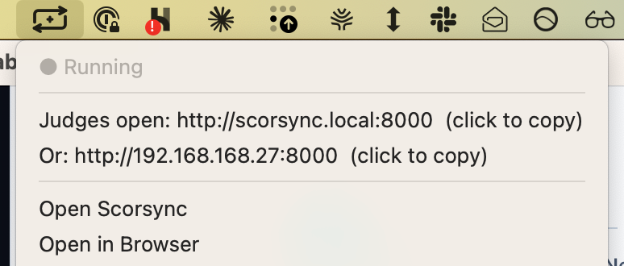

**Who it's for:** Everyone

Use this page when you're not sure which help applies to your meet.

## Find your setup

| Setup | How to tell | Where to go |
| -- | -- | -- |
| **Scorsync Cloud** | You sign in at app.scorsync.com in a web browser. Nothing is installed. | [Meet-day runbook: Scorsync Cloud](/runbook/scorsync-cloud/) |
| **Scorsync Desktop** | Scorsync is installed on the host's Mac or Windows laptop, and judges type an address such as `scorsync.local:8000`. Or you're in the December pilot, or Scorsync asked you to install an app on your laptop. | First time? Start at [Getting started with Scorsync Desktop](/offline-host/). On meet day: [Meet-day runbook: Scorsync Desktop](/runbook/scorsync-desktop/). |
| **Scorsync Live** | You score in ProScore or TScore, and the Scorsync Live app sends the scores to scorsync.com. | [help.scorsync.com](https://help.scorsync.com) |

On Scorsync Desktop, the Scorsync icon sits in the menu bar on a Mac, or in the notification area on Windows (it may be hidden under the **^** arrow). Click it on a Mac, or right-click it on Windows, to see **● Running** and the judges' address.

Meet Builder, Meet Control and the Judge panel look the same on Scorsync Cloud and Scorsync Desktop. The **Who it's for** line at the top of each page says which setup it covers.

## Not the host?

- **You follow a meet as a parent, athlete or fan,** on scorsync.com or Scorsync for iPhone: go to [help.scorsync.com](https://help.scorsync.com).
- **You're a judge:** your setup doesn't change what you do. Start at [Judges](/judges/).

## If something goes wrong

- **There's no Scorsync icon on the laptop.** Scorsync Desktop isn't open. Open Scorsync like any other app, wait for **● Running**, then look again. See [Use the Scorsync tray menu](/offline-host/tray-menu/).
- **You still can't tell.** Ask the person who set up the meet, or contact Scorsync support (support@scorsync.com).

## Related

- [Meet-day runbook: Scorsync Cloud](/runbook/scorsync-cloud/)
- [Meet-day runbook: Scorsync Desktop](/runbook/scorsync-desktop/)
- [What families see on scorsync.com](/start-here/what-families-see/)
