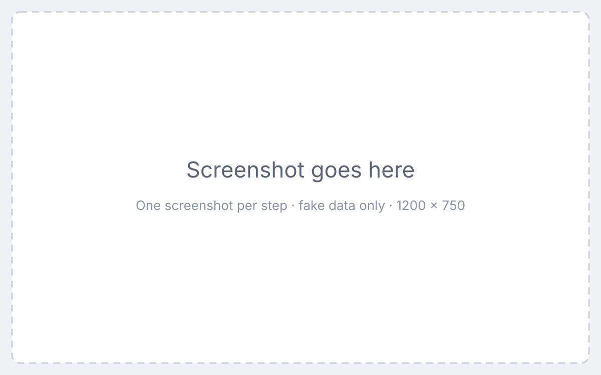

Every how-to page has the same five parts, in this order. Copy [`templates/article.mdx`](#the-source) to start a new page.

1. **Who it's for**: the audience, and which setup (Scorsync Cloud, Scorsync Desktop or both).
2. **Before you start**: what must already be true. Two or three bullets.
3. **Steps**: numbered, one action each, a screenshot under every step.
4. **If something goes wrong**: the likely symptoms, each with a fix or a link to Troubleshooting.
5. **Related**: two to four links to what the reader needs next.

## Example

Below is how the template renders. The content is a made-up example, not checked against the app.

---

**Who it's for:** Scoring table operator · Scorsync Cloud and Scorsync Desktop

### Before you start

- You're signed in to Meet Control as the host or a scoring table operator.
- The meet is live, and the flight you want to pause has started.

### Steps

<Steps>

1. Open **Run**.

   

2. Select the station card for the flight you want to pause.

   

3. Select **Pause**.

   

</Steps>

### If something goes wrong

- **There's no Pause button.** The flight hasn't started yet. See [Start a session](/scoring-table/start-a-session/).
- **Judges still see the scoring screen.** Ask them to wait a few seconds. If it doesn't change, see [Troubleshooting](/help/troubleshooting/).

### Related

- [Free a stuck panel or nudge a station](/scoring-table/free-a-stuck-panel/)
- [Meet-day runbook: Scorsync Cloud](/runbook/scorsync-cloud/)

---

## Writing each part

**Title.** Starts with a verb, in sentence case: "Pause and resume a flight", not "Flight pausing".

**Steps.** One action per step. Bold the button name exactly as it reads on screen. The last step says how the reader knows it worked.

**Screenshots.** One per step, 1200 × 750 or larger, taken with the seeded fake meet. The alt text says what the reader should see, not "screenshot". Put the image in an `images/` folder next to the page and use a relative path.

**Rules.** If a step depends on a T&T rule, add a [rulebook citation](/style-guide/rulebook-citations/) and a [Needs Austin's review](/style-guide/callouts/#needs-austins-review) callout.

## The source

````mdx title="templates/article.mdx"
**Who it's for:** Scoring table operator · Scorsync Cloud and Scorsync Desktop

## Before you start

- You're signed in to Meet Control as the host or a scoring table operator.
- The meet is live.

## Steps

<Steps>

1. Do exactly one thing, and name the button in **bold**.

   

2. Do the next one thing.

   

</Steps>

## If something goes wrong

- **What the reader sees.** What to do about it.

## Related

- [A page the reader needs next](/runbook/scorsync-cloud/)
````
